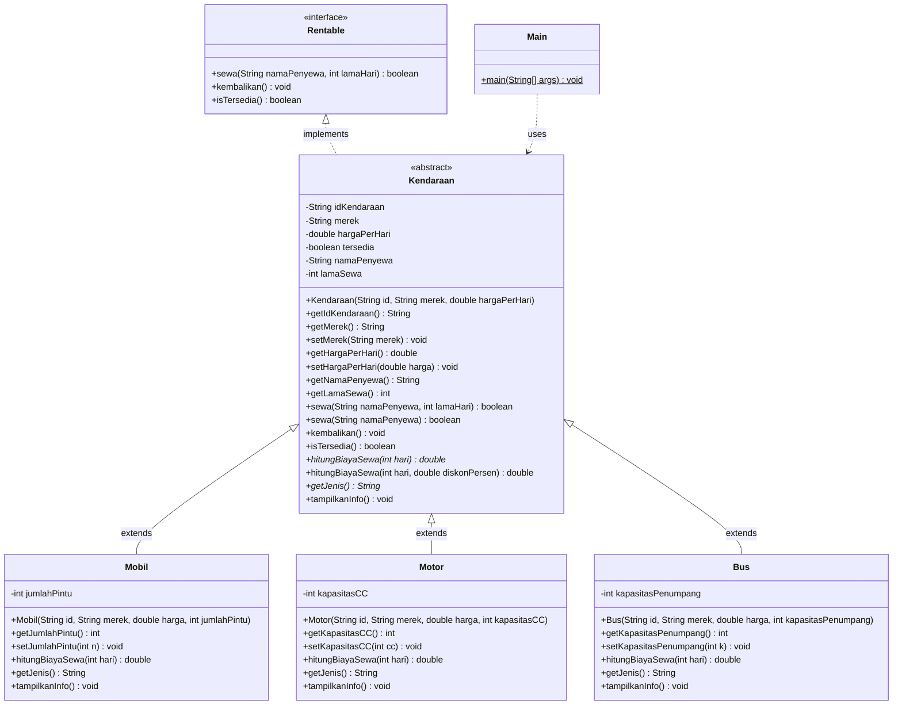

# PRD — RentaGo: Sistem Rental Kendaraan Berbasis OOP (Java)

> **Product Requirements Document**
> Tugas: **Praktik Lab Session 3B — Pengembangan Program Berbasis Object-Oriented Programming (OOP)**

---

## 1. Informasi Dokumen

| Item | Keterangan |
|---|---|
| Nama Proyek | RentaGo — Sistem Rental Kendaraan |
| Jenis Proyek | Program Java berbasis console (CLI) |
| Bahasa | Java (JDK 17 atau lebih baru; minimal JDK 11) |
| Tema | Rental kendaraan (Mobil, Motor, Bus) |
| Mata Kuliah / Tugas | Praktik Lab Session 3B — OOP |
| Status | Draft siap implementasi |
| Versi | 1.0 |

---

## 2. Ringkasan Eksekutif

RentaGo adalah program console sederhana yang mensimulasikan **layanan rental kendaraan**. Program mengelola beberapa jenis kendaraan (mobil, motor, bus) yang masing-masing punya aturan perhitungan biaya sewa berbeda. Pengguna (dalam hal ini `Main`) dapat menampilkan data kendaraan, menghitung biaya sewa, menyewa, dan mengembalikan kendaraan.

Tema ini dipilih karena **hubungan logis antar komponennya sangat natural**:

- Semua kendaraan **adalah** `Kendaraan` (is-a) → cocok untuk *inheritance* dan *abstract class*.
- Setiap jenis kendaraan **menghitung biaya sewa dengan cara berbeda** → cocok untuk *abstract method*, *overriding*, dan *runtime polymorphism*.
- Setiap kendaraan **dapat disewa** (kemampuan/kontrak perilaku) → cocok untuk *interface* `Rentable`.
- Data kendaraan (harga, status ketersediaan) harus dijaga agar tidak diubah sembarangan → cocok untuk *encapsulation*.

---

## 3. Latar Belakang dan Tujuan

### 3.1 Latar Belakang
Tugas praktik meminta mahasiswa membuat program Java yang menyelesaikan permasalahan sederhana sekaligus **mengintegrasikan lima konsep OOP**: Encapsulation, Inheritance, Polymorphism, Abstract Class, dan Interface. Tema dibebaskan.

### 3.2 Tujuan Produk
1. Menghasilkan program Java yang **dapat dikompilasi dan dijalankan** tanpa error.
2. **Memenuhi seluruh ketentuan wajib dan tambahan** pada soal (lihat Bagian 5).
3. Struktur kode **rapi, mudah dibaca, dan mudah dijelaskan** saat demo/asistensi.
4. Output program **jelas dan menunjukkan** setiap konsep OOP yang diterapkan.

### 3.3 Metrik Keberhasilan

| Metrik | Target |
|---|---|
| Ketentuan wajib terpenuhi | 5 dari 5 konsep |
| Ketentuan tambahan terpenuhi | 4 dari 4 poin |
| Program berjalan tanpa error kompilasi/runtime | Ya |
| Jumlah class (termasuk Main) | ≥ 4 (rencana: 5 class + 1 interface) |
| Jumlah objek | ≥ 4 (rencana: 4 objek utama) |

---

## 4. Ruang Lingkup

### 4.1 In Scope
- Program console tanpa GUI dan tanpa database.
- Data kendaraan dibuat langsung (hardcoded) di `Main`.
- Perhitungan biaya sewa, proses sewa, dan proses pengembalian.
- Validasi sederhana (harga tidak boleh ≤ 0, kendaraan yang sedang disewa tidak bisa disewa lagi).
- Demonstrasi lima konsep OOP lewat output di console.

### 4.2 Out of Scope
- Input interaktif dari keyboard (menu `Scanner`) — opsional, lihat Bagian 17.
- Penyimpanan permanen (file/database).
- Antarmuka grafis dan jaringan.
- Sistem pembayaran nyata, login, dan manajemen pengguna.

---

## 5. Analisis Ketentuan Tugas dan Pemetaan Implementasi

Tabel ini menjadi **acuan utama (traceability)** agar tidak ada ketentuan yang terlewat.

### 5.1 Ketentuan Wajib

| No | Ketentuan Soal | Detail yang Diminta | Rencana Implementasi di RentaGo |
|---|---|---|---|
| 1 | **Encapsulation** | Atribut `private`, ada getter & setter, perubahan data lewat method yang sesuai | Semua atribut `Kendaraan` dan subclass bersifat `private`. Ada getter untuk semua atribut dan setter (dengan validasi) untuk `merek` dan `hargaPerHari`. Status `tersedia` hanya berubah lewat `sewa()` dan `kembalikan()` (tanpa setter publik). |
| 2 | **Inheritance** | Min. 1 superclass + 2 subclass, `extends`, constructor + `super()` | Superclass `Kendaraan`; subclass `Mobil`, `Motor`, `Bus` (3 subclass). Semua memakai `extends Kendaraan` dan memanggil `super(...)` di constructor. |
| 3a | **Overriding** | `@Override` | `hitungBiayaSewa(int)` (dari abstract method), `tampilkanInfo()`, serta method interface `sewa()`/`kembalikan()`/`isTersedia()` diberi `@Override`. |
| 3b | **Overloading** | Nama method sama, parameter berbeda | `hitungBiayaSewa(int hari)` vs `hitungBiayaSewa(int hari, double diskonPersen)` dan `sewa(String, int)` vs `sewa(String)`. |
| 3c | **Runtime polymorphism** | Objek subclass disimpan di referensi superclass | `ArrayList<Kendaraan> daftar` berisi `Mobil`, `Motor`, `Bus`; dipanggil dengan loop sehingga method subclass yang dieksekusi saat runtime. |
| 4 | **Abstract Class** | Min. 1 abstract class, 1 abstract method, subclass mengimplementasikan | `abstract class Kendaraan` dengan `abstract double hitungBiayaSewa(int hari)` dan `abstract String getJenis()`. Diimplementasikan oleh `Mobil`, `Motor`, `Bus`. |
| 5 | **Interface** | Min. 1 interface, `implements`, kontrak terpenuhi | `interface Rentable` berisi `sewa`, `kembalikan`, `isTersedia`. Diimplementasikan oleh `Kendaraan` (`implements Rentable`) sehingga seluruh subclass otomatis memenuhi kontrak. |

### 5.2 Ketentuan Tambahan

| No | Ketentuan | Rencana Pemenuhan |
|---|---|---|
| 1 | Min. 4 class termasuk `Main` | `Main`, `Kendaraan`, `Mobil`, `Motor`, `Bus` = **5 class** (+ 1 interface `Rentable`) |
| 2 | Min. 4 objek | `Mobil` ×2, `Motor` ×1, `Bus` ×1 = **4 objek** |
| 3 | Dapat dijalankan dan menghasilkan output sesuai studi kasus | `Main.main()` menjalankan skenario demo lengkap (Bagian 11) |
| 4 | Hubungan logis superclass, subclass, interface | `Kendaraan` (is-a) → `Mobil/Motor/Bus`; interface `Rentable` = kemampuan "dapat disewa" |

---

## 6. Studi Kasus

**RentaGo** adalah usaha rental kendaraan kecil dengan tiga jenis armada:

| Jenis | Karakteristik | Aturan Biaya Sewa |
|---|---|---|
| **Mobil** | Memiliki jumlah pintu | `harga × hari` + **asuransi tetap Rp50.000** |
| **Motor** | Memiliki kapasitas mesin (cc) | `harga × hari` + **sewa helm Rp10.000 per hari** |
| **Bus** | Memiliki kapasitas penumpang | `harga × hari` + **biaya sopir Rp300.000 per hari** |

Semua kendaraan memiliki: ID, merek, harga sewa per hari, dan status ketersediaan. Kendaraan hanya bisa disewa bila tersedia.

---

## 7. Aktor dan User Story

| Aktor | Keterangan |
|---|---|
| Petugas Rental (diwakili `Main`) | Mengelola armada, menghitung biaya, memproses sewa dan pengembalian |

| ID | User Story |
|---|---|
| US-01 | Sebagai petugas, saya ingin **melihat daftar semua kendaraan** beserta detail spesifiknya. |
| US-02 | Sebagai petugas, saya ingin **menghitung biaya sewa** sesuai jenis kendaraan dan lama sewa. |
| US-03 | Sebagai petugas, saya ingin **memberi diskon** pada perhitungan biaya sewa. |
| US-04 | Sebagai petugas, saya ingin **memproses penyewaan** dan sistem menolak bila kendaraan sudah disewa. |
| US-05 | Sebagai petugas, saya ingin **memproses pengembalian** sehingga kendaraan tersedia lagi. |
| US-06 | Sebagai petugas, saya ingin data harga **tidak bisa diubah ke nilai tidak valid**. |

---

## 8. Functional Requirements

| ID | Requirement | Prioritas | Konsep OOP |
|---|---|---|---|
| FR-01 | Sistem menyediakan abstract class `Kendaraan` dengan atribut private: `idKendaraan`, `merek`, `hargaPerHari`, `tersedia`, `namaPenyewa`, `lamaSewa`. | Wajib | Encapsulation, Abstract |
| FR-02 | Sistem menyediakan getter untuk semua atribut dan setter dengan validasi untuk `merek` dan `hargaPerHari`. | Wajib | Encapsulation |
| FR-03 | Sistem menyediakan subclass `Mobil`, `Motor`, `Bus` dengan atribut spesifik masing-masing (private + getter/setter). | Wajib | Inheritance |
| FR-04 | Constructor setiap subclass memanggil `super(...)` untuk menginisialisasi atribut superclass. | Wajib | Inheritance |
| FR-05 | `Kendaraan` mendeklarasikan `abstract double hitungBiayaSewa(int hari)`; setiap subclass mengimplementasikannya dengan aturan berbeda dan anotasi `@Override`. | Wajib | Abstract, Overriding |
| FR-06 | `Kendaraan` mendeklarasikan `abstract String getJenis()`; setiap subclass mengembalikan jenisnya. | Wajib | Abstract |
| FR-07 | Tersedia method overload `hitungBiayaSewa(int hari, double diskonPersen)` yang menghitung biaya dasar lalu mengurangi diskon. | Wajib | Overloading |
| FR-08 | Tersedia overload `sewa(String namaPenyewa)` (default 1 hari) selain `sewa(String namaPenyewa, int lamaHari)`. | Wajib | Overloading |
| FR-09 | Interface `Rentable` mendeklarasikan `sewa(String, int)`, `kembalikan()`, `isTersedia()`; `Kendaraan` mengimplementasikannya dengan `implements` dan `@Override`. | Wajib | Interface |
| FR-10 | `tampilkanInfo()` di `Kendaraan` dioverride oleh tiap subclass untuk menambahkan detail spesifik. | Wajib | Overriding |
| FR-11 | `Main` menyimpan objek `Mobil`, `Motor`, `Bus` dalam `ArrayList<Kendaraan>` dan memprosesnya dalam loop. | Wajib | Runtime polymorphism |
| FR-12 | Proses `sewa()` gagal (return `false`) bila kendaraan tidak tersedia atau input tidak valid. | Wajib | Encapsulation |
| FR-13 | Proses `kembalikan()` mengembalikan status tersedia dan mengosongkan data penyewa. | Wajib | Encapsulation |
| FR-14 | `Main` menampilkan output terstruktur untuk setiap tahap demo. | Wajib | — |
| FR-15 | `Main` mendemonstrasikan pemanfaatan referensi interface (`Rentable r = kendaraan;`). | Opsional | Interface |

---

## 9. Business Rules

| ID | Aturan |
|---|---|
| BR-01 | `hargaPerHari` harus **> 0**. Bila tidak, setter menolak perubahan dan menampilkan pesan. |
| BR-02 | `merek` tidak boleh `null` atau kosong. |
| BR-03 | `lamaHari` pada penyewaan harus **≥ 1**. |
| BR-04 | Kendaraan yang berstatus **tidak tersedia** tidak boleh disewa lagi. |
| BR-05 | `diskonPersen` harus di antara **0 dan 100**; di luar itu dianggap 0 (tanpa diskon). |
| BR-06 | Biaya Mobil = `hargaPerHari × hari + 50.000`. |
| BR-07 | Biaya Motor = `hargaPerHari × hari + (10.000 × hari)`. |
| BR-08 | Biaya Bus = `hargaPerHari × hari + (300.000 × hari)`. |
| BR-09 | Status `tersedia` **tidak memiliki setter publik**; hanya berubah lewat `sewa()` dan `kembalikan()`. |

---

## 10. Desain Sistem

### 10.1 Struktur File

```
RentaGo/
├── PRD.md
└── src/
    ├── Rentable.java      (interface)
    ├── Kendaraan.java     (abstract class, implements Rentable)
    ├── Mobil.java         (extends Kendaraan)
    ├── Motor.java         (extends Kendaraan)
    ├── Bus.java           (extends Kendaraan)
    └── Main.java          (entry point)
```

> Catatan: Semua file memakai default package agar mudah dikompilasi. Boleh ditambah `package rentago;` bila dosen mensyaratkan.

### 10.2 Class Diagram



### 10.3 Spesifikasi Detail Class

#### a) `interface Rentable`

| Method | Return | Deskripsi |
|---|---|---|
| `sewa(String namaPenyewa, int lamaHari)` | `boolean` | Memproses penyewaan; `true` bila berhasil. |
| `kembalikan()` | `void` | Memproses pengembalian kendaraan. |
| `isTersedia()` | `boolean` | Mengembalikan status ketersediaan. |

#### b) `abstract class Kendaraan implements Rentable`

**Atribut (semua `private`):**

| Atribut | Tipe | Keterangan |
|---|---|---|
| `idKendaraan` | `String` | Kode unik, contoh `MBL-001` (hanya getter, tidak bisa diubah). |
| `merek` | `String` | Nama/merek kendaraan. |
| `hargaPerHari` | `double` | Harga dasar sewa per hari. |
| `tersedia` | `boolean` | Default `true`. |
| `namaPenyewa` | `String` | `"-"` bila tidak disewa. |
| `lamaSewa` | `int` | `0` bila tidak disewa. |

**Constructor:** `Kendaraan(String idKendaraan, String merek, double hargaPerHari)` — menginisialisasi atribut dan memvalidasi harga lewat setter.

**Method:**

| Method | Jenis | Keterangan |
|---|---|---|
| getter semua atribut | concrete | Akses baca. |
| `setMerek(String)` | concrete | Validasi tidak kosong. |
| `setHargaPerHari(double)` | concrete | Validasi `> 0`. |
| `abstract double hitungBiayaSewa(int hari)` | **abstract** | Dihitung berbeda tiap subclass. |
| `abstract String getJenis()` | **abstract** | Nama jenis kendaraan. |
| `double hitungBiayaSewa(int hari, double diskonPersen)` | concrete (**overload**) | `biaya = hitungBiayaSewa(hari)`; hasil `biaya × (1 − diskon/100)`. |
| `boolean sewa(String nama, int lamaHari)` | concrete (`@Override`) | Validasi BR-03 dan BR-04; set status tidak tersedia; simpan data penyewa. |
| `boolean sewa(String nama)` | concrete (**overload**) | Memanggil `sewa(nama, 1)`. |
| `void kembalikan()` | concrete (`@Override`) | Reset `tersedia=true`, `namaPenyewa="-"`, `lamaSewa=0`. |
| `boolean isTersedia()` | concrete (`@Override`) | Return `tersedia`. |
| `void tampilkanInfo()` | concrete | Menampilkan ID, jenis, merek, harga, status. Dioverride subclass. |

#### c) `class Mobil extends Kendaraan`

| Elemen | Detail |
|---|---|
| Atribut | `private int jumlahPintu` |
| Constructor | `Mobil(String id, String merek, double harga, int jumlahPintu)` → `super(id, merek, harga)` |
| `getJenis()` | `"Mobil"` (`@Override`) |
| `hitungBiayaSewa(int hari)` | `getHargaPerHari() * hari + 50000` (`@Override`) |
| `tampilkanInfo()` | `super.tampilkanInfo()` + baris jumlah pintu (`@Override`) |
| Getter/Setter | `getJumlahPintu()`, `setJumlahPintu(int)` (validasi > 0) |

#### d) `class Motor extends Kendaraan`

| Elemen | Detail |
|---|---|
| Atribut | `private int kapasitasCC` |
| Constructor | `Motor(String id, String merek, double harga, int kapasitasCC)` → `super(...)` |
| `getJenis()` | `"Motor"` |
| `hitungBiayaSewa(int hari)` | `getHargaPerHari() * hari + (10000 * hari)` |
| `tampilkanInfo()` | `super.tampilkanInfo()` + kapasitas CC |
| Getter/Setter | `getKapasitasCC()`, `setKapasitasCC(int)` (validasi > 0) |

#### e) `class Bus extends Kendaraan`

| Elemen | Detail |
|---|---|
| Atribut | `private int kapasitasPenumpang` |
| Constructor | `Bus(String id, String merek, double harga, int kapasitasPenumpang)` → `super(...)` |
| `getJenis()` | `"Bus"` |
| `hitungBiayaSewa(int hari)` | `getHargaPerHari() * hari + (300000 * hari)` |
| `tampilkanInfo()` | `super.tampilkanInfo()` + kapasitas penumpang |
| Getter/Setter | `getKapasitasPenumpang()`, `setKapasitasPenumpang(int)` (validasi > 0) |

#### f) `class Main`

Berisi `public static void main(String[] args)` yang menjalankan skenario pada Bagian 11.

### 10.4 Data Objek yang Dibuat

| No | Variabel | Class | ID | Merek | Harga/Hari | Atribut Khusus |
|---|---|---|---|---|---|---|
| 1 | `mobil1` | `Mobil` | MBL-001 | Toyota Avanza | Rp350.000 | 5 pintu |
| 2 | `mobil2` | `Mobil` | MBL-002 | Honda Brio | Rp300.000 | 5 pintu |
| 3 | `motor1` | `Motor` | MTR-001 | Yamaha NMAX | Rp120.000 | 155 cc |
| 4 | `bus1` | `Bus` | BUS-001 | Hino Medium Bus | Rp1.500.000 | 30 penumpang |

---

## 11. Alur Program (Skenario Demo di `Main`)

| Tahap | Aktivitas | Konsep yang Ditunjukkan |
|---|---|---|
| 1 | Membuat 4 objek (`Mobil`×2, `Motor`, `Bus`) dan memasukkannya ke `ArrayList<Kendaraan>`. | Inheritance, Runtime polymorphism |
| 2 | Loop `for-each` memanggil `tampilkanInfo()` untuk setiap kendaraan. | Overriding, Runtime polymorphism |
| 3 | Loop menghitung biaya sewa **3 hari** via `hitungBiayaSewa(3)`. | Abstract method, Polymorphism |
| 4 | Menghitung biaya `mobil1` 3 hari dengan **diskon 10%**. | Overloading |
| 5 | `mobil1.sewa("Fakhri", 3)` → berhasil. | Interface, Encapsulation |
| 6 | `mobil1.sewa("Budi")` → **gagal** karena sedang disewa. | Business rule, Encapsulation |
| 7 | `motor1.sewa("Sari")` (overload, default 1 hari) → berhasil. | Overloading |
| 8 | Mencoba `mobil2.setHargaPerHari(-5000)` → **ditolak**. | Encapsulation (validasi setter) |
| 9 | `mobil1.kembalikan()` lalu cek `isTersedia()`. | Interface, Encapsulation |
| 10 | `Rentable r = bus1;` lalu panggil `r.isTersedia()`. | Polymorphism via interface |
| 11 | Menampilkan ringkasan akhir status semua kendaraan. | — |

---

## 12. Contoh Output yang Diharapkan

> Format boleh disesuaikan, namun isi dan angka perhitungan harus konsisten dengan aturan bisnis.

```
==============================================
        RENTAGO - SISTEM RENTAL KENDARAAN
==============================================

[1] DAFTAR KENDARAAN
----------------------------------------------
ID        : MBL-001
Jenis     : Mobil
Merek     : Toyota Avanza
Harga/Hari: Rp350.000
Status    : Tersedia
Jml Pintu : 5
----------------------------------------------
ID        : MBL-002
Jenis     : Mobil
Merek     : Honda Brio
Harga/Hari: Rp300.000
Status    : Tersedia
Jml Pintu : 5
----------------------------------------------
ID        : MTR-001
Jenis     : Motor
Merek     : Yamaha NMAX
Harga/Hari: Rp120.000
Status    : Tersedia
Kapasitas : 155 cc
----------------------------------------------
ID        : BUS-001
Jenis     : Bus
Merek     : Hino Medium Bus
Harga/Hari: Rp1.500.000
Status    : Tersedia
Kapasitas : 30 penumpang
----------------------------------------------

[2] BIAYA SEWA 3 HARI (Runtime Polymorphism)
Mobil - Toyota Avanza     : Rp1.100.000
Mobil - Honda Brio        : Rp950.000
Motor - Yamaha NMAX       : Rp390.000
Bus   - Hino Medium Bus   : Rp5.400.000

[3] BIAYA DENGAN DISKON (Overloading)
Toyota Avanza 3 hari, diskon 10% : Rp990.000

[4] PROSES PENYEWAAN
Berhasil: Toyota Avanza disewa oleh Fakhri selama 3 hari.
Gagal   : Toyota Avanza sedang disewa, tidak dapat disewa lagi.
Berhasil: Yamaha NMAX disewa oleh Sari selama 1 hari.

[5] VALIDASI ENCAPSULATION
Gagal   : Harga harus lebih dari 0. Perubahan ditolak.

[6] PENGEMBALIAN
Toyota Avanza telah dikembalikan.
Status Toyota Avanza tersedia? true

[7] AKSES VIA INTERFACE
Rentable r = bus1 -> tersedia? true

[8] RINGKASAN STATUS AKHIR
MBL-001 | Toyota Avanza   | Tersedia
MBL-002 | Honda Brio      | Tersedia
MTR-001 | Yamaha NMAX     | Disewa oleh Sari (1 hari)
BUS-001 | Hino Medium Bus | Tersedia
==============================================
```

**Verifikasi perhitungan (untuk 3 hari):**

| Kendaraan | Rumus | Hasil |
|---|---|---|
| Toyota Avanza | 350.000 × 3 + 50.000 | 1.100.000 |
| Honda Brio | 300.000 × 3 + 50.000 | 950.000 |
| Yamaha NMAX | 120.000 × 3 + (10.000 × 3) | 390.000 |
| Hino Medium Bus | 1.500.000 × 3 + (300.000 × 3) | 5.400.000 |
| Avanza diskon 10% | 1.100.000 × 0,9 | 990.000 |

---

## 13. Non-Functional Requirements

| ID | Kategori | Requirement |
|---|---|---|
| NFR-01 | Kebenaran | Program kompilasi tanpa error dan warning kritis. |
| NFR-02 | Keterbacaan | Nama class **PascalCase**, method/variabel **camelCase**, konstanta **UPPER_SNAKE_CASE**. |
| NFR-03 | Dokumentasi | Setiap class dan method penting diberi komentar singkat (Javadoc atau komentar biasa). |
| NFR-04 | Modularitas | Satu class publik per file, nama file = nama class. |
| NFR-05 | Maintainability | Angka biaya tambahan (asuransi, helm, sopir) disimpan sebagai konstanta `private static final` di masing-masing subclass. |
| NFR-06 | Kompatibilitas | Berjalan di JDK 11 ke atas tanpa library eksternal. |
| NFR-07 | Output | Output rapi, berlabel per tahap, dan mudah dicocokkan dengan konsep OOP. |
| NFR-08 | Format Rupiah | Nominal ditampilkan dengan pemisah ribuan (contoh: `Rp1.100.000`) lewat helper method atau `String.format`/`NumberFormat`. |

---

## 14. Acceptance Criteria dan Test Case

| ID | Skenario | Input | Hasil yang Diharapkan |
|---|---|---|---|
| TC-01 | Biaya Mobil | `mobil1.hitungBiayaSewa(3)` | 1.100.000 |
| TC-02 | Biaya Motor | `motor1.hitungBiayaSewa(3)` | 390.000 |
| TC-03 | Biaya Bus | `bus1.hitungBiayaSewa(3)` | 5.400.000 |
| TC-04 | Overload diskon | `mobil1.hitungBiayaSewa(3, 10)` | 990.000 |
| TC-05 | Diskon tidak valid | `mobil1.hitungBiayaSewa(3, 150)` | 1.100.000 (diskon dianggap 0) |
| TC-06 | Sewa berhasil | `mobil1.sewa("Fakhri", 3)` | `true`, `isTersedia()` = `false` |
| TC-07 | Sewa saat tidak tersedia | `mobil1.sewa("Budi")` setelah TC-06 | `false`, data penyewa tidak berubah |
| TC-08 | Lama hari tidak valid | `mobil2.sewa("Andi", 0)` | `false` |
| TC-09 | Pengembalian | `mobil1.kembalikan()` | `isTersedia()` = `true`, penyewa `"-"` |
| TC-10 | Setter harga tidak valid | `mobil2.setHargaPerHari(-5000)` | Ditolak; harga tetap 300.000 |
| TC-11 | Runtime polymorphism | Loop `ArrayList<Kendaraan>` memanggil `hitungBiayaSewa(3)` | Hasil berbeda per jenis sesuai subclass |
| TC-12 | Referensi interface | `Rentable r = bus1; r.isTersedia();` | `true` |
| TC-13 | Constructor chaining | `new Mobil(...)` | Atribut superclass terisi lewat `super()` |

**Definition of Done:** seluruh test case di atas lulus saat program dijalankan, dan seluruh checklist Bagian 15 terpenuhi.

---

## 15. Checklist Kepatuhan terhadap Soal

### Encapsulation
- [ ] Atribut `Kendaraan`, `Mobil`, `Motor`, `Bus` bersifat `private`
- [ ] Getter tersedia untuk semua atribut
- [ ] Setter tersedia (dengan validasi) untuk atribut yang boleh diubah
- [ ] Status `tersedia` hanya berubah lewat `sewa()` dan `kembalikan()`

### Inheritance
- [ ] 1 superclass (`Kendaraan`) dan 3 subclass (`Mobil`, `Motor`, `Bus`)
- [ ] Semua subclass memakai `extends`
- [ ] Constructor subclass memanggil `super(...)`

### Polymorphism
- [ ] Overriding dengan `@Override` (`hitungBiayaSewa`, `getJenis`, `tampilkanInfo`, method interface)
- [ ] Overloading (`hitungBiayaSewa` dan `sewa`)
- [ ] Runtime polymorphism (`ArrayList<Kendaraan>` berisi objek subclass)

### Abstract Class
- [ ] `Kendaraan` bertipe `abstract`
- [ ] Ada abstract method (`hitungBiayaSewa(int)`, `getJenis()`)
- [ ] Semua subclass mengimplementasikan abstract method

### Interface
- [ ] `Rentable` dibuat
- [ ] `Kendaraan implements Rentable`
- [ ] Semua method kontrak diimplementasikan dengan `@Override`

### Ketentuan Tambahan
- [ ] Minimal 4 class termasuk `Main` (rencana: 5)
- [ ] Minimal 4 objek (rencana: 4)
- [ ] Program berjalan dan menghasilkan output sesuai studi kasus
- [ ] Hubungan logis superclass–subclass–interface jelas

---

## 16. Panduan Build dan Run

```bash
# 1. Masuk ke folder proyek
cd RentaGo

# 2. Kompilasi semua file Java
javac -d out src/*.java

# 3. Jalankan program
java -cp out Main
```

Jika memakai IDE (IntelliJ IDEA / NetBeans / Eclipse / VS Code): buat project Java baru, salin keenam file ke folder `src`, lalu jalankan `Main`.

---

## 17. Rencana Pengerjaan

| Tahap | Pekerjaan | Estimasi |
|---|---|---|
| 1 | Setup project dan struktur file | 10 menit |
| 2 | Membuat `interface Rentable` | 10 menit |
| 3 | Membuat `abstract class Kendaraan` (atribut, getter/setter, sewa/kembalikan, overload, abstract method) | 30 menit |
| 4 | Membuat `Mobil`, `Motor`, `Bus` | 30 menit |
| 5 | Membuat `Main` (skenario demo + format output) | 30 menit |
| 6 | Pengujian sesuai test case dan perbaikan bug | 20 menit |
| 7 | Pengecekan checklist dan merapikan komentar | 15 menit |

**Pengembangan lanjutan (opsional):**
- Menu interaktif dengan `Scanner`.
- Class `Penyewa` terpisah (relasi antar objek).
- Interface kedua `Servisable` (misal `lakukanServis()`) untuk kendaraan yang butuh perawatan.
- Total pendapatan rental dengan `static` counter.
- Custom exception untuk kendaraan yang tidak tersedia.

---

## 18. Risiko dan Mitigasi

| Risiko | Dampak | Mitigasi |
|---|---|---|
| Lupa anotasi `@Override` | Poin polymorphism berkurang | Gunakan checklist Bagian 15; IDE akan memberi peringatan. |
| Atribut tidak `private` | Poin encapsulation berkurang | Review semua deklarasi atribut sebelum pengumpulan. |
| Subclass mengakses atribut superclass langsung | Melanggar encapsulation | Gunakan getter (`getHargaPerHari()`). |
| Nama file ≠ nama class public | Error kompilasi | Pastikan satu class public per file dengan nama sama. |
| Overloading tidak jelas terlihat | Sulit dinilai | Panggil kedua versi method secara eksplisit di `Main` dan beri label output. |
| Output tidak menunjukkan konsep OOP | Sulit dipahami penguji | Beri label tahap `[1]..[8]` dan komentar konsep di output/kode. |

---

## 19. Konvensi Kode

- Indentasi 4 spasi; kurung kurawal gaya Java standar.
- Satu class/interface per file.
- Komentar penjelasan konsep OOP di titik penting, contoh: `// Overloading`, `// Runtime polymorphism`.
- Hindari magic number; gunakan konstanta (`ASURANSI_MOBIL`, `BIAYA_HELM_PER_HARI`, `BIAYA_SOPIR_PER_HARI`).
- Pesan validasi dalam Bahasa Indonesia yang jelas.

---

## 20. Glosarium

| Istilah | Arti |
|---|---|
| Encapsulation | Membungkus data dengan `private` dan mengaksesnya lewat method. |
| Inheritance | Pewarisan atribut dan method dari superclass ke subclass (`extends`). |
| Polymorphism | Satu nama method dengan banyak bentuk perilaku (overriding, overloading). |
| Overriding | Subclass mendefinisikan ulang method superclass dengan signature sama. |
| Overloading | Beberapa method bernama sama dengan parameter berbeda dalam satu class. |
| Runtime polymorphism | Method yang dijalankan ditentukan oleh tipe objek asli saat program berjalan. |
| Abstract class | Class yang tidak bisa diinstansiasi dan boleh memiliki abstract method. |
| Abstract method | Method tanpa badan yang wajib diimplementasikan subclass konkret. |
| Interface | Kontrak method yang wajib dipenuhi class yang meng-`implements`-nya. |

---

*Akhir dokumen PRD — RentaGo v1.0*
