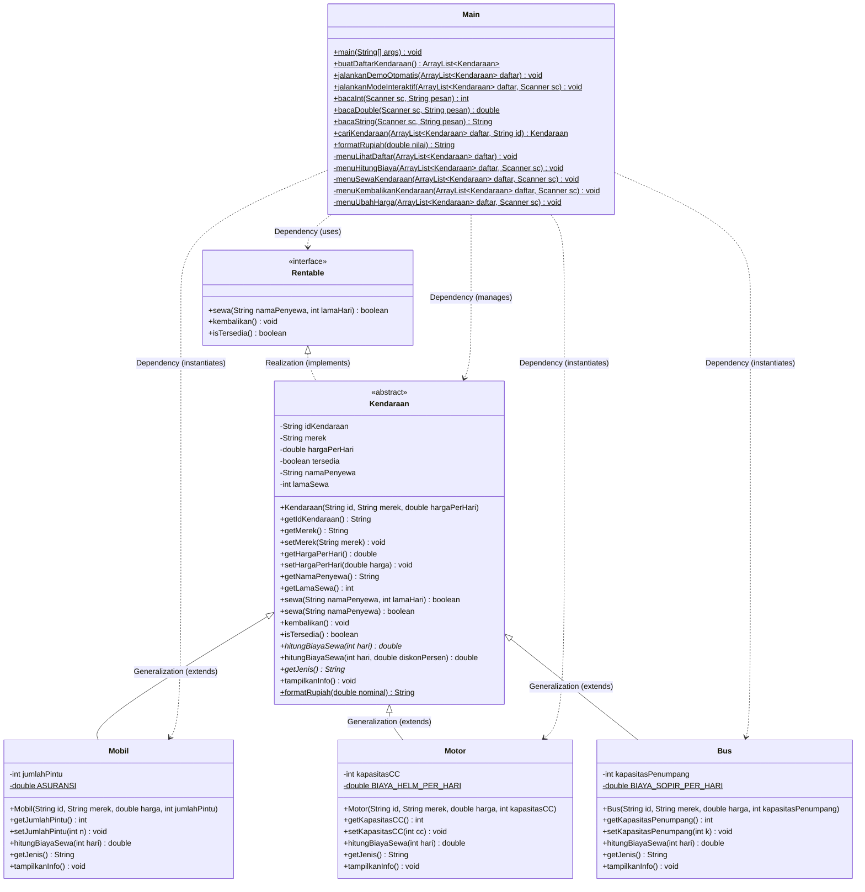
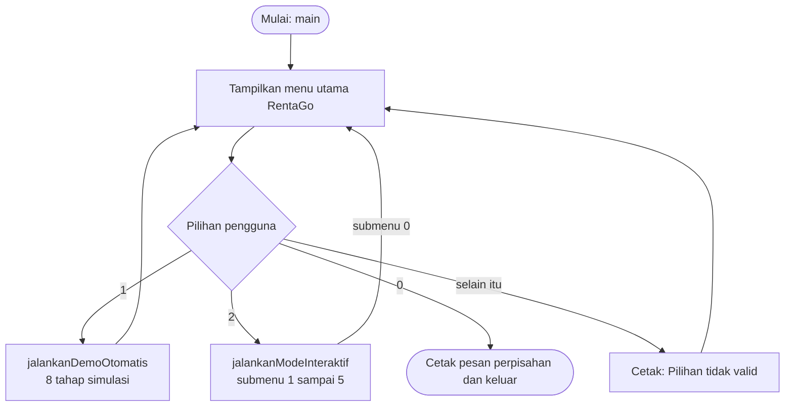
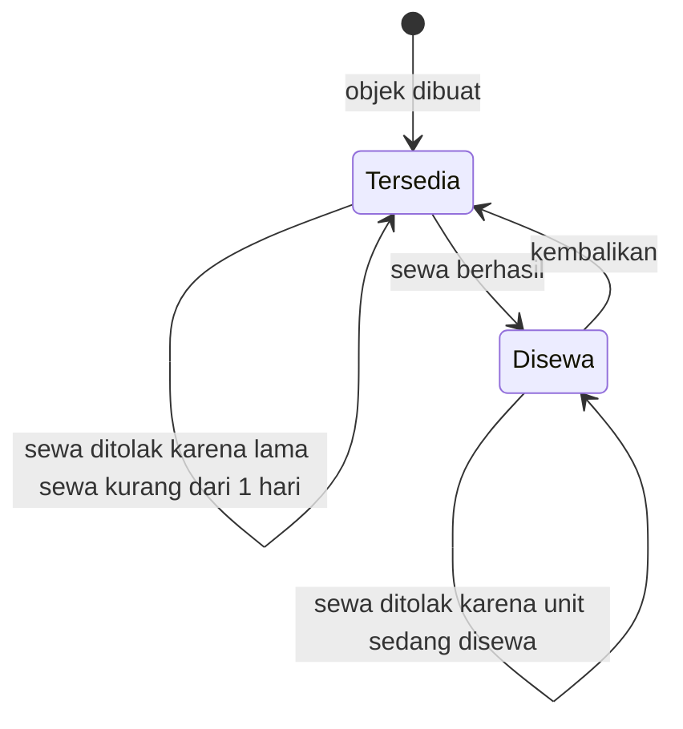

<div align="center">

# 🚗 LAPORAN PRAKTIKUM PEMROGRAMAN BERORIENTASI OBJEK

## Praktik Lab Session 3B: Pengembangan Program Berbasis Object-Oriented Programming (OOP)

### RentaGo — Sistem Manajemen Rental Kendaraan


</div>

---

## INFORMASI PRAKTIKUM & IDENTITAS MAHASISWA

| Keterangan | Detail |
|---|---|
| **Nama Lengkap** | **Muhammad Fakhri Abdullah** |
| **NIM** | **L0325030** |
| **Kelas** | **3 B** |
| **Mata Kuliah** | Praktikum Pemrograman Berorientasi Objek (OOP) |
| **Modul Tugas** | Praktik Lab Session 3B — Pengembangan Program Berbasis OOP |
| **Studi Kasus** | **RentaGo — Sistem Manajemen Rental Kendaraan** |
| **Bahasa Pemrograman** | Java (Standar JDK 11 / JDK 17 / JDK 25) |
| **Paket / Package** | Default Package |
| **Arsitektur Kode** | Modular OOP (1 Interface, 1 Abstract Superclass, 3 Subclasses, 1 Driver Class) |

### Proyek Sekilas

| Aspek | Ringkasan |
|---|---|
| **Apa yang dibangun** | Aplikasi *command-line* untuk mengelola rental kendaraan (Mobil, Motor, dan Bus) |
| **Lima konsep OOP** | Encapsulation, Inheritance, Polymorphism, Abstract Class, dan Interface |
| **Armada awal** | 4 objek kendaraan: 2 Mobil, 1 Motor, dan 1 Bus |
| **Mode operasi** | Demo otomatis (8 tahap) dan mode interaktif berbasis menu `Scanner` |
| **Struktur kode** | 6 file: 1 interface, 1 abstract class, 3 subclass, dan 1 driver class |
| **Pengujian** | 13 test case (TC-01 s.d. TC-13), seluruhnya **LULUS** |
| **Dependensi** | Tidak ada pustaka eksternal (*zero external dependency*) |

### Panduan Membaca Laporan

Laporan ini disusun mengalir dari **konsep → perancangan → kode → bukti pengujian**. Jika Anda tidak ingin membacanya secara berurutan, gunakan petunjuk berikut:

| Jika Anda ingin... | Langsung buka |
|---|---|
| Memahami gambaran umum dan studi kasus | [Bagian 1](#1-ringkasan-eksekutif--abstrak) dan [Bagian 2](#2-latar-belakang--deskripsi-studi-kasus) |
| Mempelajari teori OOP yang dipakai | [Bagian 4](#4-landasan-teori-pemrograman-berorientasi-objek) |
| Memastikan semua ketentuan soal terpenuhi | [Bagian 5](#5-analisis-pemenuhan-ketentuan-soal-lembar-tugas-pdf) |
| Melihat desain sistem, diagram UML, dan rumus tarif | [Bagian 6](#6-perancangan-sistem--arsitektur-perangkat-lunak) |
| Membaca kode sumber beserta penjelasannya | [Bagian 7](#7-implementasi-source-code--pembahasan-detail) |
| Melihat hasil eksekusi dan 13 test case | [Bagian 8](#8-hasil-pengujian-output-eksekusi--analisis-hasil) |
| Menjalankan program sendiri | [Bagian 9](#9-panduan-kompilasi-dan-eksekusi) |
| Memahami istilah teknis | [Lampiran A](#lampiran-a-glosarium-istilah) |

---

## DAFTAR ISI
1. [Ringkasan Eksekutif & Abstrak](#1-ringkasan-eksekutif--abstrak)
2. [Latar Belakang & Deskripsi Studi Kasus](#2-latar-belakang--deskripsi-studi-kasus)
   - 2.1 [Latar Belakang](#21-latar-belakang)
   - 2.2 [Studi Kasus "RentaGo"](#22-studi-kasus-rentago)
3. [Tujuan Praktikum & Metrik Keberhasilan](#3-tujuan-praktikum--metrik-keberhasilan)
   - 3.1 [Tujuan Praktikum](#31-tujuan-praktikum)
   - 3.2 [Metrik Ketercapaian](#32-metrik-ketercapaian)
4. [Landasan Teori Pemrograman Berorientasi Objek](#4-landasan-teori-pemrograman-berorientasi-objek)
   - 4.1 [Paradigma Berorientasi Objek vs Prosedural](#41-paradigma-berorientasi-objek-vs-prosedural)
   - 4.2 [Class, Objek, Atribut, dan Method](#42-class-objek-atribut-dan-method)
   - 4.3 [Pilar 1: Encapsulation (Enkapsulasi & Data Hiding)](#43-pilar-1-encapsulation-enkapsulasi--data-hiding)
   - 4.4 [Pilar 2: Inheritance (Pewarisan & Constructor Chaining)](#44-pilar-2-inheritance-pewarisan--constructor-chaining)
   - 4.5 [Pilar 3: Polymorphism (Overriding, Overloading, Runtime Polymorphism)](#45-pilar-3-polymorphism-overriding-overloading-runtime-polymorphism)
   - 4.6 [Pilar 4: Abstract Class & Abstract Method](#46-pilar-4-abstract-class--abstract-method)
   - 4.7 [Pilar 5: Interface & Kontrak Perilaku](#47-pilar-5-interface--kontrak-perilaku)
   - 4.8 [Peta Ringkas Konsep OOP pada RentaGo](#48-peta-ringkas-konsep-oop-pada-rentago)
5. [Analisis Pemenuhan Ketentuan Soal (Lembar Tugas PDF)](#5-analisis-pemenuhan-ketentuan-soal-lembar-tugas-pdf)
   - 5.1 [Pemenuhan Ketentuan Wajib](#51-pemenuhan-ketentuan-wajib)
   - 5.2 [Pemenuhan Ketentuan Tambahan](#52-pemenuhan-ketentuan-tambahan)
6. [Perancangan Sistem & Arsitektur Perangkat Lunak](#6-perancangan-sistem--arsitektur-perangkat-lunak)
   - 6.1 [Struktur Direktori Proyek](#61-struktur-direktori-proyek)
   - 6.2 [Class Diagram (UML)](#62-class-diagram-uml)
   - 6.3 [Aturan Bisnis & Formula Biaya Sewa Kendaraan](#63-aturan-bisnis--formula-biaya-sewa-kendaraan)
   - 6.4 [Alur Eksekusi Program & Siklus Status Kendaraan](#64-alur-eksekusi-program--siklus-status-kendaraan)
7. [Implementasi Source Code & Pembahasan Detail](#7-implementasi-source-code--pembahasan-detail)
   - 7.1 [`Rentable.java` (Interface)](#71-rentablejava-interface)
   - 7.2 [`Kendaraan.java` (Abstract Superclass)](#72-kendaraanjava-abstract-superclass)
   - 7.3 [`Mobil.java` (Subclass Konkret)](#73-mobiljava-subclass-konkret)
   - 7.4 [`Motor.java` (Subclass Konkret)](#74-motorjava-subclass-konkret)
   - 7.5 [`Bus.java` (Subclass Konkret)](#75-busjava-subclass-konkret)
   - 7.6 [`Main.java` (Driver Class: Demo Otomatis & Menu CLI Interaktif)](#76-mainjava-driver-class-demo-otomatis--menu-cli-interaktif)
8. [Hasil Pengujian, Output Eksekusi, & Analisis Hasil](#8-hasil-pengujian-output-eksekusi--analisis-hasil)
   - 8.1 [Output Demo Otomatis (Tahap 1 s.d. 8)](#81-output-demo-otomatis-tahap-1-sd-8)
   - 8.2 [Output Mode Interaktif (Sesi Uji Kasus Nyata)](#82-output-mode-interaktif-sesi-uji-kasus-nyata)
   - 8.3 [Verifikasi Mandiri 13 Test Case (TC-01 s.d. TC-13)](#83-verifikasi-mandiri-13-test-case-tc-01-sd-tc-13)
9. [Panduan Kompilasi dan Eksekusi](#9-panduan-kompilasi-dan-eksekusi)
   - 9.1 [Melalui Command Prompt / PowerShell / Linux Terminal](#91-melalui-command-prompt--powershell--linux-terminal)
   - 9.2 [Melalui Integrated Development Environment (IDE)](#92-melalui-integrated-development-environment-ide)
   - 9.3 [Pemecahan Masalah Umum (Troubleshooting)](#93-pemecahan-masalah-umum-troubleshooting)
10. [Kesimpulan dan Saran](#10-kesimpulan-dan-saran)
    - 10.1 [Kesimpulan](#101-kesimpulan)
    - 10.2 [Saran Pengembangan Lanjutan](#102-saran-pengembangan-lanjutan)
- [Lampiran A: Glosarium Istilah](#lampiran-a-glosarium-istilah)

---

## 1. Ringkasan Eksekutif & Abstrak

Tugas praktikum **Praktik Lab Session 3B** menitikberatkan pada perancangan dan implementasi aplikasi berbasis bahasa pemrograman Java dengan mengintegrasikan lima konsep fundamental *Object-Oriented Programming* (OOP): **Encapsulation**, **Inheritance**, **Polymorphism**, **Abstract Class**, dan **Interface**. Kelima konsep tersebut tidak dibahas secara terpisah, melainkan dipadukan dalam satu studi kasus utuh sehingga keterkaitan antarkonsep dapat terlihat langsung pada kode.

Aplikasi yang dibangun berjudul **RentaGo — Sistem Manajemen Rental Kendaraan**. Sistem ini mensimulasikan operasional bisnis rental kendaraan yang mengelola berbagai varian armada: Mobil, Motor, dan Bus. Setiap jenis kendaraan memiliki spesifikasi teknis dan formula perhitungan tarif rental yang unik (memperhitungkan asuransi, biaya sewa helm, dan upah sopir harian). Program dirancang dengan dua mode operasi:
1. **Mode Demo Otomatis**: Menjalankan 8 tahap simulasi terstruktur untuk memverifikasi secara langsung seluruh konsep OOP dan aturan bisnis.
2. **Mode Interaktif CLI**: Menyediakan menu interaktif berbasis `Scanner` dengan penanganan error defensif (*exception handling*) untuk memudahkan pengguna mengeksplorasi fungsionalitas sistem secara dinamis.

Seluruh ketentuan wajib dan ketentuan tambahan dari dokumen penugasan berhasil diimplementasikan 100% tanpa menggunakan pustaka eksternal (*zero external dependency*).

---

## 2. Latar Belakang & Deskripsi Studi Kasus

### 2.1 Latar Belakang

Dalam paradigma prosedural tradisional, pengelolaan data armada dan perhitungan tarif sewa sering kali disatukan dalam percabangan logika kondisional (`if-else` atau `switch-case`) yang panjang dan rentan kesalahan. Ketika terdapat penambahan armada baru, pengembang terpaksa membongkar kode lama, melanggar prinsip *Open/Closed Principle* (OCP).

Ilustrasi pendekatan prosedural tersebut (hanya sebagai perbandingan, bukan bagian dari program RentaGo):

```java
// Pendekatan prosedural: setiap jenis kendaraan baru menuntut penambahan cabang if-else
double hitungBiaya(String jenis, double harga, int hari) {
    if (jenis.equals("Mobil"))      { return harga * hari + 50000; }
    else if (jenis.equals("Motor")) { return harga * hari + 10000 * hari; }
    else if (jenis.equals("Bus"))   { return harga * hari + 300000 * hari; }
    return 0; // jenis baru? fungsi ini harus dibongkar lagi
}
```

Dengan mengadopsi paradigma Berorientasi Objek (OOP), sistem dirancang modular:
* Setiap kendaraan dimodelkan sebagai objek otonom yang membungkus status dan perilakunya sendiri.
* Hubungan *is-a* (Mobil adalah Kendaraan, Motor adalah Kendaraan, Bus adalah Kendaraan) dimodelkan secara alamiah melalui pewarisan (*inheritance*).
* Kemampuan transaksi persewaan dimodelkan sebagai kontrak perilaku melalui *interface*.

Hasilnya, pemanggilan biaya sewa cukup ditulis satu kali untuk seluruh jenis kendaraan, dan penambahan jenis baru cukup dilakukan dengan membuat subclass baru tanpa menyentuh kode yang sudah ada:

```java
for (Kendaraan k : daftar) {
    k.hitungBiayaSewa(3); // formula yang dipakai mengikuti jenis objek sebenarnya
}
```

### 2.2 Studi Kasus "RentaGo"

RentaGo mengelola empat unit armada awal:

| No | ID | Merek | Jenis | Spesifikasi | Tarif Dasar |
|:---:|---|---|---|---|---|
| 1 | `MBL-001` | **Toyota Avanza** | Mobil | 5 Pintu | Rp350.000/hari |
| 2 | `MBL-002` | **Honda Brio** | Mobil | 5 Pintu | Rp300.000/hari |
| 3 | `MTR-001` | **Yamaha NMAX** | Motor | 155 cc | Rp120.000/hari |
| 4 | `BUS-001` | **Hino Medium Bus** | Bus | 30 Penumpang | Rp1.500.000/hari |

Setiap entitas harus memenuhi empat tuntutan berikut:
1. **Menghitung biaya sewa** dengan formula spesifik sesuai jenis kendaraannya.
2. **Menerima diskon persentase** pada perhitungan biaya.
3. **Divalidasi status ketersediaannya** sebelum transaksi sewa diproses.
4. **Dilindungi dari manipulasi nilai data yang tidak sah** (seperti nilai harga negatif).

---

## 3. Tujuan Praktikum & Metrik Keberhasilan

### 3.1 Tujuan Praktikum
1. Mampu merancang class hierarkis yang merefleksikan entitas dunia nyata secara logis.
2. Mampu menerapkan **Encapsulation** melalui hak akses `private`, setter ter-validasi, dan *data hiding*.
3. Mampu menerapkan **Inheritance** dengan superclass dan subclass menggunakan `extends` serta `super()`.
4. Mampu menerapkan **Polymorphism** baik *compile-time* (*method overloading*) maupun *runtime* (*method overriding* dan polimorfisme referensi koleksi).
5. Mampu menerapkan **Abstract Class** untuk membuat kerangka dasar superclass yang tidak dapat diinstansiasi secara prematur.
6. Mampu menerapkan **Interface** sebagai kontrak perilaku persewaan (`Rentable`) yang diimplementasikan secara konsisten.

Agar setiap tujuan dapat ditelusuri, berikut pemetaannya ke bagian teori, kode, dan bukti pengujian:

| Tujuan | Landasan Teori | Wujud di Kode | Bukti Pengujian |
|:---:|---|---|---|
| 1 | [Bagian 4.1 – 4.2](#41-paradigma-berorientasi-objek-vs-prosedural) | [Bagian 6.2](#62-class-diagram-uml) dan [Bagian 7](#7-implementasi-source-code--pembahasan-detail) | Seluruh test case |
| 2 | [Bagian 4.3](#43-pilar-1-encapsulation-enkapsulasi--data-hiding) | [Bagian 7.2](#72-kendaraanjava-abstract-superclass) | TC-06 s.d. TC-10 |
| 3 | [Bagian 4.4](#44-pilar-2-inheritance-pewarisan--constructor-chaining) | [Bagian 7.3 – 7.5](#73-mobiljava-subclass-konkret) | TC-13 |
| 4 | [Bagian 4.5](#45-pilar-3-polymorphism-overriding-overloading-runtime-polymorphism) | [Bagian 7.2](#72-kendaraanjava-abstract-superclass) dan [7.6](#76-mainjava-driver-class-demo-otomatis--menu-cli-interaktif) | TC-04, TC-05, TC-11 |
| 5 | [Bagian 4.6](#46-pilar-4-abstract-class--abstract-method) | [Bagian 7.2](#72-kendaraanjava-abstract-superclass) | TC-01 s.d. TC-03 |
| 6 | [Bagian 4.7](#47-pilar-5-interface--kontrak-perilaku) | [Bagian 7.1](#71-rentablejava-interface) | TC-12 |

### 3.2 Metrik Ketercapaian
- [x] Seluruh 5 ketentuan wajib terpenuhi tanpa pengecualian.
- [x] Seluruh 4 ketentuan tambahan terpenuhi (memiliki 6 file/class/interface dan 4 objek konkret).
- [x] Kompilasi dan eksekusi berjalan 100% mulus tanpa error dan tanpa warning pada JDK standar.
- [x] Seluruh 13 Test Case (TC-01 hingga TC-13) terverifikasi **LULUS** (*PASS*).

---

## 4. Landasan Teori Pemrograman Berorientasi Objek

Berikut adalah kajian teori komprehensif terkait konsep-konsep materi kuliah Pemrograman Berorientasi Objek yang diintegrasikan dalam aplikasi. Pembahasan dimulai dari fondasi (paradigma, class, objek), kemudian dilanjutkan ke lima pilar OOP. Setiap pilar disertai contoh nyata pada kode RentaGo agar teori dapat langsung dihubungkan dengan implementasinya.

### 4.1 Paradigma Berorientasi Objek vs Prosedural

* **Pemrograman Prosedural**: Program dipandang sebagai urutan langkah instruksi linier (*functions/procedures*) yang beroperasi pada struktur data terpisah. Kelemahannya adalah data bersifat global/terbuka sehingga mudah termodifikasi secara tidak sengaja.
* **Pemrograman Berorientasi Objek (OOP)**: Program dipandang sebagai kumpulan entitas mandiri (*objects*) yang saling berinteraksi. Data (state/atribut) dan operasi (behavior/method) dibungkus secara kohesif dalam satu kesatuan unit class.

| Aspek | Prosedural | Berorientasi Objek |
|---|---|---|
| **Unit utama program** | Fungsi / prosedur | Class dan objek |
| **Hubungan data & logika** | Terpisah | Menyatu dalam satu class |
| **Keamanan data** | Data cenderung terbuka | Data dapat disembunyikan (*data hiding*) |
| **Penambahan fitur baru** | Sering mengubah kode lama | Cukup menambah class/subclass baru |
| **Penggunaan ulang kode** | Terbatas | Tinggi melalui pewarisan dan interface |

### 4.2 Class, Objek, Atribut, dan Method

* **Class**: Cetak biru (*blueprint*) atau definisi tipe data bentukan yang mendeskripsikan atribut dan perilaku umum dari suatu entitas. Pada proyek ini, class didefinisikan pada [`Kendaraan`](src/Kendaraan.java), [`Mobil`](src/Mobil.java), [`Motor`](src/Motor.java), [`Bus`](src/Bus.java), dan [`Main`](src/Main.java).
* **Objek (*Object / Instance*)**: Wujud nyata (*instantiation*) dari class yang dialokasikan di dalam memori Heap. Misalnya: `mobil1`, `mobil2`, `motor1`, `bus1`.
* **Atribut (*Field / State*)**: Data atau variabel yang dimiliki objek untuk merepresentasikan karakteristiknya (`idKendaraan`, `merek`, `hargaPerHari`, `tersedia`, `namaPenyewa`, `lamaSewa`).
* **Method (*Behavior*)**: Fungsi atau aksi operasional yang dapat dieksekusi oleh atau terhadap objek (`sewa()`, `kembalikan()`, `hitungBiayaSewa()`, `tampilkanInfo()`).

Analogi sederhananya: `Mobil` adalah *cetakan*, sedangkan Toyota Avanza `MBL-001` adalah *hasil cetakan* yang punya merek, harga, dan status sewanya sendiri.

---

### 4.3 Pilar 1: Encapsulation (Enkapsulasi & Data Hiding)

**Enkapsulasi** adalah teknik menyembunyikan detail implementasi internal dan melindungi keadaan (*state*) suatu objek dari manipulasi liar dari luar class (*Data Hiding*).

#### Prinsip Implementasi:
1. **Access Modifier Private**: Semua variabel atribut dideklarasikan menggunakan kata kunci `private`. Variabel ini tidak dapat diakses atau diubah langsung oleh class lain maupun subclass.
2. **Accessor (Getter)**: Menyediakan method publik (`public`) bertipe kembalian untuk membaca nilai atribut secara aman tanpa memberikan hak tulis langsung (contoh: `getIdKendaraan()`, `getMerek()`, `getHargaPerHari()`).
3. **Mutator (Setter) Ter-validasi**: Menyediakan method publik untuk mengubah data dengan menyematkan logika validasi integritas (*invarian rule*). Pada [`Kendaraan.java`](src/Kendaraan.java#L53-L59), method `setHargaPerHari(double)` memvalidasi bahwa nilai tidak boleh $\le 0$. Jika tidak valid, perubahan ditolak dan nilai lama tetap dipertahankan.
4. **State Guarding**: Atribut penting seperti `tersedia`, `namaPenyewa`, dan `lamaSewa` **tidak memiliki setter publik**. Perubahan status hanya diizinkan melalui transaksi bisnis resmi, yaitu method `sewa()` dan `kembalikan()`.

Contoh setter ter-validasi pada RentaGo:

```java
public void setHargaPerHari(double hargaPerHari) {
    if (hargaPerHari <= 0) {
        System.out.println("Gagal   : Harga harus lebih dari 0. Perubahan ditolak.");
    } else {
        this.hargaPerHari = hargaPerHari;
    }
}
```

Matriks akses atribut pada RentaGo membantu melihat siapa yang boleh membaca dan mengubah setiap data:

| Atribut | Class | Getter | Setter | Cara Nilai Berubah |
|---|---|:---:|:---:|---|
| `idKendaraan` | `Kendaraan` | Ada | Tidak ada | Hanya diisi sekali lewat constructor |
| `merek` | `Kendaraan` | Ada | Ada (menolak kosong/`null`) | Setter ter-validasi |
| `hargaPerHari` | `Kendaraan` | Ada | Ada (menolak $\le 0$) | Setter ter-validasi |
| `tersedia` | `Kendaraan` | Ada (`isTersedia()`) | Tidak ada | Hanya lewat `sewa()` dan `kembalikan()` |
| `namaPenyewa` | `Kendaraan` | Ada | Tidak ada | Hanya lewat `sewa()` dan `kembalikan()` |
| `lamaSewa` | `Kendaraan` | Ada | Tidak ada | Hanya lewat `sewa()` dan `kembalikan()` |
| `jumlahPintu` | `Mobil` | Ada | Ada (menolak $\le 0$) | Setter ter-validasi |
| `kapasitasCC` | `Motor` | Ada | Ada (menolak $\le 0$) | Setter ter-validasi |
| `kapasitasPenumpang` | `Bus` | Ada | Ada (menolak $\le 0$) | Setter ter-validasi |

Dengan rancangan ini, objek tidak mungkin berada dalam kondisi tidak valid, misalnya harga negatif atau kendaraan yang berstatus "tersedia" tetapi masih memiliki nama penyewa.

---

### 4.4 Pilar 2: Inheritance (Pewarisan & Constructor Chaining)

**Inheritance** adalah mekanisme pembentukan hierarki antar class di mana sebuah class turunan (*subclass*) mewarisi atribut dan method dari class induknya (*superclass*). Konsep ini mengeliminasi duplikasi kode (*reusability*) dan mencerminkan hubungan taksonomi alamiah (*is-a relationship*).

Hierarki pewarisan pada RentaGo:

```text
Rentable            (interface)        ← kontrak "dapat disewa"
   ▲  implements
Kendaraan           (abstract class)   ← atribut & perilaku umum semua kendaraan
   ▲  extends
   ├── Mobil        (+ jumlahPintu, asuransi tetap)
   ├── Motor        (+ kapasitasCC, sewa helm harian)
   └── Bus          (+ kapasitasPenumpang, upah sopir harian)
```

#### Prinsip Implementasi:
1. **Keyword `extends`**: Digunakan untuk mendeklarasikan hubungan pewarisan:
   * `public class Mobil extends Kendaraan`
   * `public class Motor extends Kendaraan`
   * `public class Bus extends Kendaraan`
2. **Constructor Chaining (`super()`)**: Ketika constructor subclass dijalankan, constructor superclass harus dipanggil terlebih dahulu untuk menginisialisasi atribut dasar superclass. Pemanggilan dilakukan pada baris pertama tubuh constructor dengan sintaks `super(idKendaraan, merek, hargaPerHari);`.
3. **Pemberian Karakteristik Khusus**: Subclass memperluas superclass dengan menambahkan atribut spesifik:
   * `Mobil` menambahkan `jumlahPintu`
   * `Motor` menambahkan `kapasitasCC`
   * `Bus` menambahkan `kapasitasPenumpang`

Contoh *constructor chaining* pada class `Mobil`:

```java
public Mobil(String idKendaraan, String merek, double hargaPerHari, int jumlahPintu) {
    super(idKendaraan, merek, hargaPerHari); // 1) bangun bagian Kendaraan terlebih dahulu
    setJumlahPintu(jumlahPintu);             // 2) lengkapi atribut khusus Mobil
}
```

Urutan kejadian saat `new Mobil("MBL-001", "Toyota Avanza", 350000, 5)` dieksekusi:
1. Constructor `Mobil` dipanggil, lalu langsung meneruskan `id`, `merek`, dan `harga` ke constructor `Kendaraan` melalui `super(...)`.
2. Constructor `Kendaraan` mengisi atribut dasar (termasuk nilai awal `tersedia = true`) dan memvalidasi `merek` serta `hargaPerHari` lewat setter.
3. Kendali kembali ke constructor `Mobil` yang kemudian mengisi `jumlahPintu` lewat setter ter-validasi.

---

### 4.5 Pilar 3: Polymorphism (Overriding, Overloading, Runtime Polymorphism)

Berasal dari bahasa Yunani yang berarti "banyak bentuk". Dalam OOP, polimorfisme memungkinkan satu nama method atau antarmuka memiliki banyak bentuk perilaku nyata tergantung konteks eksekusinya. Pada RentaGo, polimorfisme hadir dalam tiga bentuk yang saling melengkapi.

#### a. Method Overriding (Dynamic / Runtime Polymorphism)
* Terjadi saat subclass menuliskan ulang badan method yang sudah ada di superclass dengan tanda tangan (*signature*: nama method serta jumlah dan tipe data parameter) yang sama persis, dengan return type yang sama atau kompatibel.
* Ditandai secara eksplisit dengan anotasi `@Override` agar *compiler* dapat memverifikasi kesesuaian tanda tangan method.
* **Dynamic Method Dispatch**: Pemanggilan method ditentukan oleh tipe objek nyata saat *runtime*, bukan tipe referensinya.
* Contoh di RentaGo: Setiap subclass (`Mobil`, `Motor`, `Bus`) meng-*override* method `hitungBiayaSewa(int hari)` dan `tampilkanInfo()`.

#### b. Method Overloading (Static / Compile-time Polymorphism)
* Terjadi ketika sebuah class memiliki beberapa method dengan **nama yang sama**, tetapi memiliki **daftar parameter yang berbeda** (berbeda jumlah parameter atau tipe datanya).
* Diputuskan langsung oleh *compiler* pada tahap kompilasi (*compile-time*).
* Contoh di RentaGo:
  1. `hitungBiayaSewa(int hari)` vs `hitungBiayaSewa(int hari, double diskonPersen)` pada class `Kendaraan`.
  2. `sewa(String namaPenyewa, int lamaHari)` vs `sewa(String namaPenyewa)` pada class `Kendaraan`.

#### c. Runtime Polymorphism via Koleksi Superclass
* Objek dari class-class turunan yang berlainan (`Mobil`, `Motor`, `Bus`) dapat dikelompokkan bersama ke dalam satu wadah koleksi bertipe superclass:
  ```java
  ArrayList<Kendaraan> daftar = new ArrayList<>();
  daftar.add(new Mobil(...));
  daftar.add(new Motor(...));
  daftar.add(new Bus(...));
  ```
* Saat dilakukan iterasi loop `for (Kendaraan k : daftar)`, pemanggilan `k.hitungBiayaSewa(3)` secara otomatis memanggil implementasi milik subclass yang bersangkutan di dalam memori runtime.

#### Perbandingan Overriding vs Overloading

| Aspek | Overriding | Overloading |
|---|---|---|
| **Lokasi** | Subclass menulis ulang method milik superclass/interface | Beberapa method sewarga dalam class yang sama |
| **Signature** | Sama persis | Daftar parameter berbeda |
| **Waktu penentuan** | *Runtime* (*dynamic dispatch*) | *Compile-time* |
| **Jenis polimorfisme** | Dinamis | Statis |
| **Contoh di RentaGo** | `hitungBiayaSewa(int)` pada `Mobil`, `Motor`, dan `Bus` | `hitungBiayaSewa(int)` vs `hitungBiayaSewa(int, double)` |

> [!NOTE]
> Method `sewa(String, int)` pada `Kendaraan` menjalankan dua peran sekaligus: ia **meng-override** method kontrak dari interface `Rentable`, sementara `sewa(String)` adalah **overload**-nya dengan durasi bawaan 1 hari.

---

### 4.6 Pilar 4: Abstract Class & Abstract Method

**Abstract Class** adalah class yang bersifat konseptual dan tidak lengkap, sehingga **tidak dapat diinstansiasi secara langsung** menggunakan operator `new`. Abstract class berfungsi sebagai cetak biru dasar bagi keluarga class turunannya.

#### Karakteristik Implementasi:
* Dideklarasikan dengan kata kunci `public abstract class Kendaraan`.
* **Abstract Method**: Method yang hanya memiliki *header* / deklarasi tanda tangan tanpa tubuh implementasi (`{}`), diakhiri dengan titik koma.
  ```java
  public abstract double hitungBiayaSewa(int hari);
  public abstract String getJenis();
  ```
* **Kewajiban Subclass**: Setiap subclass konkret yang mewarisi `Kendaraan` **wajib** mengimplementasikan seluruh abstract method tersebut, atau subclass tersebut juga harus dideklarasikan sebagai abstract class.

#### Mengapa `Kendaraan` dibuat abstract?
"Kendaraan" hanyalah konsep umum; di dunia nyata yang disewa selalu berupa mobil, motor, atau bus. Karena itu `new Kendaraan(...)` sengaja tidak diizinkan dan akan ditolak *compiler*. Di sisi lain, abstract class ini tetap menyimpan **kode bersama** yang dipakai semua turunan, sehingga tidak ditulis berulang:

| Dalam `Kendaraan` | Isi | Siapa yang mengisi badan method |
|---|---|---|
| **Abstract method** | `hitungBiayaSewa(int)` dan `getJenis()` | Masing-masing subclass (`Mobil`, `Motor`, `Bus`) |
| **Method konkret** | Getter/setter, `sewa()`, `kembalikan()`, `isTersedia()`, `tampilkanInfo()`, `hitungBiayaSewa(int, double)`, `formatRupiah()` | `Kendaraan` sendiri, diwariskan ke semua subclass |

Perhatikan bahwa `hitungBiayaSewa(int, double)` yang bersifat konkret memanggil `hitungBiayaSewa(int)` yang bersifat abstract. Berkat polimorfisme, logika diskon cukup ditulis **satu kali** di superclass, tetapi tetap memakai formula dasar milik masing-masing subclass.

---

### 4.7 Pilar 5: Interface & Kontrak Perilaku

**Interface** adalah struktur acuan murni yang mendefinisikan *kontrak perilaku* yang harus dipatuhi oleh class yang mengimplementasikannya. Interface hanya berisi deklarasi method publik abstrak (pada standar klasik) tanpa menyimpan status objek (tidak memiliki instance variables).

#### Karakteristik Implementasi:
* Dideklarasikan dengan `public interface Rentable`.
* Menyatakan kemampuan: "Objek apa pun yang mengimplementasikan `Rentable` dijamin dapat disewa (`sewa`), dapat dikembalikan (`kembalikan`), dan dapat diperiksa ketersediaannya (`isTersedia`)".
* Dihubungkan ke superclass menggunakan kata kunci `implements`:
  ```java
  public abstract class Kendaraan implements Rentable
  ```
* Karena superclass `Kendaraan` mengimplementasikan `Rentable`, maka seluruh subclass (`Mobil`, `Motor`, `Bus`) secara otomatis memenuhi kontrak `Rentable`.
* **Polimorfisme Referensi Interface**: Memungkinkan variabel referensi bertipe interface menampung objek konkret subclass:
  ```java
  Rentable r = bus1;
  boolean status = r.isTersedia();
  ```

> [!NOTE]
> Sejak Java 8, interface juga dapat memuat *default method* dan *static method*. Pada proyek ini `Rentable` sengaja dibuat sebagai interface klasik yang hanya berisi deklarasi method, sehingga fokus tetap pada konsep kontrak perilaku.

#### Abstract Class vs Interface pada RentaGo

| Aspek | `Kendaraan` (abstract class) | `Rentable` (interface) |
|---|---|---|
| **Jenis hubungan** | *is-a* (Mobil adalah Kendaraan) | *can-do* (dapat disewa) |
| **Menyimpan state** | Ya (atribut `private`) | Tidak |
| **Berisi method konkret** | Ya | Tidak (hanya deklarasi) |
| **Cara dipakai** | `extends` (satu superclass) | `implements` (dapat banyak interface) |
| **Peran utama** | Kerangka dan kode bersama keluarga kendaraan | Kontrak perilaku persewaan |

---

### 4.8 Peta Ringkas Konsep OOP pada RentaGo

Ringkasan berikut menyatukan seluruh teori di atas agar dapat dijadikan acuan cepat sebelum membaca kode:

| Pilar | Kata Kunci Java | Wujud di RentaGo | Berkas Utama |
|---|---|---|---|
| **Encapsulation** | `private`, getter, setter ter-validasi | Atribut privat, validasi harga/merek/kapasitas, status hanya berubah lewat `sewa()` dan `kembalikan()` | [`Kendaraan.java`](src/Kendaraan.java) |
| **Inheritance** | `extends`, `super()` | `Mobil`, `Motor`, `Bus` mewarisi `Kendaraan` | [`Mobil.java`](src/Mobil.java), [`Motor.java`](src/Motor.java), [`Bus.java`](src/Bus.java) |
| **Polymorphism** | `@Override`, overloading, referensi superclass | `hitungBiayaSewa()` beda formula per subclass; `ArrayList<Kendaraan>` diproses seragam | [`Kendaraan.java`](src/Kendaraan.java), [`Main.java`](src/Main.java) |
| **Abstract Class** | `abstract` | `Kendaraan` dengan `hitungBiayaSewa(int)` dan `getJenis()` abstrak | [`Kendaraan.java`](src/Kendaraan.java) |
| **Interface** | `interface`, `implements` | `Rentable` diimplementasikan oleh `Kendaraan` | [`Rentable.java`](src/Rentable.java) |

---

## 5. Analisis Pemenuhan Ketentuan Soal (Lembar Tugas PDF)

Setelah teori dipahami, bagian ini memeriksa apakah seluruh persyaratan pada lembar penugasan sudah dipenuhi. Berdasarkan lembar instruksi resmi **Praktik Lab Session 3B**, berikut adalah matriks keterlacakan (*traceability matrix*) yang membuktikan bahwa seluruh ketentuan telah dipenuhi secara lengkap:

> [!NOTE]
> Kolom **Bukti Lokasi Kode** berisi tautan menuju file sumber di folder [`src/`](src/) beserta rentang baris (misalnya `#L8-L59`). Nomor baris merujuk pada file `.java` asli; posisinya dapat bergeser beberapa baris apabila komentar pada file diubah.

### 5.1 Pemenuhan Ketentuan Wajib

| No | Ketentuan Wajib Soal | Rincian Persyaratan | Implementasi Nyata pada Kode RentaGo | Bukti Lokasi Kode |
|:---:|---|---|---|---|
| **1** | **Encapsulation** | • Gunakan access modifier `private` pada atribut.<br>• Implementasikan getter dan setter.<br>• Pastikan perubahan data dilakukan melalui method yang sesuai. | • Semua atribut pada `Kendaraan`, `Mobil`, `Motor`, dan `Bus` dideklarasikan `private`.<br>• Getter tersedia untuk semua atribut.<br>• Setter tersedia untuk `merek` dan `hargaPerHari` dengan validasi nilai.<br>• Status `tersedia`, `namaPenyewa`, dan `lamaSewa` hanya berubah lewat `sewa()` dan `kembalikan()`. | [`Kendaraan.java` Baris 8-59](src/Kendaraan.java#L8-L59) |
| **2** | **Inheritance** | • Buat minimal satu superclass dan dua subclass.<br>• Gunakan keyword `extends`.<br>• Implementasikan constructor dan pemanggilan `super()`. | • Superclass: `Kendaraan`.<br>• Subclass: `Mobil`, `Motor`, `Bus` (3 subclass, melampaui batas minimal 2).<br>• Semua subclass memakai `extends Kendaraan`.<br>• Constructor tiap subclass memanggil `super(id, merek, harga)` di baris pertama. | [`Mobil.java` Baris 2 & 11](src/Mobil.java#L2-L14)<br>[`Motor.java` Baris 2 & 11](src/Motor.java#L2-L14)<br>[`Bus.java` Baris 2 & 11](src/Bus.java#L2-L14) |
| **3** | **Polymorphism** | • Implementasikan method overriding menggunakan anotasi `@Override`.<br>• Implementasikan method overloading dengan nama sama beda parameter.<br>• Tunjukkan penerapan runtime polymorphism melalui objek dari class turunan yang disimpan dalam referensi superclass. | • **Overriding**: `@Override` pada `hitungBiayaSewa()`, `getJenis()`, `tampilkanInfo()`, serta method interface `sewa()`, `kembalikan()`, `isTersedia()`.<br>• **Overloading**: `hitungBiayaSewa(int)` vs `hitungBiayaSewa(int, double)` dan `sewa(String, int)` vs `sewa(String)`.<br>• **Runtime Polymorphism**: Objek `Mobil`, `Motor`, `Bus` dimasukkan ke `ArrayList<Kendaraan>` dan diproses seragam dalam loop. | [`Kendaraan.java` Baris 66-98](src/Kendaraan.java#L66-L98)<br>[`Main.java` Baris 45-70](src/Main.java#L45-L70) |
| **4** | **Abstract Class** | • Buat minimal satu abstract class.<br>• Implementasikan minimal satu abstract method.<br>• Buat subclass yang mengimplementasikan abstract method tersebut. | • `public abstract class Kendaraan`.<br>• Dua abstract method: `abstract double hitungBiayaSewa(int hari)` dan `abstract String getJenis()`.<br>• Seluruh subclass (`Mobil`, `Motor`, `Bus`) mengimplementasikan kedua method abstrak tersebut. | [`Kendaraan.java` Baris 6 & 62-63](src/Kendaraan.java#L6-L63)<br>Subclass `Mobil`, `Motor`, `Bus` |
| **5** | **Interface** | • Buat minimal satu interface.<br>• Implementasikan interface menggunakan keyword `implements`.<br>• Setiap class yang mengimplementasikan interface harus memenuhi kontrak method. | • `public interface Rentable` berisi deklarasi method `sewa`, `kembalikan`, dan `isTersedia`.<br>• `Kendaraan implements Rentable`.<br>• Seluruh kontrak method diimplementasikan secara konkret dengan anotasi `@Override` di `Kendaraan`. | [`Rentable.java` Baris 2-6](src/Rentable.java#L2-L6)<br>[`Kendaraan.java` Baris 6 & 74-118](src/Kendaraan.java#L6-L118) |

---

### 5.2 Pemenuhan Ketentuan Tambahan

| No | Ketentuan Tambahan Soal | Target Soal | Realisasi pada Proyek RentaGo | Status |
|:---:|---|---|---|:---:|
| **1** | Jumlah Class Termasuk Main | Minimal 4 class | **5 class + 1 interface = 6 unit** (`Main`, `Kendaraan`, `Mobil`, `Motor`, `Bus`, `Rentable`) | **TERPENUHI** |
| **2** | Jumlah Objek dalam Program | Minimal 4 objek | **4 objek utama**: `mobil1`, `mobil2`, `motor1`, `bus1` diinisialisasi secara konsisten | **TERPENUHI** |
| **3** | Program Dapat Dijalankan & Output Sesuai | Eksekusi lancar | Program berjalan tanpa exception, output tahap [1] s.d. [8] presisi dan rapi | **TERPENUHI** |
| **4** | Hubungan Logis Superclass–Subclass–Interface | Logis & Natural | Taksonomi kendaraan nyata: `Kendaraan` (is-a) $\rightarrow$ `Mobil/Motor/Bus`; `Rentable` (can-do) $\rightarrow$ Kemampuan disewa | **TERPENUHI** |

Seluruh ketentuan wajib maupun tambahan berstatus **terpenuhi**; pembuktian lebih lanjut berupa output eksekusi dan test case disajikan pada [Bagian 8](#8-hasil-pengujian-output-eksekusi--analisis-hasil).

---

## 6. Perancangan Sistem & Arsitektur Perangkat Lunak

Bagian ini menjembatani teori dan kode: bagaimana class disusun dalam proyek, bagaimana hubungan antarclass digambarkan, dan aturan bisnis apa yang menjadi dasar perhitungan biaya.

### 6.1 Struktur Direktori Proyek

Proyek disusun dengan arsitektur standar Java berbasis folder `src` (source code) dan `out` (bytecode hasil kompilasi):

```text
LabSession3B/
├── PRD.md                  # Product Requirements Document (Spesifikasi Kebutuhan Proyek)
├── README.md               # Dokumen Laporan Praktikum Lengkap
├── out/                    # Direktori Output File Hasil Kompilasi (.class)
│   ├── Bus.class
│   ├── Kendaraan.class
│   ├── Main.class
│   ├── Mobil.class
│   ├── Motor.class
│   └── Rentable.class
└── src/                    # Direktori Source Code Java (.java)
    ├── Bus.java            (Subclass Bus, mewarisi Kendaraan)
    ├── Kendaraan.java      (Abstract Superclass, implements Rentable)
    ├── Main.java           (Driver Class: Entry Point, Demo Otomatis, Menu Interaktif)
    ├── Mobil.java          (Subclass Mobil, mewarisi Kendaraan)
    ├── Motor.java          (Subclass Motor, mewarisi Kendaraan)
    └── Rentable.java       (Interface Kontrak Persewaan)
```

Folder `out/` tidak perlu ditulis manual karena dibuat otomatis saat proses kompilasi (lihat [Bagian 9](#9-panduan-kompilasi-dan-eksekusi)).

---

### 6.2 Class Diagram (UML)

Diagram kelas berikut memvisualisasikan struktur class, modifier atribut, method, serta hubungan pewarisan dan realisasi interface:



**Cara membaca diagram:**

| Simbol | Arti |
|:---:|---|
| `+` / `-` | Anggota `public` / `private` |
| `<<interface>>` / `<<abstract>>` | Penanda stereotipe interface / abstract class |
| `*` (akhiran method) | Method abstrak |
| `$` (akhiran) | Anggota `static` |
| `<\|..` | *Realization*: class mengimplementasikan interface (`implements`) |
| `<\|--` | *Generalization*: class mewarisi class lain (`extends`) |
| `..>` | *Dependency*: class menggunakan class lain |

---

### 6.3 Aturan Bisnis & Formula Biaya Sewa Kendaraan

Setiap jenis kendaraan memiliki formula penentuan tarif sewa yang berbeda:

$$\text{Biaya Mobil} = (\text{HargaPerHari} \times \text{Hari}) + \text{ASURANSI}$$
* Konstanta Asuransi Tetap: Rp50.000 (flat per masa sewa).

$$\text{Biaya Motor} = (\text{HargaPerHari} \times \text{Hari}) + (\text{BIAYA\_HELM\_PER\_HARI} \times \text{Hari})$$
* Konstanta Sewa Helm Harian: Rp10.000 per hari.

$$\text{Biaya Bus} = (\text{HargaPerHari} \times \text{Hari}) + (\text{BIAYA\_SOPIR\_PER\_HARI} \times \text{Hari})$$
* Konstanta Biaya Sopir Harian: Rp300.000 per hari.

$$\text{Biaya Diskon} = \text{BiayaDasar} \times \left(1 - \frac{\text{Diskon}}{100}\right)$$
* Aturan Validasi Diskon: Jika nilai diskon $< 0$ atau $> 100$, diskon secara otomatis dianggap $0\%$ (tanpa diskon).

**Ringkasan konstanta biaya:**

| Konstanta | Class | Nilai | Skema Penagihan |
|---|---|---:|---|
| `ASURANSI` | `Mobil` | Rp50.000 | Tetap (*flat*) satu kali per masa sewa |
| `BIAYA_HELM_PER_HARI` | `Motor` | Rp10.000 | Dikalikan jumlah hari sewa |
| `BIAYA_SOPIR_PER_HARI` | `Bus` | Rp300.000 | Dikalikan jumlah hari sewa |

**Contoh perhitungan untuk sewa 3 hari** (identik dengan hasil [Bagian 8.1](#81-output-demo-otomatis-tahap-1-sd-8)):

| Kendaraan | Perhitungan | Biaya Sewa |
|---|---|---:|
| Toyota Avanza (Mobil) | (350.000 × 3) + 50.000 | **Rp1.100.000** |
| Honda Brio (Mobil) | (300.000 × 3) + 50.000 | **Rp950.000** |
| Yamaha NMAX (Motor) | (120.000 × 3) + (10.000 × 3) | **Rp390.000** |
| Hino Medium Bus (Bus) | (1.500.000 × 3) + (300.000 × 3) | **Rp5.400.000** |
| Toyota Avanza + diskon 10% | 1.100.000 × (1 − 10/100) | **Rp990.000** |

> [!IMPORTANT]
> Diskon dikenakan pada **total biaya dasar** hasil `hitungBiayaSewa(hari)`, sehingga komponen asuransi, sewa helm, atau upah sopir ikut terdiskon. Hal ini dapat dilihat pada contoh Toyota Avanza: diskon 10% dihitung dari Rp1.100.000, bukan hanya dari tarif sewanya.

---

### 6.4 Alur Eksekusi Program & Siklus Status Kendaraan

Alur menu utama program (satu objek `Scanner` dipakai bersama sepanjang program):



Setiap kali demo atau sesi interaktif dimulai, `buatDaftarKendaraan()` membuat **4 objek baru** sehingga kondisi awal selalu bersih.

Siklus status sebuah kendaraan dikendalikan sepenuhnya oleh method `sewa()` dan `kembalikan()` (prinsip *state guarding*):



---

## 7. Implementasi Source Code & Pembahasan Detail

Berikut adalah kode sumber lengkap dari keenam file yang menyusun program RentaGo disertai pembahasan konseptual dan teknis baris-per-baris. Urutan pembahasan sengaja mengikuti alur ketergantungan, dari **kontrak** (`Rentable`), **kerangka** (`Kendaraan`), **implementasi** (`Mobil`, `Motor`, `Bus`), hingga **pemakai** (`Main`).

> [!NOTE]
> Nomor baris pada bagian "Pembahasan Kode" merujuk pada file sumber asli di folder [`src/`](src/). Setiap file juga memuat komentar penanda konsep (misalnya `// Encapsulation: ...`, `// Overriding: ...`) agar konsep OOP mudah ditemukan langsung di kode.

---

### 7.1 [`Rentable.java`](src/Rentable.java) (Interface)

*Peran:* menetapkan **apa** yang harus mampu dilakukan setiap objek yang dapat disewa, tanpa menjelaskan **bagaimana** caranya.

```java
// Interface: Kontrak perilaku untuk objek yang dapat disewa
public interface Rentable {
    boolean sewa(String namaPenyewa, int lamaHari);
    void kembalikan();
    boolean isTersedia();
}
```

#### Pembahasan Kode:
* **Baris 2**: Kata kunci `public interface Rentable` mendefinisikan tipe antarmuka publik. Interface ini berperan sebagai *kontrak formal* bahwa class apa pun yang mengimplementasikannya wajib memiliki mekanisme persewaan.
* **Baris 3**: Method `sewa(String namaPenyewa, int lamaHari)` mengembalikan tipe `boolean` untuk mengindikasikan apakah transaksi sewa disetujui (`true`) atau ditolak (`false`).
* **Baris 4**: Method `kembalikan()` bertipe `void` untuk memproses pengembalian unit kendaraan ke garasi rental.
* **Baris 5**: Method `isTersedia()` mengembalikan `boolean` untuk memeriksa status ketersediaan kendaraan saat itu.
* **Catatan**: Method pada interface tidak ditulis dengan modifier `public abstract` karena secara bawaan seluruh method interface bersifat publik dan abstrak.

---

### 7.2 [`Kendaraan.java`](src/Kendaraan.java) (Abstract Superclass)

*Peran:* inti sistem. Class ini menampung seluruh atribut dan perilaku yang sama pada semua kendaraan, memenuhi kontrak `Rentable`, serta menyisakan dua method abstrak untuk dilengkapi subclass.

```java
import java.text.DecimalFormat;
import java.text.DecimalFormatSymbols;

// Abstract Class: Superclass yang merepresentasikan entitas umum Kendaraan
// Mengimplementasikan interface Rentable
public abstract class Kendaraan implements Rentable {

    // Encapsulation: Semua atribut bersifat private
    private String idKendaraan;
    private String merek;
    private double hargaPerHari;
    private boolean tersedia;
    private String namaPenyewa;
    private int lamaSewa;

    // Constructor: Inisialisasi atribut superclass dengan validasi setter
    public Kendaraan(String idKendaraan, String merek, double hargaPerHari) {
        this.idKendaraan = idKendaraan;
        this.tersedia = true;
        this.namaPenyewa = "-";
        this.lamaSewa = 0;
        setMerek(merek);
        setHargaPerHari(hargaPerHari);
    }

    // Encapsulation: Getter untuk semua atribut
    public String getIdKendaraan() {
        return idKendaraan;
    }

    public String getMerek() {
        return merek;
    }

    public double getHargaPerHari() {
        return hargaPerHari;
    }

    public String getNamaPenyewa() {
        return namaPenyewa;
    }

    public int getLamaSewa() {
        return lamaSewa;
    }

    // Encapsulation: Setter hanya untuk merek dan hargaPerHari dengan validasi
    public void setMerek(String merek) {
        if (merek == null || merek.trim().isEmpty()) {
            System.out.println("Gagal   : Merek tidak boleh kosong. Perubahan ditolak.");
        } else {
            this.merek = merek;
        }
    }

    public void setHargaPerHari(double hargaPerHari) {
        if (hargaPerHari <= 0) {
            System.out.println("Gagal   : Harga harus lebih dari 0. Perubahan ditolak.");
        } else {
            this.hargaPerHari = hargaPerHari;
        }
    }

    // Abstract Method: Wajib diimplementasikan oleh setiap subclass konkret
    public abstract double hitungBiayaSewa(int hari);
    public abstract String getJenis();

    // Overloading: Menghitung biaya sewa dengan potongan diskon
    public double hitungBiayaSewa(int hari, double diskonPersen) {
        if (diskonPersen < 0 || diskonPersen > 100) {
            diskonPersen = 0;
        }
        double biayaDasar = hitungBiayaSewa(hari);
        return biayaDasar * (1.0 - (diskonPersen / 100.0));
    }

    // Overriding: Implementasi method dari interface Rentable
    @Override
    public boolean sewa(String namaPenyewa, int lamaHari) {
        if (!tersedia) {
            System.out.println("Gagal   : " + merek + " sedang disewa, tidak dapat disewa lagi.");
            return false;
        }
        if (lamaHari < 1) {
            System.out.println("Gagal   : Lama sewa minimal 1 hari.");
            return false;
        }
        this.tersedia = false;
        this.namaPenyewa = namaPenyewa;
        this.lamaSewa = lamaHari;
        System.out.println("Berhasil: " + merek + " disewa oleh " + namaPenyewa + " selama " + lamaHari + " hari.");
        return true;
    }

    // Overloading: Method sewa dengan default 1 hari
    public boolean sewa(String namaPenyewa) {
        return sewa(namaPenyewa, 1);
    }

    // Overriding: Implementasi method dari interface Rentable
    @Override
    public void kembalikan() {
        this.tersedia = true;
        this.namaPenyewa = "-";
        this.lamaSewa = 0;
        System.out.println(merek + " telah dikembalikan.");
    }

    // Overriding: Implementasi method dari interface Rentable
    @Override
    public boolean isTersedia() {
        return tersedia;
    }

    // Menampilkan informasi umum kendaraan
    public void tampilkanInfo() {
        System.out.printf("%-10s: %s%n", "ID", idKendaraan);
        System.out.printf("%-10s: %s%n", "Jenis", getJenis());
        System.out.printf("%-10s: %s%n", "Merek", merek);
        System.out.printf("%-10s: %s%n", "Harga/Hari", formatRupiah(hargaPerHari));
        System.out.printf("%-10s: %s%n", "Status", (tersedia ? "Tersedia" : "Disewa oleh " + namaPenyewa));
    }

    // Helper method statis untuk memformat nominal ke mata uang Rupiah
    public static String formatRupiah(double nominal) {
        DecimalFormatSymbols symbols = new DecimalFormatSymbols();
        symbols.setGroupingSeparator('.');
        DecimalFormat df = new DecimalFormat("#,##0", symbols);
        return "Rp" + df.format((long) nominal);
    }
}
```

#### Pembahasan Kode:
* **Baris 6**: `public abstract class Kendaraan implements Rentable` mendeklarasikan superclass abstrak yang mengadopsi kontrak antarmuka `Rentable`.
* **Baris 9-14 (Encapsulation)**: Seluruh atribut dideklarasikan dengan modifier `private`. Tidak ada kode di luar class ini yang dapat menyentuh variabel-variabel tersebut secara langsung.
* **Baris 17-25 (Constructor)**: Menginisialisasi nilai default `tersedia = true`, `namaPenyewa = "-"`, dan `lamaSewa = 0`. Variabel `merek` dan `hargaPerHari` dilewatkan ke method setter masing-masing agar proses inisialisasi awal juga melewati saringan validasi integritas.
* **Baris 44-59 (Validasi Setter)**: `setMerek()` menolak string kosong atau null. `setHargaPerHari()` menolak nilai $\le 0$ dan mencetak pesan `"Gagal   : Harga harus lebih dari 0. Perubahan ditolak."` tanpa mengubah nilai yang sudah tersimpan.
* **Baris 62-63 (Abstract Methods)**: `hitungBiayaSewa(int)` dan `getJenis()` tidak memiliki tubuh kode dan didelegasikan ke subclass.
* **Baris 66-72 (Overloading)**: Method `hitungBiayaSewa(int hari, double diskonPersen)` adalah *overload* dari `hitungBiayaSewa(int hari)`. Method ini memanggil `hitungBiayaSewa(hari)` untuk mendapatkan biaya dasar, lalu mengurangi diskon.
* **Baris 75-92 (Overriding & Aturan Bisnis Sewa)**: Memeriksa apakah `!tersedia` atau `lamaHari < 1`. Jika tidak valid, return `false`. Jika valid, atribut diperbarui dan return `true`.
* **Baris 95-97 (Overloading Sewa)**: `sewa(String namaPenyewa)` memanggil `sewa(namaPenyewa, 1)` untuk mendukung penyewaan cepat dengan durasi default 1 hari.
* **Baris 100-106 (Pengembalian)**: Mereset `tersedia` menjadi `true`, nama menjadi `"-"`, dan lama sewa menjadi `0`.
* **Baris 119-125 (Format Rupiah)**: Helper statis menggunakan `DecimalFormatSymbols` dengan grouping separator titik (`.`) sehingga angka nominal tercetak standar format Indonesia (contoh: `Rp1.100.000`).

**Catatan tambahan yang perlu diperhatikan:**
* `tampilkanInfo()` mencetak data umum kendaraan dan memanggil `getJenis()` (method abstrak) untuk menampilkan jenis. Dengan demikian superclass sendiri sudah memanfaatkan polimorfisme tanpa perlu mengetahui subclass-nya.
* `idKendaraan` hanya diisi satu kali melalui constructor dan **tidak memiliki setter**, sehingga identitas kendaraan tidak dapat diubah setelah objek dibuat.
* Pada `formatRupiah()`, nilai dikonversi dengan `(long) nominal` sehingga bagian desimal dibuang (bukan dibulatkan) sebelum diformat.
* Urutan pengecekan pada `sewa()` sengaja memeriksa **ketersediaan lebih dahulu**, baru kemudian validitas lama sewa.

---

### 7.3 [`Mobil.java`](src/Mobil.java) (Subclass Konkret)

*Peran:* kendaraan roda empat dengan atribut tambahan `jumlahPintu` dan biaya asuransi tetap per masa sewa.

```java
// Inheritance: Mobil mewarisi class Kendaraan
public class Mobil extends Kendaraan {

    // Encapsulation: Atribut khusus Mobil bersifat private
    private int jumlahPintu;

    // Konstanta biaya asuransi tetap
    private static final double ASURANSI = 50000;

    // Constructor: Memanggil super constructor
    public Mobil(String idKendaraan, String merek, double hargaPerHari, int jumlahPintu) {
        super(idKendaraan, merek, hargaPerHari);
        setJumlahPintu(jumlahPintu);
    }

    // Encapsulation: Getter dan Setter dengan validasi
    public int getJumlahPintu() {
        return jumlahPintu;
    }

    public void setJumlahPintu(int jumlahPintu) {
        if (jumlahPintu <= 0) {
            System.out.println("Gagal   : Jumlah pintu harus lebih dari 0. Perubahan ditolak.");
        } else {
            this.jumlahPintu = jumlahPintu;
        }
    }

    // Overriding: Implementasi abstract method getJenis()
    @Override
    public String getJenis() {
        return "Mobil";
    }

    // Overriding: Implementasi abstract method hitungBiayaSewa() sesuai aturan bisnis Mobil
    // Mengakses harga sewa via getHargaPerHari() untuk menjaga enkapsulasi
    @Override
    public double hitungBiayaSewa(int hari) {
        return (getHargaPerHari() * hari) + ASURANSI;
    }

    // Overriding: Menampilkan info lengkap Mobil
    @Override
    public void tampilkanInfo() {
        super.tampilkanInfo();
        System.out.printf("%-10s: %d%n", "Jml Pintu", jumlahPintu);
        System.out.println("----------------------------------------------");
    }
}
```

#### Pembahasan Kode:
* **Baris 2 (Inheritance)**: Kata kunci `extends Kendaraan` menjadikan `Mobil` sebagai turunan langsung dari `Kendaraan`.
* **Baris 5-8**: Atribut spesifik `jumlahPintu` dilindungi dengan `private`. Konstanta asuransi `ASURANSI = 50000` didefinisikan sebagai `private static final` untuk menghindari *magic number*.
* **Baris 11-14 (Constructor Chaining)**: Constructor memanggil `super(idKendaraan, merek, hargaPerHari)` untuk menginisialisasi state dasar superclass, kemudian memanggil `setJumlahPintu(jumlahPintu)`.
* **Baris 30-33 & 36-39 (Overriding Abstract Method)**: Mengimplementasikan `getJenis()` mengembalikan `"Mobil"`, dan `hitungBiayaSewa(int hari)` menghitung `(getHargaPerHari() * hari) + ASURANSI`. Perhatikan bahwa harga diakses melalui `getHargaPerHari()` demi mematuhi prinsip enkapsulasi superclass.
* **Baris 42-47 (Overriding tampilkanInfo)**: Memanggil `super.tampilkanInfo()` terlebih dahulu untuk mencetak data umum, lalu menambahkan informasi khusus `jumlahPintu` dan garis pembatas.

---

### 7.4 [`Motor.java`](src/Motor.java) (Subclass Konkret)

*Peran:* kendaraan roda dua dengan atribut tambahan `kapasitasCC` dan biaya sewa helm yang ditagih per hari.

```java
// Inheritance: Motor mewarisi class Kendaraan
public class Motor extends Kendaraan {

    // Encapsulation: Atribut khusus Motor bersifat private
    private int kapasitasCC;

    // Konstanta biaya sewa helm per hari
    private static final double BIAYA_HELM_PER_HARI = 10000;

    // Constructor: Memanggil super constructor
    public Motor(String idKendaraan, String merek, double hargaPerHari, int kapasitasCC) {
        super(idKendaraan, merek, hargaPerHari);
        setKapasitasCC(kapasitasCC);
    }

    // Encapsulation: Getter dan Setter dengan validasi
    public int getKapasitasCC() {
        return kapasitasCC;
    }

    public void setKapasitasCC(int kapasitasCC) {
        if (kapasitasCC <= 0) {
            System.out.println("Gagal   : Kapasitas CC harus lebih dari 0. Perubahan ditolak.");
        } else {
            this.kapasitasCC = kapasitasCC;
        }
    }

    // Overriding: Implementasi abstract method getJenis()
    @Override
    public String getJenis() {
        return "Motor";
    }

    // Overriding: Implementasi abstract method hitungBiayaSewa() sesuai aturan bisnis Motor
    // Mengakses harga sewa via getHargaPerHari() untuk menjaga enkapsulasi
    @Override
    public double hitungBiayaSewa(int hari) {
        return (getHargaPerHari() * hari) + (BIAYA_HELM_PER_HARI * hari);
    }

    // Overriding: Menampilkan info lengkap Motor
    @Override
    public void tampilkanInfo() {
        super.tampilkanInfo();
        System.out.printf("%-10s: %d cc%n", "Kapasitas", kapasitasCC);
        System.out.println("----------------------------------------------");
    }
}
```

#### Pembahasan Kode:
* **Inheritance & Constructor Chaining**: `Motor extends Kendaraan`; constructor memanggil `super(idKendaraan, merek, hargaPerHari)` terlebih dahulu, lalu mengisi `kapasitasCC` melalui setter.
* **Encapsulation**: Subclass `Motor` menambahkan atribut privat `kapasitasCC` dengan setter ber-validasi $> 0$.
* **Konstanta biaya**: Biaya sewa helm diatur melalui konstanta `BIAYA_HELM_PER_HARI = 10000`.
* **Overriding formula biaya**: Method `hitungBiayaSewa(int hari)` mengalikan biaya helm dengan lama hari sewa: `(getHargaPerHari() * hari) + (BIAYA_HELM_PER_HARI * hari)`. Berbeda dengan `Mobil`, komponen tambahan di sini **bertambah seiring jumlah hari**, bukan tetap.
* **Overriding `getJenis()` dan `tampilkanInfo()`**: `getJenis()` mengembalikan `"Motor"`. Method `tampilkanInfo()` memanggil `super.tampilkanInfo()` lalu mencetak baris kapasitas mesin dengan satuan `cc`.

---

### 7.5 [`Bus.java`](src/Bus.java) (Subclass Konkret)

*Peran:* kendaraan berkapasitas besar dengan atribut tambahan `kapasitasPenumpang` dan upah sopir harian yang selalu ikut ditagihkan.

```java
// Inheritance: Bus mewarisi class Kendaraan
public class Bus extends Kendaraan {

    // Encapsulation: Atribut khusus Bus bersifat private
    private int kapasitasPenumpang;

    // Konstanta biaya sopir per hari
    private static final double BIAYA_SOPIR_PER_HARI = 300000;

    // Constructor: Memanggil super constructor
    public Bus(String idKendaraan, String merek, double hargaPerHari, int kapasitasPenumpang) {
        super(idKendaraan, merek, hargaPerHari);
        setKapasitasPenumpang(kapasitasPenumpang);
    }

    // Encapsulation: Getter dan Setter dengan validasi
    public int getKapasitasPenumpang() {
        return kapasitasPenumpang;
    }

    public void setKapasitasPenumpang(int kapasitasPenumpang) {
        if (kapasitasPenumpang <= 0) {
            System.out.println("Gagal   : Kapasitas penumpang harus lebih dari 0. Perubahan ditolak.");
        } else {
            this.kapasitasPenumpang = kapasitasPenumpang;
        }
    }

    // Overriding: Implementasi abstract method getJenis()
    @Override
    public String getJenis() {
        return "Bus";
    }

    // Overriding: Implementasi abstract method hitungBiayaSewa() sesuai aturan bisnis Bus
    // Mengakses harga sewa via getHargaPerHari() untuk menjaga enkapsulasi
    @Override
    public double hitungBiayaSewa(int hari) {
        return (getHargaPerHari() * hari) + (BIAYA_SOPIR_PER_HARI * hari);
    }

    // Overriding: Menampilkan info lengkap Bus
    @Override
    public void tampilkanInfo() {
        super.tampilkanInfo();
        System.out.printf("%-10s: %d penumpang%n", "Kapasitas", kapasitasPenumpang);
        System.out.println("----------------------------------------------");
    }
}
```

#### Pembahasan Kode:
* **Inheritance & Constructor Chaining**: `Bus extends Kendaraan`; constructor memanggil `super(idKendaraan, merek, hargaPerHari)` terlebih dahulu, lalu mengisi `kapasitasPenumpang` melalui setter.
* **Encapsulation**: Subclass `Bus` mengelola atribut privat `kapasitasPenumpang` dengan setter ber-validasi $> 0$.
* **Konstanta biaya**: Biaya sopir per hari ditetapkan melalui konstanta `BIAYA_SOPIR_PER_HARI = 300000`.
* **Overriding formula biaya**: Formula `hitungBiayaSewa(int hari)` memperhitungkan upah sopir harian dikalikan durasi sewa: `(getHargaPerHari() * hari) + (BIAYA_SOPIR_PER_HARI * hari)`.
* **Overriding `getJenis()` dan `tampilkanInfo()`**: `getJenis()` mengembalikan `"Bus"`. Method `tampilkanInfo()` memanggil `super.tampilkanInfo()` lalu mencetak kapasitas penumpang dengan satuan `penumpang`.

---

### 7.6 [`Main.java`](src/Main.java) (Driver Class: Demo Otomatis & Menu CLI Interaktif)

*Peran:* titik masuk program (*entry point*) sekaligus "pengguna" seluruh class lainnya. Class ini mengatur menu, membuat objek, dan menjalankan skenario demo maupun sesi interaktif.

```java
import java.util.ArrayList;
import java.util.Scanner;

public class Main {

    public static void main(String[] args) {
        // Satu objek Scanner untuk seluruh program
        Scanner sc = new Scanner(System.in);
        boolean berjalan = true;

        while (berjalan) {
            System.out.println("==============================================");
            System.out.println("        RENTAGO - SISTEM RENTAL KENDARAAN");
            System.out.println("==============================================");
            System.out.println("1. Jalankan demo otomatis");
            System.out.println("2. Mode interaktif");
            System.out.println("0. Keluar");

            int pilihan = bacaInt(sc, "Pilih menu: ");
            switch (pilihan) {
                case 1:
                    // Data baru dibuat setiap kali demo dijalankan agar kondisi bersih
                    jalankanDemoOtomatis(buatDaftarKendaraan());
                    break;
                case 2:
                    // Data baru dibuat untuk sesi interaktif baru
                    jalankanModeInteraktif(buatDaftarKendaraan(), sc);
                    break;
                case 0:
                    System.out.println("Terima kasih, sampai jumpa!");
                    berjalan = false;
                    break;
                default:
                    System.out.println("Pilihan tidak valid.\n");
            }
        }

        sc.close();
    }

    // Helper membuat 4 objek awal kendaraan (Inheritance & Constructor Chaining)
    public static ArrayList<Kendaraan> buatDaftarKendaraan() {
        ArrayList<Kendaraan> daftar = new ArrayList<>();
        daftar.add(new Mobil("MBL-001", "Toyota Avanza", 350000, 5));
        daftar.add(new Mobil("MBL-002", "Honda Brio", 300000, 5));
        daftar.add(new Motor("MTR-001", "Yamaha NMAX", 120000, 155));
        daftar.add(new Bus("BUS-001", "Hino Medium Bus", 1500000, 30));
        return daftar;
    }

    // Menjalankan demo otomatis 8 tahap (output identik dengan PRD Bagian 12)
    public static void jalankanDemoOtomatis(ArrayList<Kendaraan> daftarKendaraan) {
        System.out.println("==============================================");
        System.out.println("        RENTAGO - SISTEM RENTAL KENDARAAN");
        System.out.println("==============================================");
        System.out.println();

        Kendaraan mobil1 = daftarKendaraan.get(0);
        Kendaraan mobil2 = daftarKendaraan.get(1);
        Kendaraan motor1 = daftarKendaraan.get(2);
        Kendaraan bus1 = daftarKendaraan.get(3);

        // [1] DAFTAR KENDARAAN
        System.out.println("[1] DAFTAR KENDARAAN");
        System.out.println("----------------------------------------------");
        for (Kendaraan k : daftarKendaraan) {
            // Polymorphism & Overriding: tampilkanInfo() memanggil implementasi tiap subclass
            k.tampilkanInfo();
        }
        System.out.println();

        // [2] BIAYA SEWA 3 HARI (Runtime Polymorphism)
        System.out.println("[2] BIAYA SEWA 3 HARI (Runtime Polymorphism)");
        for (Kendaraan k : daftarKendaraan) {
            // Runtime Polymorphism: hitungBiayaSewa dieksekusi sesuai jenis objek asli saat runtime
            System.out.printf("%-5s - %-17s : %s%n", k.getJenis(), k.getMerek(), formatRupiah(k.hitungBiayaSewa(3)));
        }
        System.out.println();

        // [3] BIAYA DENGAN DISKON (Overloading)
        System.out.println("[3] BIAYA DENGAN DISKON (Overloading)");
        // Overloading: memanggil method hitungBiayaSewa(int hari, double diskonPersen)
        System.out.println(mobil1.getMerek() + " 3 hari, diskon 10% : " + formatRupiah(mobil1.hitungBiayaSewa(3, 10)));
        System.out.println();

        // [4] PROSES PENYEWAAN
        System.out.println("[4] PROSES PENYEWAAN");
        // Penyewaan normal
        mobil1.sewa("Fakhri", 3);
        // Penyewaan gagal karena kendaraan sedang disewa (Business Rule)
        mobil1.sewa("Budi");
        // Overloading: sewa(namaPenyewa) dengan default durasi 1 hari
        motor1.sewa("Sari");
        System.out.println();

        // [5] VALIDASI ENCAPSULATION
        System.out.println("[5] VALIDASI ENCAPSULATION");
        // Validasi setter harga: nilai <= 0 ditolak
        mobil2.setHargaPerHari(-5000);
        System.out.println();

        // [6] PENGEMBALIAN
        System.out.println("[6] PENGEMBALIAN");
        // Interface & Encapsulation: proses pengembalian kendaraan
        mobil1.kembalikan();
        System.out.println("Status " + mobil1.getMerek() + " tersedia? " + mobil1.isTersedia());
        System.out.println();

        // [7] AKSES VIA INTERFACE
        System.out.println("[7] AKSES VIA INTERFACE");
        // Polymorphism: Mengakses objek Bus melalui referensi interface Rentable
        Rentable r = bus1;
        System.out.println("Rentable r = bus1 -> tersedia? " + r.isTersedia());
        System.out.println();

        // [8] RINGKASAN STATUS AKHIR
        System.out.println("[8] RINGKASAN STATUS AKHIR");
        for (Kendaraan k : daftarKendaraan) {
            String status = k.isTersedia() ? "Tersedia" : "Disewa oleh " + k.getNamaPenyewa() + " (" + k.getLamaSewa() + " hari)";
            System.out.printf("%s | %-15s | %s%n", k.getIdKendaraan(), k.getMerek(), status);
        }
        System.out.println("==============================================");
        System.out.println();
    }

    // Loop Mode Interaktif
    public static void jalankanModeInteraktif(ArrayList<Kendaraan> daftar, Scanner sc) {
        boolean kembali = false;
        while (!kembali) {
            System.out.println("\n--- MODE INTERAKTIF ---");
            System.out.println("1. Lihat daftar kendaraan");
            System.out.println("2. Hitung biaya sewa");
            System.out.println("3. Sewa kendaraan");
            System.out.println("4. Kembalikan kendaraan");
            System.out.println("5. Ubah harga sewa per hari");
            System.out.println("0. Kembali ke menu utama");

            int pilihan = bacaInt(sc, "Pilih menu: ");
            switch (pilihan) {
                case 1:
                    menuLihatDaftar(daftar);
                    break;
                case 2:
                    menuHitungBiaya(daftar, sc);
                    break;
                case 3:
                    menuSewaKendaraan(daftar, sc);
                    break;
                case 4:
                    menuKembalikanKendaraan(daftar, sc);
                    break;
                case 5:
                    menuUbahHarga(daftar, sc);
                    break;
                case 0:
                    System.out.println("Kembali ke menu utama...\n");
                    kembali = true;
                    break;
                default:
                    System.out.println("Pilihan tidak valid.");
            }
        }
    }

    // Menu Interaktif 1: Lihat daftar kendaraan
    private static void menuLihatDaftar(ArrayList<Kendaraan> daftar) {
        System.out.println("\n--- DAFTAR KENDARAAN ---");
        System.out.println("----------------------------------------------");
        // Runtime polymorphism: memanggil tampilkanInfo() sesuai subclass masing-masing
        for (Kendaraan k : daftar) {
            k.tampilkanInfo();
        }
    }

    // Menu Interaktif 2: Hitung biaya sewa (menunjukkan overloading hitungBiayaSewa)
    private static void menuHitungBiaya(ArrayList<Kendaraan> daftar, Scanner sc) {
        System.out.println("\n--- HITUNG BIAYA SEWA ---");
        for (Kendaraan k : daftar) {
            System.out.println(k.getIdKendaraan() + " | " + k.getJenis() + " | " + k.getMerek());
        }

        String id = bacaString(sc, "Masukkan ID kendaraan: ");
        Kendaraan k = cariKendaraan(daftar, id);
        if (k == null) {
            System.out.println("Kendaraan dengan ID tersebut tidak ditemukan.");
            return;
        }

        int hari = bacaInt(sc, "Masukkan lama sewa (hari): ");
        double diskon = bacaDouble(sc, "Masukkan diskon persen (boleh 0): ");

        double total;
        if (diskon > 0) {
            // Overloading: memanggil hitungBiayaSewa(int hari, double diskonPersen)
            total = k.hitungBiayaSewa(hari, diskon);
            String diskonStr = (diskon == (long) diskon) ? String.format("%d", (long) diskon) : String.valueOf(diskon);
            System.out.println("Total biaya sewa " + k.getMerek() + " (" + hari + " hari, diskon " + diskonStr + "%): " + formatRupiah(total));
        } else {
            // Memanggil hitungBiayaSewa(int hari) tanpa diskon
            total = k.hitungBiayaSewa(hari);
            System.out.println("Total biaya sewa " + k.getMerek() + " (" + hari + " hari): " + formatRupiah(total));
        }
    }

    // Menu Interaktif 3: Sewa kendaraan (menunjukkan overloading sewa)
    private static void menuSewaKendaraan(ArrayList<Kendaraan> daftar, Scanner sc) {
        System.out.println("\n--- SEWA KENDARAAN ---");
        for (Kendaraan k : daftar) {
            String status = k.isTersedia() ? "Tersedia" : "Disewa";
            System.out.println(k.getIdKendaraan() + " | " + k.getJenis() + " - " + k.getMerek() + " | Status: " + status);
        }

        String id = bacaString(sc, "Masukkan ID kendaraan: ");
        Kendaraan k = cariKendaraan(daftar, id);
        if (k == null) {
            System.out.println("Kendaraan dengan ID tersebut tidak ditemukan.");
            return;
        }

        String nama = bacaString(sc, "Masukkan nama penyewa: ");
        if (nama.isEmpty()) {
            System.out.println("Nama penyewa tidak boleh kosong.");
            return;
        }

        int lamaHari = 1;
        boolean pakaiDefault = false;
        while (true) {
            System.out.print("Masukkan lama sewa (hari) [Tekan Enter untuk 1 hari]: ");
            String inputHari = sc.nextLine().trim();
            if (inputHari.isEmpty()) {
                pakaiDefault = true;
                break;
            }
            try {
                lamaHari = Integer.parseInt(inputHari);
                break;
            } catch (NumberFormatException e) {
                System.out.println("Input harus berupa angka.");
            }
        }

        if (pakaiDefault) {
            // Overloading: sewa(String namaPenyewa) dengan default 1 hari
            k.sewa(nama);
        } else {
            // Memanggil sewa(String namaPenyewa, int lamaHari)
            k.sewa(nama, lamaHari);
        }
    }

    // Menu Interaktif 4: Kembalikan kendaraan
    private static void menuKembalikanKendaraan(ArrayList<Kendaraan> daftar, Scanner sc) {
        System.out.println("\n--- PENGEMBALIAN KENDARAAN ---");
        String id = bacaString(sc, "Masukkan ID kendaraan: ");
        Kendaraan k = cariKendaraan(daftar, id);
        if (k == null) {
            System.out.println("Kendaraan dengan ID tersebut tidak ditemukan.");
            return;
        }

        if (!k.isTersedia()) {
            // Memanggil method kembalikan() dari interface Rentable
            k.kembalikan();
        } else {
            System.out.println("Kendaraan " + k.getMerek() + " tidak sedang disewa.");
        }
    }

    // Menu Interaktif 5: Ubah harga sewa per hari (menunjukkan Encapsulation via setter)
    private static void menuUbahHarga(ArrayList<Kendaraan> daftar, Scanner sc) {
        System.out.println("\n--- UBAH HARGA SEWA ---");
        String id = bacaString(sc, "Masukkan ID kendaraan: ");
        Kendaraan k = cariKendaraan(daftar, id);
        if (k == null) {
            System.out.println("Kendaraan dengan ID tersebut tidak ditemukan.");
            return;
        }

        System.out.println("Harga saat ini: " + formatRupiah(k.getHargaPerHari()));
        double hargaBaru = bacaDouble(sc, "Masukkan harga sewa per hari yang baru: ");

        // Encapsulation: Validasi harga diserahkan sepenuhnya ke setter class Kendaraan
        k.setHargaPerHari(hargaBaru);
        System.out.println("Harga sekarang: " + formatRupiah(k.getHargaPerHari()));
    }

    // Helper input integer aman
    public static int bacaInt(Scanner sc, String pesan) {
        while (true) {
            System.out.print(pesan);
            String input = sc.nextLine().trim();
            try {
                return Integer.parseInt(input);
            } catch (NumberFormatException e) {
                System.out.println("Input harus berupa angka.");
            }
        }
    }

    // Helper input double aman
    public static double bacaDouble(Scanner sc, String pesan) {
        while (true) {
            System.out.print(pesan);
            String input = sc.nextLine().trim();
            try {
                return Double.parseDouble(input);
            } catch (NumberFormatException e) {
                System.out.println("Input harus berupa angka.");
            }
        }
    }

    // Helper input string aman
    public static String bacaString(Scanner sc, String pesan) {
        System.out.print(pesan);
        return sc.nextLine().trim();
    }

    // Helper pencarian kendaraan berdasarkan ID (case-insensitive)
    public static Kendaraan cariKendaraan(ArrayList<Kendaraan> daftar, String id) {
        for (Kendaraan k : daftar) {
            if (k.getIdKendaraan().equalsIgnoreCase(id)) {
                return k;
            }
        }
        return null;
    }

    // Helper format mata uang Rupiah (memanfaatkan helper yang sudah ada di Kendaraan)
    public static String formatRupiah(double nilai) {
        return Kendaraan.formatRupiah(nilai);
    }
}
```

#### Pembahasan Kode:
* **Single Scanner Pattern**: Hanya satu instance `Scanner(System.in)` yang dibuat di method `main()` dan dioper ke seluruh sub-method. Pola ini mencegah kebocoran *resource descriptor* dan konflik stream masukan.
* **Defensive Line Reading**: Seluruh pembacaan masukan menggunakan `sc.nextLine().trim()` lalu di-parse manual menggunakan `Integer.parseInt` / `Double.parseDouble` di dalam blok `try-catch(NumberFormatException)`. Pendekatan ini secara total menghindari bug klasik newline sisa (*skipping prompt*) yang sering muncul bila menggunakan `nextInt()`.
* **State Isolation (`buatDaftarKendaraan`)**: Fungsi ini mengembalikan daftar baru yang berisi 4 objek segar (`Mobil x2`, `Motor`, `Bus`). Dengan demikian, eksekusi demo otomatis berulang kali maupun perpindahan sesi interaktif selalu dimulai dengan status kendaraan bersih (*idempotent*).
* **Arsitektur Dual Mode**:
  1. `jalankanDemoOtomatis()`: Menjalankan eksekusi deterministik untuk pengujian akademis 8 tahap.
  2. `jalankanModeInteraktif()`: Menyediakan menu CRUD operasional rental kendaraan.

**Peta method pada `Main`:**

| Method | Akses | Tugas | Konsep yang Ditunjukkan |
|---|:---:|---|---|
| `main` | `public static` | Loop menu utama: 1 demo, 2 interaktif, 0 keluar | Satu `Scanner` untuk seluruh program |
| `buatDaftarKendaraan` | `public static` | Membuat 4 objek awal dalam `ArrayList<Kendaraan>` | Inheritance, constructor chaining, koleksi bertipe superclass |
| `jalankanDemoOtomatis` | `public static` | Menjalankan 8 tahap simulasi | Polymorphism, Encapsulation, Interface |
| `jalankanModeInteraktif` | `public static` | Loop submenu 1 s.d. 5 dan 0 | Pengarah ke method `menu...` |
| `menuLihatDaftar` | `private static` | Mencetak info seluruh kendaraan | Runtime polymorphism (`tampilkanInfo()`) |
| `menuHitungBiaya` | `private static` | Meminta ID, hari, dan diskon, lalu menghitung biaya | Overloading `hitungBiayaSewa` |
| `menuSewaKendaraan` | `private static` | Meminta ID, nama, dan lama sewa (Enter = 1 hari) | Overloading `sewa`, aturan bisnis |
| `menuKembalikanKendaraan` | `private static` | Memeriksa status lalu memanggil `kembalikan()` | Kontrak interface `Rentable` |
| `menuUbahHarga` | `private static` | Mengubah harga lewat setter | Encapsulation (validasi di setter) |
| `bacaInt`, `bacaDouble` | `public static` | Membaca angka dan mengulang sampai valid | Pemrograman defensif |
| `bacaString` | `public static` | Membaca teks dengan `nextLine().trim()` | Pola baca masukan yang aman |
| `cariKendaraan` | `public static` | Mencari kendaraan berdasarkan ID tanpa membedakan huruf besar/kecil | Pencarian pada koleksi |
| `formatRupiah` | `public static` | Mendelegasikan ke `Kendaraan.formatRupiah` | Penggunaan ulang kode |

---

## 8. Hasil Pengujian, Output Eksekusi, & Analisis Hasil

Setelah kode dibahas, bagian ini membuktikan bahwa program benar-benar berjalan sesuai rancangan. Pembuktian dilakukan melalui tiga lapis: **demo otomatis** (skenario terstruktur), **sesi interaktif** (penggunaan nyata, termasuk input salah), dan **13 test case** (verifikasi per perilaku).

### 8.1 Output Demo Otomatis (Tahap 1 s.d. 8)

Berikut adalah rekaman output sebenarnya saat opsi menu `1` dipilih:

```text
==============================================
        RENTAGO - SISTEM RENTAL KENDARAAN
==============================================

[1] DAFTAR KENDARAAN
----------------------------------------------
ID        : MBL-001
Jenis     : Mobil
Merek     : Toyota Avanza
Harga/Hari: Rp350.000
Status    : Tersedia
Jml Pintu : 5
----------------------------------------------
ID        : MBL-002
Jenis     : Mobil
Merek     : Honda Brio
Harga/Hari: Rp300.000
Status    : Tersedia
Jml Pintu : 5
----------------------------------------------
ID        : MTR-001
Jenis     : Motor
Merek     : Yamaha NMAX
Harga/Hari: Rp120.000
Status    : Tersedia
Kapasitas : 155 cc
----------------------------------------------
ID        : BUS-001
Jenis     : Bus
Merek     : Hino Medium Bus
Harga/Hari: Rp1.500.000
Status    : Tersedia
Kapasitas : 30 penumpang
----------------------------------------------

[2] BIAYA SEWA 3 HARI (Runtime Polymorphism)
Mobil - Toyota Avanza     : Rp1.100.000
Mobil - Honda Brio        : Rp950.000
Motor - Yamaha NMAX       : Rp390.000
Bus   - Hino Medium Bus   : Rp5.400.000

[3] BIAYA DENGAN DISKON (Overloading)
Toyota Avanza 3 hari, diskon 10% : Rp990.000

[4] PROSES PENYEWAAN
Berhasil: Toyota Avanza disewa oleh Fakhri selama 3 hari.
Gagal   : Toyota Avanza sedang disewa, tidak dapat disewa lagi.
Berhasil: Yamaha NMAX disewa oleh Sari selama 1 hari.

[5] VALIDASI ENCAPSULATION
Gagal   : Harga harus lebih dari 0. Perubahan ditolak.

[6] PENGEMBALIAN
Toyota Avanza telah dikembalikan.
Status Toyota Avanza tersedia? true

[7] AKSES VIA INTERFACE
Rentable r = bus1 -> tersedia? true

[8] RINGKASAN STATUS AKHIR
MBL-001 | Toyota Avanza   | Tersedia
MBL-002 | Honda Brio      | Tersedia
MTR-001 | Yamaha NMAX     | Disewa oleh Sari (1 hari)
BUS-001 | Hino Medium Bus | Tersedia
==============================================
```

Peta cepat antara tahap demo dan konsep OOP yang dibuktikannya:

| Tahap | Judul Output | Konsep yang Dibuktikan |
|:---:|---|---|
| 1 | Daftar Kendaraan | Inheritance & Method Overriding (`tampilkanInfo()`) |
| 2 | Biaya Sewa 3 Hari | Runtime Polymorphism (`hitungBiayaSewa(3)`) |
| 3 | Biaya dengan Diskon | Method Overloading (`hitungBiayaSewa(3, 10)`) |
| 4 | Proses Penyewaan | Aturan bisnis & Encapsulation (`sewa()`, overload `sewa(nama)`) |
| 5 | Validasi Encapsulation | Setter ter-validasi menolak harga negatif |
| 6 | Pengembalian | Kontrak Interface (`kembalikan()`) |
| 7 | Akses via Interface | Interface Polymorphism (`Rentable r = bus1`) |
| 8 | Ringkasan Status Akhir | Konsistensi status seluruh armada |

#### Analisis Hasil Demo Otomatis:
* **Tahap [1]**: Membuktikan **Inheritance & Method Overriding**. Loop `for-each` memanggil `k.tampilkanInfo()`. Setiap kendaraan mencetak atribut umum dari superclass sekaligus atribut khususnya (`Jml Pintu` untuk Mobil, `Kapasitas cc` untuk Motor, `Kapasitas penumpang` untuk Bus).
* **Tahap [2]**: Membuktikan **Runtime Polymorphism**. Method `hitungBiayaSewa(3)` dipanggil seragam melalui referensi superclass `Kendaraan`. Hasil perhitungan diverifikasi akurat sesuai rumus:
  * Avanza: $(350.000 \times 3) + 50.000 = \text{Rp}1.100.000$
  * Brio: $(300.000 \times 3) + 50.000 = \text{Rp}950.000$
  * NMAX: $(120.000 \times 3) + (10.000 \times 3) = \text{Rp}390.000$
  * Bus: $(1.500.000 \times 3) + (300.000 \times 3) = \text{Rp}5.400.000$
* **Tahap [3]**: Membuktikan **Method Overloading**. Method `hitungBiayaSewa(3, 10)` menghasilkan Rp990.000 ($1.100.000 \times 0,9$).
* **Tahap [4]**: Membuktikan **Business Rule & Encapsulation**. Mobil 1 berhasil disewa oleh Fakhri. Percobaan kedua menyewa Mobil 1 oleh Budi langsung ditolak karena status `tersedia == false`. Percobaan sewa Motor 1 oleh Sari menggunakan overload `sewa(nama)` berhasil dengan default durasi 1 hari.
* **Tahap [5]**: Membuktikan **Encapsulation via Setter**. Percobaan mengubah harga `mobil2` menjadi $-5000$ ditolak oleh setter dengan pesan `"Gagal : Harga harus lebih dari 0. Perubahan ditolak."`.
* **Tahap [6]**: Membuktikan **Interface & Pengembalian**. Method `kembalikan()` berhasil memulihkan status ketersediaan menjadi `true`.
* **Tahap [7]**: Membuktikan **Interface Polymorphism**. Variabel referensi interface `Rentable r = bus1` berhasil mengakses method `r.isTersedia()`.
* **Tahap [8]**: Membuktikan konsistensi integritas data status akhir seluruh armada secara ringkas.

---

### 8.2 Output Mode Interaktif (Sesi Uji Kasus Nyata)

Berikut adalah cuplikan log pengujian interaktif langsung di terminal yang menguji penanganan input huruf, hitung diskon, sewa kendaraan, penolakan kendaraan yang sedang disewa, penolakan harga negatif, dan pengembalian unit:

```text
==============================================
        RENTAGO - SISTEM RENTAL KENDARAAN
==============================================
1. Jalankan demo otomatis
2. Mode interaktif
0. Keluar
Pilih menu: 2

--- MODE INTERAKTIF ---
1. Lihat daftar kendaraan
2. Hitung biaya sewa
3. Sewa kendaraan
4. Kembalikan kendaraan
5. Ubah harga sewa per hari
0. Kembali ke menu utama
Pilih menu: abc
Input harus berupa angka.
Pilih menu: 2

--- HITUNG BIAYA SEWA ---
MBL-001 | Mobil | Toyota Avanza
MBL-002 | Mobil | Honda Brio
MTR-001 | Motor | Yamaha NMAX
BUS-001 | Bus | Hino Medium Bus
Masukkan ID kendaraan: MBL-001
Masukkan lama sewa (hari): tiga
Input harus berupa angka.
Masukkan lama sewa (hari): 3
Masukkan diskon persen (boleh 0): 10
Total biaya sewa Toyota Avanza (3 hari, diskon 10%): Rp990.000

--- MODE INTERAKTIF ---
1. Lihat daftar kendaraan
2. Hitung biaya sewa
3. Sewa kendaraan
4. Kembalikan kendaraan
5. Ubah harga sewa per hari
0. Kembali ke menu utama
Pilih menu: 3

--- SEWA KENDARAAN ---
MBL-001 | Mobil - Toyota Avanza | Status: Tersedia
MBL-002 | Mobil - Honda Brio | Status: Tersedia
MTR-001 | Motor - Yamaha NMAX | Status: Tersedia
BUS-001 | Bus - Hino Medium Bus | Status: Tersedia
Masukkan ID kendaraan: MBL-001
Masukkan nama penyewa: Fakhri
Masukkan lama sewa (hari) [Tekan Enter untuk 1 hari]: 3
Berhasil: Toyota Avanza disewa oleh Fakhri selama 3 hari.

--- MODE INTERAKTIF ---
1. Lihat daftar kendaraan
2. Hitung biaya sewa
3. Sewa kendaraan
4. Kembalikan kendaraan
5. Ubah harga sewa per hari
0. Kembali ke menu utama
Pilih menu: 3

--- SEWA KENDARAAN ---
MBL-001 | Mobil - Toyota Avanza | Status: Disewa
MBL-002 | Mobil - Honda Brio | Status: Tersedia
MTR-001 | Motor - Yamaha NMAX | Status: Tersedia
BUS-001 | Bus - Hino Medium Bus | Status: Tersedia
Masukkan ID kendaraan: MBL-001
Masukkan nama penyewa: Budi
Masukkan lama sewa (hari) [Tekan Enter untuk 1 hari]: 2
Gagal   : Toyota Avanza sedang disewa, tidak dapat disewa lagi.

--- MODE INTERAKTIF ---
1. Lihat daftar kendaraan
2. Hitung biaya sewa
3. Sewa kendaraan
4. Kembalikan kendaraan
5. Ubah harga sewa per hari
0. Kembali ke menu utama
Pilih menu: 5

--- UBAH HARGA SEWA ---
Masukkan ID kendaraan: MBL-002
Harga saat ini: Rp300.000
Masukkan harga sewa per hari yang baru: -5000
Gagal   : Harga harus lebih dari 0. Perubahan ditolak.
Harga sekarang: Rp300.000

--- MODE INTERAKTIF ---
1. Lihat daftar kendaraan
2. Hitung biaya sewa
3. Sewa kendaraan
4. Kembalikan kendaraan
5. Ubah harga sewa per hari
0. Kembali ke menu utama
Pilih menu: 4

--- PENGEMBALIAN KENDARAAN ---
Masukkan ID kendaraan: MBL-001
Toyota Avanza telah dikembalikan.

--- MODE INTERAKTIF ---
1. Lihat daftar kendaraan
2. Hitung biaya sewa
3. Sewa kendaraan
4. Kembalikan kendaraan
5. Ubah harga sewa per hari
0. Kembali ke menu utama
Pilih menu: 0
Kembali ke menu utama...

==============================================
        RENTAGO - SISTEM RENTAL KENDARAAN
==============================================
1. Jalankan demo otomatis
2. Mode interaktif
0. Keluar
Pilih menu: 0
Terima kasih, sampai jumpa!
```

#### Analisis Hasil Sesi Interaktif:

| Langkah | Masukan Pengguna | Respons Program | Yang Dibuktikan |
|:---:|---|---|---|
| 1 | Menu mode interaktif diisi `abc` | `Input harus berupa angka.` lalu menu diminta ulang | Penanganan input defensif (`NumberFormatException`) |
| 2 | Hitung biaya: ID `MBL-001`, lama sewa `tiga` | `Input harus berupa angka.` lalu diminta ulang | Validasi input angka pada setiap prompt |
| 3 | Lama sewa `3`, diskon `10` | `Rp990.000` | Overloading `hitungBiayaSewa(int, double)` (setara TC-04) |
| 4 | Sewa `MBL-001` oleh Fakhri, 3 hari | `Berhasil: ...` | Transaksi sewa valid (setara TC-06) |
| 5 | Sewa `MBL-001` oleh Budi | `Gagal   : Toyota Avanza sedang disewa...` | Aturan ketersediaan (setara TC-07) |
| 6 | Ubah harga `MBL-002` menjadi `-5000` | `Gagal   : Harga harus lebih dari 0...`; harga tetap `Rp300.000` | Setter ter-validasi (setara TC-10) |
| 7 | Kembalikan `MBL-001` | `Toyota Avanza telah dikembalikan.` | Pengembalian unit (setara TC-09) |
| 8 | Menu `0` lalu `0` | Kembali ke menu utama, kemudian keluar | Alur menu berjalan tanpa crash |

---

### 8.3 Verifikasi Mandiri 13 Test Case (TC-01 s.d. TC-13)

Seluruh 13 skenario uji yang didefinisikan pada PRD diuji secara komputasional dan manual:

| ID Test | Skenario Pengujian | Masukan / Aksi | Ekspektasi Hasil | Hasil Aktual Program | Status |
|:---:|---|---|---|---|:---:|
| **TC-01** | Biaya Sewa Mobil | `mobil1.hitungBiayaSewa(3)` | `1.100.000` | `1.100.000` | **LULUS** |
| **TC-02** | Biaya Sewa Motor | `motor1.hitungBiayaSewa(3)` | `390.000` | `390.000` | **LULUS** |
| **TC-03** | Biaya Sewa Bus | `bus1.hitungBiayaSewa(3)` | `5.400.000` | `5.400.000` | **LULUS** |
| **TC-04** | Overload Diskon Valid | `mobil1.hitungBiayaSewa(3, 10)` | `990.000` | `990.000` | **LULUS** |
| **TC-05** | Diskon Di Luar Batas | `mobil1.hitungBiayaSewa(3, 150)` | `1.100.000` (diskon dianggap 0%) | `1.100.000` | **LULUS** |
| **TC-06** | Transaksi Sewa Valid | `mobil1.sewa("Fakhri", 3)` | Return `true`, status berubah `false` | `true`, status `false` | **LULUS** |
| **TC-07** | Sewa Unit Sedang Disewa | `mobil1.sewa("Budi")` | Return `false`, nama penyewa tetap | `false`, nama tetap "Fakhri" | **LULUS** |
| **TC-08** | Durasi Hari Sewa Nol | `mobil2.sewa("Andi", 0)` | Return `false`, pesan hari $\ge 1$ | `false`, muncul pesan penolakan | **LULUS** |
| **TC-09** | Transaksi Pengembalian | `mobil1.kembalikan()` | Status `true`, penyewa `"-"`, hari `0` | Status pulih bersih | **LULUS** |
| **TC-10** | Setter Harga Tidak Valid | `mobil2.setHargaPerHari(-5000)` | Ditolak; harga tetap `300.000` | Ditolak; harga tetap `300.000` | **LULUS** |
| **TC-11** | Runtime Polymorphism | Loop koleksi superclass | Eksekusi formula subclass dinamis | Masing-masing subclass terhitung tepat | **LULUS** |
| **TC-12** | Polimorfisme Interface | `Rentable r = bus1; r.isTersedia()` | Return `true` | `true` | **LULUS** |
| **TC-13** | Constructor Chaining | `new Mobil(...)` | Nilai superclass terisi via `super()` | Terisi presisi di superclass | **LULUS** |

**Pemetaan test case terhadap konsep OOP:**

| Konsep | Test Case yang Memverifikasi |
|---|---|
| **Encapsulation** | TC-06, TC-07, TC-08, TC-09, TC-10 |
| **Inheritance** | TC-13 |
| **Polymorphism (Overloading)** | TC-04, TC-05 |
| **Polymorphism (Overriding & Runtime)** | TC-01, TC-02, TC-03, TC-11 |
| **Abstract Class** | TC-01, TC-02, TC-03 (implementasi `hitungBiayaSewa` oleh tiap subclass) |
| **Interface** | TC-12 |

**Hasil akhir: 13 dari 13 test case LULUS.**

---

## 9. Panduan Kompilasi dan Eksekusi

Bagian ini ditujukan bagi siapa pun yang ingin menjalankan program RentaGo secara mandiri.

**Prasyarat:** JDK 11 atau yang lebih baru telah terpasang. Periksa dengan perintah berikut; keduanya harus menampilkan nomor versi:

```bash
java -version
javac -version
```

### 9.1 Melalui Command Prompt / PowerShell / Linux Terminal

1. **Buka Terminal** dan arahkan ke folder proyek `LabSession3B`:
   ```bash
   cd "e:\Folder Tugas-Q\SEMESTER 3\Praktikum OOP\Project-Praktikum-OOP\LabSession3B"
   ```
   > Path di atas adalah lokasi pada perangkat penulis. Sesuaikan dengan lokasi folder `LabSession3B` di perangkat Anda.

2. **Kompilasi Seluruh File Java** ke dalam folder `out`:
   ```bash
   javac -d out src/*.java
   ```

3. **Jalankan Program**:
   ```bash
   java -cp out Main
   ```

Setelah program berjalan, menu utama akan tampil dengan pilihan berikut:

| Pilihan | Fungsi |
|:---:|---|
| `1` | Menjalankan demo otomatis 8 tahap |
| `2` | Masuk ke mode interaktif (lihat daftar, hitung biaya, sewa, kembalikan, ubah harga) |
| `0` | Keluar dari program |

### 9.2 Melalui Integrated Development Environment (IDE)

* **Visual Studio Code**: Buka folder `LabSession3B`, buka file [`Main.java`](src/Main.java), lalu klik tombol **Run Java** di sudut kanan atas.
* **IntelliJ IDEA / Eclipse / NetBeans**: *Open / Import Project* pada direktori `LabSession3B`, pastikan folder `src` ditandai sebagai *Sources Root*, lalu jalankan class `Main`.

### 9.3 Pemecahan Masalah Umum (Troubleshooting)

| Gejala | Penyebab Umum | Solusi |
|---|---|---|
| `javac` atau `java` tidak dikenali (*not recognized* / *command not found*) | JDK belum terpasang atau belum masuk ke `PATH` | Pasang JDK, pastikan `PATH`/`JAVA_HOME` sudah diatur, lalu cek ulang dengan `javac -version` |
| `directory not found: out` saat kompilasi | Pada JDK lama, folder tujuan harus sudah ada | Buat folder terlebih dahulu dengan `mkdir out`, lalu ulangi kompilasi |
| `Could not find or load main class Main` | Belum dikompilasi, atau perintah dijalankan dari folder yang salah | Pastikan berada di folder `LabSession3B`, jalankan ulang `javac -d out src/*.java`, lalu `java -cp out Main` |
| Muncul pesan `Input harus berupa angka.` | Masukan pada prompt angka berisi huruf atau karakter lain | Ini perilaku normal program; masukkan angka yang valid pada prompt berikutnya |

---

## 10. Kesimpulan dan Saran

### 10.1 Kesimpulan

Berdasarkan seluruh tahapan perancangan, implementasi, dan pengujian yang telah dilakukan, dapat disimpulkan bahwa:
1. Program **RentaGo — Sistem Manajemen Rental Kendaraan** telah berhasil dibangun dan berhasil memenuhi **seluruh ketentuan wajib (5 konsep)** dan **seluruh ketentuan tambahan (4 poin)** dari lembar penugasan **Praktik Lab Session 3B**.
2. Penerapan pilar OOP terbukti meningkatkan keterbacaan kode (*code readability*), fleksibilitas pengembangan (*extensibility*), dan keamanan data (*data integrity*):
   * **Encapsulation** melindungi harga sewa dan status kendaraan dari modifikasi ilegal.
   * **Inheritance** meniadakan redundansi kode dengan menyatukan atribut umum pada superclass `Kendaraan`.
   * **Polymorphism** mempermudah perhitungan biaya sewa yang dinamis dan fleksibel (*overloading* dan *runtime overriding*).
   * **Abstract Class** menjamin standarisasi struktur class turunan.
   * **Interface** menegakkan kontrak formal kemampuan persewaan (`Rentable`).
3. Penambahan mode interaktif dengan penanganan input defensif (*try-catch NumberFormatException*) menghasilkan pengalaman pengguna yang ramah dan bebas crash.

### 10.2 Saran Pengembangan Lanjutan

Rancangan berbasis OOP pada RentaGo membuka banyak peluang pengembangan tanpa perlu membongkar kode yang sudah ada. Beberapa ide yang dapat dipertimbangkan:
* **Menambah jenis kendaraan baru** (misalnya Truk atau Sepeda Listrik) cukup dengan membuat subclass baru dari `Kendaraan` yang mengimplementasikan `hitungBiayaSewa()` dan `getJenis()`, tanpa mengubah `Main` maupun subclass lain (sejalan dengan *Open/Closed Principle*).
* **Penyimpanan data permanen** ke file atau basis data agar status sewa tidak hilang saat program ditutup.
* **Riwayat transaksi dan total biaya** yang tercatat otomatis saat kendaraan disewa dan dikembalikan.
* **Penanganan kesalahan dengan exception khusus** (*custom exception*) sebagai pengganti pesan `println` pada setter, sehingga pemanggil dapat menentukan sendiri cara menanganinya.
* **Pengujian otomatis** menggunakan kerangka kerja seperti JUnit untuk menggantikan verifikasi manual 13 test case.
* **Antarmuka grafis** (GUI) sebagai alternatif menu CLI.

---

## Lampiran A: Glosarium Istilah

| Istilah | Penjelasan Singkat |
|---|---|
| **Class** | Cetak biru yang mendefinisikan atribut dan perilaku sekelompok objek |
| **Objek (Instance)** | Wujud nyata dari sebuah class yang dibuat dengan `new` |
| **Atribut (Field)** | Variabel milik objek yang menyimpan keadaannya |
| **Method** | Fungsi milik class/objek yang mendefinisikan perilakunya |
| **Constructor** | Method khusus yang dipanggil saat objek dibuat untuk mengisi nilai awal |
| **Encapsulation** | Membungkus data dan menyembunyikannya dari akses langsung di luar class |
| **Getter / Setter** | Method untuk membaca / mengubah atribut `private` secara terkendali |
| **Inheritance** | Pewarisan atribut dan method dari superclass ke subclass |
| **Superclass / Subclass** | Class induk / class turunan dalam hubungan pewarisan |
| **`super()`** | Pemanggilan constructor superclass dari constructor subclass |
| **Polymorphism** | Kemampuan satu nama method atau tipe memiliki banyak bentuk perilaku |
| **Overriding** | Subclass menulis ulang method milik superclass dengan signature yang sama |
| **Overloading** | Beberapa method bernama sama dengan daftar parameter berbeda |
| **Dynamic Method Dispatch** | Penentuan method yang dipanggil berdasarkan tipe objek nyata saat runtime |
| **Abstract Class** | Class yang tidak dapat diinstansiasi dan boleh memuat method abstrak |
| **Abstract Method** | Method tanpa badan yang wajib diimplementasikan oleh subclass konkret |
| **Interface** | Kontrak perilaku murni yang diimplementasikan oleh class |
| **`@Override`** | Anotasi agar compiler memverifikasi bahwa sebuah method benar-benar meng-override |
| **`ArrayList`** | Struktur data daftar berukuran dinamis dari pustaka standar Java |
| **`Scanner`** | Class standar Java untuk membaca masukan dari pengguna |
| **OCP (Open/Closed Principle)** | Prinsip desain: terbuka untuk perluasan, tertutup untuk perubahan |
| **Test Case (TC)** | Skenario uji dengan masukan dan hasil yang diharapkan untuk memverifikasi perilaku program |

---

*Laporan Praktikum ini disusun oleh **Muhammad Fakhri Abdullah** (NIM: **L0325030**, Kelas: **3 B**) sebagai dokumentasi resmi dan materi pertanggungjawaban asistensi Praktik Lab Session 3B.*
