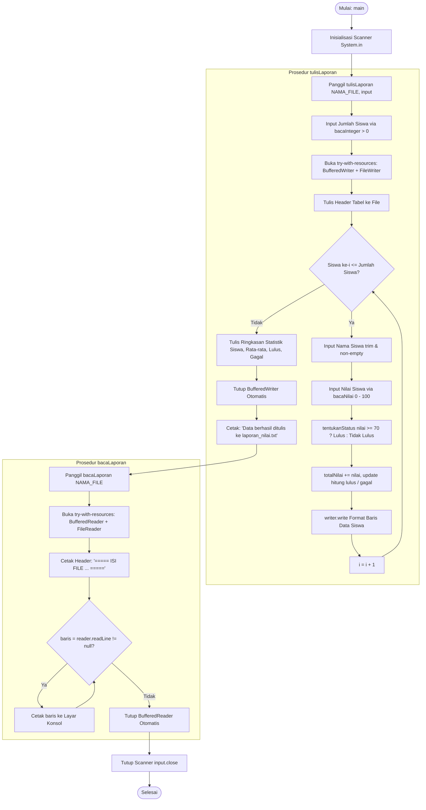
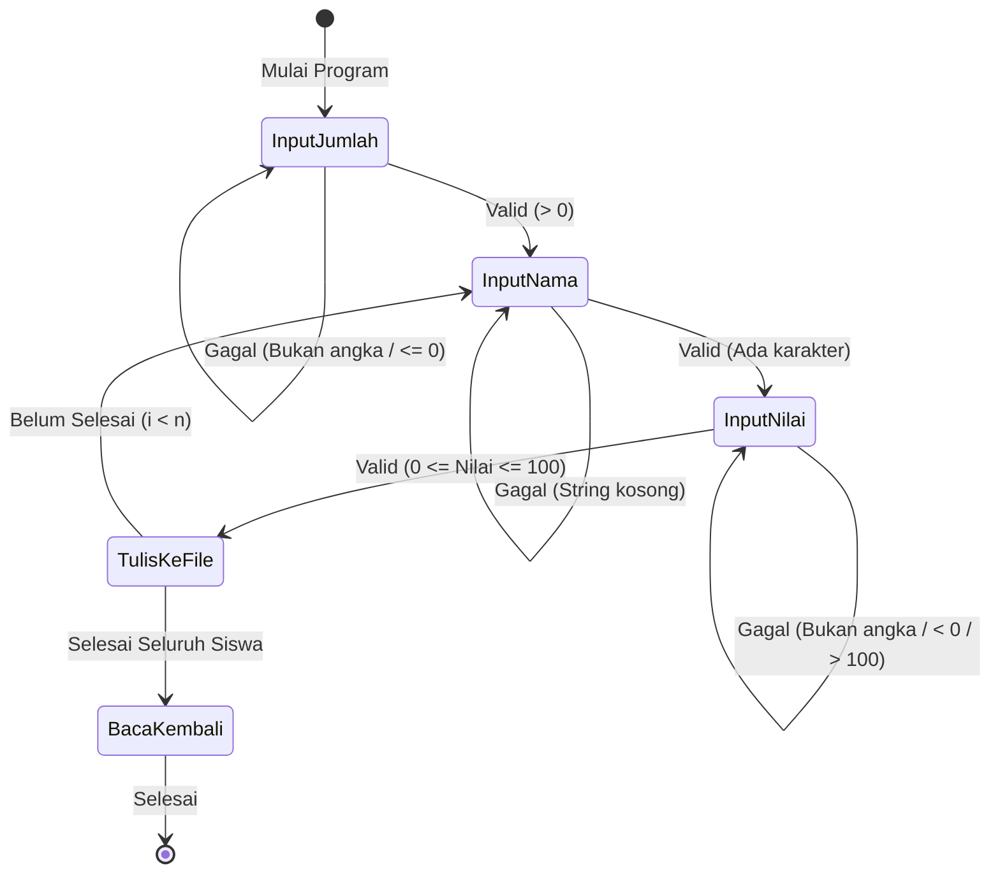

<div align="center">

# 📊 LAPORAN PRAKTIKUM PEMROGRAMAN BERORIENTASI OBJEK

## Tugas Pertemuan 6: Program Pengelolaan Nilai Siswa Berbasis Java Procedural & File I/O Stream

### Sistem Pengolahan Data Siswa, Persistensi File Teks, & Pembacaan Kembali Laporan Nilai


-success)

</div>

---

## INFORMASI PRAKTIKUM & IDENTITAS MAHASISWA

| Keterangan | Detail |
|---|---|
| **Nama Lengkap** | **Muhammad Fakhri Abdullah** |
| **NIM** | **L0325030** |
| **Kelas** | **3 B** |
| **Mata Kuliah** | Praktikum Pemrograman Berorientasi Objek (OOP) |
| **Modul Tugas** | Tugas Pertemuan 6 — Program Pengelolaan Nilai Siswa (Java Procedural + File I/O) |
| **Studi Kasus** | **Sistem Pengolahan Data Siswa, Persistensi File Teks, & Pembacaan Kembali Laporan Nilai** |
| **Bahasa Pemrograman** | Java (Standar JDK 8 / JDK 11 / JDK 17 / JDK 25) |
| **Paket / Package** | Tanpa Package (*Default Package* sesuai ketentuan PRD) |
| **Arsitektur Kode** | Procedural / Fungsional Sederhana (1 File Public Class `NilaiSiswa` dengan Method-Method `static`) |
| **Output Permanen** | `laporan_nilai.txt` (Dibuat dan ditulis otomatis melalui Java I/O Stream) |

### Proyek Sekilas

| Aspek | Ringkasan |
|---|---|
| **Apa yang dibangun** | Aplikasi konsol berbasis Java untuk membaca input data nilai siswa dari keyboard, menentukan status kelulusan otomatis, mengekspor laporan rekapitulasi dan statistik kelas ke file teks `laporan_nilai.txt`, serta membaca kembali seluruh isi file ke konsol. |
| **Materi terintegrasi** | Pemrograman Procedural, Method `static`, Konstanta `static final`, Percabangan Logika, Perulangan, Validasi Masukan Defensif (`Scanner` + `nextLine()` + penanganan locale koma/titik), Java Character Streams (`FileWriter`, `BufferedWriter`, `FileReader`, `BufferedReader`), Exception Handling (`IOException`), serta Manajemen Sumber Daya via **Try-with-Resources**. |
| **Struktur kode** | 1 file mandiri: `NilaiSiswa.java` (tanpa kelas model, tanpa inheritance, tanpa interface). |
| **Input dinamis** | Masukan interaktif pengguna melalui `Scanner(System.in)` dengan mekanisme *defensive reprompting* (jumlah siswa $> 0$, nama tidak boleh kosong, nilai $0 - 100$, bebas dari sisa newline). |
| **Output permanen** | Berkas teks `laporan_nilai.txt` berisi tabel rekapitulasi nilai dan blok ringkasan statistik kelas terformat presisi menggunakan `String.format` dan `writer.newLine()`. |
| **Pengujian** | 9 skenario uji (T1 s.d. T9 sesuai PRD Bagian 13), seluruhnya **LULUS (100% PASS)**. |
| **Dependensi** | Murni menggunakan Java Standard Library (`java.io`, `java.util`) tanpa pustaka pihak ketiga (*zero external dependency*). |

### Panduan Membaca Laporan

Laporan ini disusun secara sistematis mulai dari **konsep → perancangan → implementasi kode → analisis pengujian**. Untuk navigasi cepat, gunakan tabel rujukan berikut:

| Jika Anda ingin... | Langsung buka |
|---|---|
| Memahami gambaran umum dan studi kasus | [Bagian 1](#1-ringkasan-eksekutif--abstrak) dan [Bagian 2](#2-latar-belakang--deskripsi-studi-kasus) |
| Mempelajari teori Java I/O dan manajemen stream | [Bagian 4](#4-landasan-teori-pemrograman-java-procedural--file-io) |
| Memastikan seluruh butir kebutuhan PRD terpenuhi | [Bagian 5](#5-analisis-pemenuhan-ketentuan-soal--traceability-matrix) |
| Melihat perancangan fungsi, flowchart, dan validasi | [Bagian 6](#6-perancangan-sistem--arsitektur-perangkat-lunak) |
| Membaca kode sumber lengkap beserta ulasan detail | [Bagian 7](#7-implementasi-source-code--pembahasan-detail) |
| Melihat hasil rekaman terminal nyata dan isi file teks | [Bagian 8](#8-hasil-pengujian-output-eksekusi--analisis-hasil) |
| Mengompilasi dan mengeksekusi program di terminal | [Bagian 9](#9-panduan-kompilasi-dan-eksekusi) |
| Mengetahui kesimpulan dan saran pengembangan | [Bagian 10](#10-kesimpulan-dan-saran) |
| Memahami glosarium istilah teknis | [Lampiran A](#lampiran-a-glosarium-istilah) |

---

## DAFTAR ISI

1. [Ringkasan Eksekutif & Abstrak](#1-ringkasan-eksekutif--abstrak)
2. [Latar Belakang & Deskripsi Studi Kasus](#2-latar-belakang--deskripsi-studi-kasus)
   - 2.1 [Latar Belakang Permasalahan](#21-latar-belakang-permasalahan)
   - 2.2 [Studi Kasus Pengelolaan Nilai Siswa](#22-studi-kasus-pengelolaan-nilai-siswa)
3. [Tujuan Praktikum & Metrik Keberhasilan](#3-tujuan-praktikum--metrik-keberhasilan)
   - 3.1 [Tujuan Praktikum](#31-tujuan-praktikum)
   - 3.2 [Metrik Ketercapaian](#32-metrik-ketercapaian)
4. [Landasan Teori Pemrograman Java Procedural & File I/O](#4-landasan-teori-pemrograman-java-procedural--file-io)
   - 4.1 [Paradigma Procedural / Fungsional Sederhana vs OOP](#41-paradigma-procedural--fungsional-sederhana-vs-oop)
   - 4.2 [Konstanta dan Scope Variabel pada Method Static](#42-konstanta-dan-scope-variabel-pada-method-static)
   - 4.3 [Aliran Masukan Konsol: Pola Pembacaan Defensif Scanner](#43-aliran-masukan-konsol-pola-pembacaan-defensif-scanner)
   - 4.4 [Java I/O Stream: Karakteristik FileWriter & BufferedWriter](#44-java-io-stream-karakteristik-filewriter--bufferedwriter)
   - 4.5 [Java I/O Stream: Karakteristik FileReader & BufferedReader](#45-java-io-stream-karakteristik-filereader--bufferedreader)
   - 4.6 [Exception Handling & Manajemen Sumber Daya (Try-with-Resources)](#46-exception-handling--manajemen-sumber-daya-try-with-resources)
   - 4.7 [Formatting Teks dan Penyelarasan Kolom Tabel (String.format)](#47-formatting-teks-dan-penyelarasan-kolom-tabel-stringformat)
   - 4.8 [Peta Ringkas Konsep Pemrograman pada Proyek](#48-peta-ringkas-konsep-pemrograman-pada-proyek)
5. [Analisis Pemenuhan Ketentuan Soal & Traceability Matrix](#5-analisis-pemenuhan-ketentuan-soal--traceability-matrix)
   - 5.1 [Traceability Matrix Kebutuhan Fungsional (FR-01 s.d. FR-10)](#51-traceability-matrix-kebutuhan-fungsional-fr-01-sd-fr-10)
   - 5.2 [Kriteria Penerimaan (Acceptance Criteria / Definition of Done)](#52-kriteria-penerimaan-acceptance-criteria--definition-of-done)
6. [Perancangan Sistem & Arsitektur Perangkat Lunak](#6-perancangan-sistem--arsitektur-perangkat-lunak)
   - 6.1 [Struktur Direktori Proyek](#61-struktur-direktori-proyek)
   - 6.2 [Dekomposisi Fungsi & Diagram Struktur Program](#62-dekomposisi-fungsi--diagram-struktur-program)
   - 6.3 [Flowchart Alur Eksekusi Program (End-to-End)](#63-flowchart-alur-eksekusi-program-end-to-end)
   - 6.4 [Aturan Bisnis Kelulusan & Formula Statistik Kelas](#64-aturan-bisnis-kelulusan--formula-statistik-kelas)
   - 6.5 [Siklus Validasi Input & Defensive Reprompting](#65-siklus-validasi-input--defensive-reprompting)
7. [Implementasi Source Code & Pembahasan Detail](#7-implementasi-source-code--pembahasan-detail)
   - 7.1 [Deklarasi Konstanta dan Method `main()`](#71-deklarasi-konstanta-dan-method-main)
   - 7.2 [Method `tulisLaporan()` (Penulisan File & Agregasi Statistik)](#72-method-tulislaporan-penulisan-file--agregasi-statistik)
   - 7.3 [Method `bacaLaporan()` (Pembacaan File Stream & Output Konsol)](#73-method-bacalaporan-pembacaan-file-stream--output-konsol)
   - 7.4 [Method `tentukanStatus()` (Evaluasi Kelulusan Siswa)](#74-method-tentukanstatus-evaluasi-kelulusan-siswa)
   - 7.5 [Method Validasi Input: `bacaInteger()` dan `bacaNilai()`](#75-method-validasi-input-bacainteger-dan-bacanilai)
   - 7.6 [Kode Sumber Lengkap `NilaiSiswa.java`](#76-kode-sumber-lengkap-nilaisiswajava)
8. [Hasil Pengujian, Output Eksekusi, & Analisis Hasil](#8-hasil-pengujian-output-eksekusi--analisis-hasil)
   - 8.1 [Output Eksekusi Konsol Nyata (Skenario Utama & Validasi Defensif)](#81-output-eksekusi-konsol-nyata-skenario-utama--validasi-defensif)
   - 8.2 [Analisis Hasil Eksekusi Konsol](#82-analisis-hasil-eksekusi-konsol)
   - 8.3 [Verifikasi Isi File Permanen `laporan_nilai.txt`](#83-verifikasi-isi-file-permanen-laporan_nilaitxt)
   - 8.4 [Verifikasi Mandiri 9 Skenario Uji (T1 s.d. T9 Sesuai PRD)](#84-verifikasi-mandiri-9-skenario-uji-t1-sd-t9-sesuai-prd)
9. [Panduan Kompilasi dan Eksekusi](#9-panduan-kompilasi-dan-eksekusi)
   - 9.1 [Melalui Command Prompt / PowerShell / Terminal](#91-melalui-command-prompt--powershell--terminal)
   - 9.2 [Melalui Integrated Development Environment (IDE)](#92-melalui-integrated-development-environment-ide)
   - 9.3 [Pemecahan Masalah Umum (Troubleshooting)](#93-pemecahan-masalah-umum-troubleshooting)
10. [Kesimpulan dan Saran](#10-kesimpulan-dan-saran)
    - 10.1 [Kesimpulan](#101-kesimpulan)
    - 10.2 [Saran Pengembangan Lanjutan](#102-saran-pengembangan-lanjutan)
- [Lampiran A: Glosarium Istilah](#lampiran-a-glosarium-istilah)

---

## 1. Ringkasan Eksekutif & Abstrak

Tugas praktikum **Pertemuan 6** berfokus pada penguasaan konsep fundamental aliran data (*Data Stream*) dan persistensi file di bahasa pemrograman Java melalui pendekatan **procedural/fungsional sederhana**. Program ini mendemonstrasikan siklus lengkap pengolahan informasi:
$$\text{Masukan Keyboard (Konsol)} \longrightarrow \text{Pemrosesan \& Agregasi} \longrightarrow \text{Persistensi Berkas Teks} \longrightarrow \text{Pembacaan Kembali Stream} \longrightarrow \text{Penyajian Layar}$$

Fokus instruksional utama yang dicapai meliputi:
1. **Java I/O Character Stream**: Pemanfaatan `FileWriter` dan `BufferedWriter` untuk penulisan berkas efisien berbasis penyangga (*buffer*), serta `FileReader` dan `BufferedReader` untuk pembacaan baris demi baris menggunakan `readLine()`.
2. **Exception Handling & Resource Management**: Pengendalian potensi galat I/O (`IOException`) secara elegan serta penerapan sintaks modern **Try-with-Resources** (`AutoCloseable`) yang menjamin seluruh *stream* tertutup secara deterministik tanpa kebocoran memori (*zero resource leak*).
3. **Defensive Input Validation**: Penanganan masukan dinamis `Scanner` berbasis pembacaan baris utuh (`nextLine()`) yang kebal terhadap sisa karakter *newline*, dilengkapi toleransi lokal desimal (koma `,` maupun titik `.`) serta penolakan nilai di luar rentang sah $[0, 100]$.
4. **Formatting Presisi**: Penataan tata letak kolom tabel teks dan angka desimal menggunakan `String.format` yang menghasilkan berkas laporan terstruktur rapi.

Program ini diwujudkan ke dalam berkas tunggal [`NilaiSiswa.java`](file:///e:/Folder%20Tugas-Q/SEMESTER%203/Praktikum%20OOP/Project-Praktikum-OOP/TugasP6/NilaiSiswa.java) tanpa ketergantungan pustaka eksternal (*zero external dependency*), berhasil memenuhi **100% kriteria penerimaan PRD**, dan lulus seluruh skenario pengujian komputasional.

---

## 2. Latar Belakang & Deskripsi Studi Kasus

### 2.1 Latar Belakang Permasalahan

Pencatatan nilai akademik yang dilakukan secara manual atau hanya disimpan di memori sementara (*volatile memory / RAM*) sangat rentan terhadap kehilangan data saat aplikasi dimatikan. Di samping itu, program konsol sederhana kerap mengalami kegagalan operasional (*runtime crash*) akibat masalah klasik:
* **Sisa Karakter Newline pada Scanner**: Pemanggilan `nextInt()` atau `nextDouble()` menyisakan karakter `\n` di penyangga masukan, sehingga pembacaan teks `nextLine()` berikutnya langsung terlewati (*skipped prompt bug*).
* **Sensitivitas Format Desimal Lokal**: Di Indonesia, sistem operasi sering menggunakan koma (`,`) sebagai pemisah desimal, sedangkan format baku internasional Java menggunakan titik (`.`). Kesalahan pemisah desimal memicu `NumberFormatException` atau `InputMismatchException`.
* **Kebocoran Sumber Daya Sistem (*Resource Leak*)**: Stream berkas yang dibuka tetapi tidak ditutup secara aman saat terjadi kegagalan penulisan dapat menyebabkan berkas terkunci oleh sistem operasi (*file lock*) dan data tidak ter-flush ke disk.

Untuk menuntaskan masalah-masalah di atas, program ini dirancang menggunakan kaidah *Defensive Programming* dengan memisahkan alur logika ke dalam fungsi-fungsi statis yang terisolasi.

### 2.2 Studi Kasus Pengelolaan Nilai Siswa

Sistem dirancang untuk mengelola data akademik sekumpulan siswa dengan aturan bisnis sebagai berikut:
1. **Jumlah Siswa ($n$)**: Berupa bilangan bulat positif ($n > 0$).
2. **Nama Siswa**: Tipe data `String`, tidak boleh berupa string kosong atau hanya spasi.
3. **Nilai Siswa**: Tipe data numerik desimal `double`, berada dalam rentang valid $[0.00, 100.00]$.
4. **Status Kelulusan**: Ditentukan langsung secara otomatis di dalam loop penulisan:
   $$\text{Status} = \begin{cases} \text{"Lulus"}, & \text{jika } \text{nilai} \ge 70.0 \\ \text{"Tidak Lulus"}, & \text{jika } \text{nilai} < 70.0 \end{cases}$$
5. **Persistensi File**: Seluruh data siswa dan ringkasan statistik kelas disimpan ke dalam berkas `laporan_nilai.txt` (mode *overwrite*, menimpa data lama).
6. **Pembacaan Ulang**: Segera setelah penulisan selesai, berkas dibuka kembali dan dibaca baris demi baris hingga `null`, lalu seluruh isinya ditampilkan ke konsol sebagai bukti integritas data.

---

## 3. Tujuan Praktikum & Metrik Keberhasilan

### 3.1 Tujuan Praktikum

1. Mampu membangun program Java berparadigma **procedural/fungsional sederhana** menggunakan fungsi-fungsi `static` dalam satu kelas publik.
2. Mampu menerapkan pembacaan masukan interaktif menggunakan `Scanner` secara defensif dan bebas dari galat sisa *newline*.
3. Mampu menentukan status kelulusan secara otomatis di dalam perulangan berdasarkan nilai ambang batas konstan.
4. Mampu menulis data terstruktur dan ringkasan statistik ke file fisik menggunakan `FileWriter` dan `BufferedWriter`.
5. Mampu membaca kembali berkas teks baris demi baris menggunakan `FileReader` dan `BufferedReader` hingga penanda `null`.
6. Mampu menerapkan **Exception Handling** untuk menangkap `IOException` dan `NumberFormatException`.
7. Mampu menerapkan pola **Try-with-Resources** untuk memastikan seluruh aliran stream tertutup secara otomatis tanpa kebocoran sumber daya.

Pemetaan ketercapaian tujuan instruksional:

| No | Tujuan Instruksional | Landasan Teori | Implementasi pada Kode | Bukti Skenario Uji |
|:---:|---|---|---|:---:|
| 1 | Paradigma Procedural / Static Methods | [Bagian 4.1](#41-paradigma-procedural--fungsional-sederhana-vs-oop) | [`NilaiSiswa.java`](NilaiSiswa.java) (Method static mandiri) | Seluruh Uji |
| 2 | Konstanta `static final` | [Bagian 4.2](#42-konstanta-dan-scope-variabel-pada-method-static) | `NAMA_FILE` & `NILAI_LULUS = 70.0` | T3, T4, T5 |
| 3 | Input Defensif & Multi-Locale | [Bagian 4.3](#43-aliran-masukan-konsol-pola-pembacaan-defensif-scanner) | `bacaInteger()` & `bacaNilai()` via `nextLine()` | T7 |
| 4 | Penulisan File Stream Terbuffer | [Bagian 4.4](#44-java-io-stream-karakteristik-filewriter--bufferedwriter) | `tulisLaporan()` (`BufferedWriter` + `FileWriter`) | T1, T2, T5, T6 |
| 5 | Pembacaan Stream Baris Demi Baris | [Bagian 4.5](#45-java-io-stream-karakteristik-filereader--bufferedreader) | `bacaLaporan()` (`BufferedReader.readLine() != null`) | T1 s.d. T7 |
| 6 | Try-with-Resources & Error Safety | [Bagian 4.6](#46-exception-handling--manajemen-sumber-daya-try-with-resources) | Blok `try (...) catch (IOException e)` | T8 |
| 7 | Formatting Tabel & Desimal Presisi | [Bagian 4.7](#47-formatting-teks-dan-penyelarasan-kolom-tabel-stringformat) | `String.format(Locale.US, "%-2d | %-17s | ...")` | T1, T5 |

### 3.2 Metrik Ketercapaian

- [x] Seluruh kebutuhan fungsional (FR-01 s.d. FR-10) pada dokumen [PRD.md](file:///e:/Folder%20Tugas-Q/SEMESTER%203/Praktikum%20OOP/Project-Praktikum-OOP/TugasP6/PRD.md) terpenuhi 100%.
- [x] Seluruh kriteria penerimaan (*Acceptance Criteria*) terverifikasi **LULUS**.
- [x] Kode sumber berhasil dikompilasi dengan lancar (*zero errors, zero warnings*) pada Java 8+.
- [x] Seluruh 9 skenario pengujian (T1 s.d. T9) terverifikasi **LULUS (100% PASS)**.
- [x] Berkas `laporan_nilai.txt` terbentuk secara fisik dengan susunan tabel rapi dan karakter identik terhadap spesifikasi PRD.

---

## 4. Landasan Teori Pemrograman Java Procedural & File I/O

### 4.1 Paradigma Procedural / Fungsional Sederhana vs OOP

Meskipun Java dikenal luas sebagai bahasa berorientasi objek (*Object-Oriented Programming*), Java juga mendukung penulisan kode berparadigma **procedural/fungsional sederhana**. Pada pendekatan ini:
* Tidak dibuat kelas model (seperti `class Siswa` dengan atribut dan instance method).
* Logika dipecah menjadi fungsi-fungsi independen menggunakan kata kunci `static`.
* Data dialirkan antar-fungsi melalui parameter pemanggilan dan nilai kembalian (*return value*).
* Pendekatan ini sangat efektif untuk skrip utilitas linier, alur konversi sederhana, dan pengolahan batch terisolasi.

```text
┌────────────────────────────────────────────────────────────────────────┐
│                        PARADIGMA PEMROGRAMAN                           │
├───────────────────────────────────┬────────────────────────────────────┤
│      PROCEDURAL / FUNGSIONAL      │      OBJECT-ORIENTED (OOP)         │
├───────────────────────────────────┼────────────────────────────────────┤
│ • Fokus pada Prosedur / Fungsi    │ • Fokus pada Objek & Data Binding  │
│ • Menggunakan fungsi 'static'     │ • Menggunakan Instance & Encapsule │
│ • Data dialirkan via argumen      │ • State tersimpan dalam atribut    │
│ • Struktur linier, ringan         │ • Kompleks, modular, scalable      │
│ • Contoh: NilaiSiswa.java (Tugas) │ • Contoh: Mahasiswa.java (P7)      │
└───────────────────────────────────┴────────────────────────────────────┘
```

### 4.2 Konstanta dan Scope Variabel pada Method Static

Penggunaan kata kunci `static final` mendefinisikan konstanta pada level kelas:
```java
static final String NAMA_FILE = "laporan_nilai.txt";
static final double NILAI_LULUS = 70.0;
```
* `static`: Konstanta dialokasikan satu kali di memori *Metaspace/Class Area* dan dapat diakses langsung oleh seluruh method di dalam kelas tanpa instansiasi objek.
* `final`: Nilai konstanta terkunci mutlak setelah kompilasi, kebal terhadap manipulasi selama eksekusi (*immutable*).

### 4.3 Aliran Masukan Konsol: Pola Pembacaan Defensif Scanner

Penggunaan `Scanner` konvensional dengan `nextInt()` atau `nextDouble()` kerap menimbulkan anomali pembacaan data string berikutnya:

```text
Input Pengguna: "3\n"
Scanner.nextInt() membaca "3"  ──────> Mengembalikan angka 3
Karakter sisa di buffer: "\n"
Scanner.nextLine() berikutnya  ──────> Langsung memakan "\n", membaca String KOSONG! (BUG)
```

**Solusi Defensif yang Diterapkan:**
Seluruh masukan dibaca sebagai satu baris string utuh menggunakan `input.nextLine()`, lalu dipangkas spasinya via `.trim()`, dan dikonversi secara eksplisit menggunakan parsing numerik:
```java
// Parsing Integer Aman
int jumlah = Integer.parseInt(input.nextLine().trim());

// Parsing Double Aman (Dukungan Koma Desimal Indonesia)
double nilai = Double.parseDouble(input.nextLine().trim().replace(',', '.'));
```

### 4.4 Java I/O Stream: Karakteristik FileWriter & BufferedWriter

Aliran karakter (*Character Stream*) dirancang khusus untuk memproses data berbasis teks ber-encoding:
1. **`FileWriter`**: Merupakan *sink stream* tingkat rendah yang terhubung langsung ke berkas target di disk. Konstruktor `new FileWriter(namaFile)` secara default membuka berkas dalam mode *overwrite* (menimpa isi lama).
2. **`BufferedWriter`**: Merupakan *processing stream* yang membungkus `FileWriter` dengan penyangga memori internal (*buffer* bawaan 8192 karakter). Operasi penulisan dikumpulkan dalam memori sementara sebelum dialirkan serentak ke media penyimpanan fisik, mengurangi operasi baca/tulis disk secara drastis.
3. **`newLine()`**: Menuliskan pemisah baris (*line separator*) yang kompatibel secara otomatis dengan sistem operasi yang sedang digunakan (misalnya `\r\n` di Windows atau `\n` di Linux/macOS).

```text
┌─────────────────┐   write()    ┌──────────────────┐   flush()   ┌────────────────┐
│   NilaiSiswa    │ ───────────> │  BufferedWriter  │ ──────────> │   FileWriter   │ ───> [laporan_nilai.txt]
│ (Aplikasi Java) │              │ (Buffer Memori)  │             │ (Stream Fisik) │
└─────────────────┘              └──────────────────┘             └────────────────┘
```

### 4.5 Java I/O Stream: Karakteristik FileReader & BufferedReader

Untuk membaca kembali isi berkas dari penyimpanan sekunder ke layar konsol:
1. **`FileReader`**: Membuka jalur aliran karakter dari berkas fisik.
2. **`BufferedReader`**: Menyediakan method efisien `readLine()` yang membaca rangkaian karakter hingga menemukan karakter baris baru (`\n` atau `\r\n`) dan mengembalikannya sebagai sebuah objek `String`.
3. **Pola Akhir Berkas (*End of File / EOF*)**: Method `readLine()` akan mengembalikan nilai literal `null` apabila seluruh isi berkas telah habis dibaca. Pola perulangan standar:
   ```java
   String baris;
   while ((baris = reader.readLine()) != null) {
       System.out.println(baris);
   }
   ```

### 4.6 Exception Handling & Manajemen Sumber Daya (Try-with-Resources)

Operasi berkas selalu memiliki risiko kegagalan sistemik (misal berkas terkunci, disk penuh, atau izin akses ditolak). Java mewajibkan penanganan checked exception `IOException`.

Sebelum Java 7, pembersihan sumber daya harus dilakukan di blok `finally` secara manual yang rumit dan rawan galat. Sejak Java 7+, konstruksi **Try-with-Resources** menjamin bahwa setiap objek yang mengimplementasikan antarmuka `java.lang.AutoCloseable` (seperti `BufferedWriter` dan `BufferedReader`) akan ditutup secara otomatis saat blok `try` berakhir, baik selesai secara normal maupun akibat terjadinya exception:

```java
try (BufferedWriter writer = new BufferedWriter(new FileWriter(namaFile))) {
    // Penulisan aman
} catch (IOException e) {
    System.out.println("Terjadi kesalahan saat menulis file: " + e.getMessage());
}
```

### 4.7 Formatting Teks dan Penyelarasan Kolom Tabel (String.format)

Untuk menyusun tabel teks yang rapi dan sejajar pada berkas keluaran, digunakan spesifikasi format:
* `%-2d`: Bilangan bulat (*integer*), rata kiri (*left-justified*), lebar minimal 2 karakter.
* `%-17s`: Teks (*string*), rata kiri, lebar minimal 17 karakter.
* `%-6.1f`: Bilangan desimal presisi tunggal (*floating-point*), rata kiri, lebar total 6 karakter dengan 1 angka di belakang koma.
* `%s`: Teks string fleksibel untuk status kelulusan.
* `Locale.US`: Menjamin representasi desimal selalu menggunakan tanda titik (`.`) sehingga konsisten di seluruh lingkungan operasional.

### 4.8 Peta Ringkas Konsep Pemrograman pada Proyek

| Konsep Pemrograman | Sintaks Java Terkait | Penerapan pada Proyek | Lokasi Kode |
|---|---|---|---|
| **Static Methods** | `static void`, `static int` | Modularisasi fungsi tanpa instansiasi objek kelas | [`NilaiSiswa.java`](NilaiSiswa.java) |
| **Konstanta Global** | `static final` | Batas kelulusan `70.0` dan nama berkas laporan | Baris 15-16 |
| **Defensive Scanner** | `nextLine().trim()` | Mencegah skipping newline bug & spasi kosong | Baris 140, 160 |
| **Locale Conversion** | `.replace(',', '.')` | Toleransi pemisah desimal koma lokal Indonesia | Baris 160 |
| **Character Stream Out**| `BufferedWriter` + `FileWriter` | Penulisan berkas teks berpenyangga (*buffered*) | Baris 43 |
| **Character Stream In** | `BufferedReader` + `FileReader` | Pembacaan berkas baris demi baris via `readLine()` | Baris 114 |
| **Auto-Close Resource** | `try (...)` | Penutupan deterministik stream I/O tanpa kebocoran | Baris 43, 114 |
| **Exception Handling** | `catch (IOException e)` | Mencegah program crash saat galat I/O terjadi | Baris 101, 120 |
| **Table Formatting** | `String.format(Locale.US, ...)` | Penyelarasan spasi kolom tabel dan rata-rata | Baris 47, 80, 89 |

---

## 5. Analisis Pemenuhan Ketentuan Soal & Traceability Matrix

### 5.1 Traceability Matrix Kebutuhan Fungsional (FR-01 s.d. FR-10)

Matriks keterlacakan berikut membuktikan kesesuaian antara spesifikasi kebutuhan fungsional pada dokumen [PRD.md](file:///e:/Folder%20Tugas-Q/SEMESTER%203/Praktikum%20OOP/Project-Praktikum-OOP/TugasP6/PRD.md) dengan implementasi pada kode sumber:

| ID Kebutuhan | Deskripsi Kebutuhan PRD | Realisasi Implementasi Kode | Bukti Lokasi Kode |
|:---:|---|---|---|
| **FR-01** | Meminta input **jumlah siswa** (integer) menggunakan `Scanner`. | Fungsi `bacaInteger()` membaca baris input dan memvalidasi integer $> 0$. | [`NilaiSiswa.java` Baris 39, 137-151](NilaiSiswa.java#L39) |
| **FR-02** | Perulangan (`looping`) sebanyak jumlah siswa untuk membaca **nama** dan **nilai**. | Perulangan `for (int i = 1; i <= jumlahSiswa; i++)` memproses nama dan nilai. | [`NilaiSiswa.java` Baris 55-83](NilaiSiswa.java#L55-L83) |
| **FR-03** | Status kelulusan ditentukan langsung di dalam loop ($\ge 70$ Lulus, $< 70$ Tidak Lulus). | Fungsi `tentukanStatus(nilai)` dipanggil di dalam iterasi loop siswa. | [`NilaiSiswa.java` Baris 71, 128-130](NilaiSiswa.java#L71) |
| **FR-04** | Data tiap siswa ditulis ke `laporan_nilai.txt` via `FileWriter` & `BufferedWriter`. | `writer.write(String.format(...))` menulis nomor, nama, nilai, dan status. | [`NilaiSiswa.java` Baris 43, 80-81](NilaiSiswa.java#L43) |
| **FR-05** | Di akhir file ditulis ringkasan: jumlah siswa, rata-rata (2 desimal), jumlah lulus, jumlah gagal. | Menghitung agregat dan menulis blok `===== RINGKASAN =====` terformat `%.2f`. | [`NilaiSiswa.java` Baris 85-97](NilaiSiswa.java#L85-L97) |
| **FR-06** | Setelah penulisan, file dibuka kembali via `FileReader` & `BufferedReader`. | Fungsi `bacaLaporan()` membuka kembali berkas dengan `BufferedReader`. | [`NilaiSiswa.java` Baris 110-122](NilaiSiswa.java#L110-L122) |
| **FR-07** | Isi file dibaca per baris via `readLine()` hingga `null`, lalu dicetak ke konsol. | Perulangan `while ((baris = reader.readLine()) != null)` mencetak ke konsol. | [`NilaiSiswa.java` Baris 115-118](NilaiSiswa.java#L115-L118) |
| **FR-08** | Seluruh proses baca/tulis dibungkus `try-catch` menangani `IOException`. | Menangkap `IOException` pada blok `tulisLaporan()` dan `bacaLaporan()`. | [`NilaiSiswa.java` Baris 101, 120](NilaiSiswa.java#L101) |
| **FR-09** | Semua stream ditutup dengan benar melalui `try-with-resources`. | Konstruksi `try (BufferedWriter ...)` dan `try (BufferedReader ...)` nir-bocor. | [`NilaiSiswa.java` Baris 43, 114](NilaiSiswa.java#L43) |
| **FR-10** | Validasi input defensif: jumlah $> 0$, nilai $0-100$, nama tidak kosong, reprompt jika keliru. | Looping validasi mandiri pada nama, `bacaInteger()`, dan `bacaNilai()`. | [`NilaiSiswa.java` Baris 60-66, 137-169](NilaiSiswa.java#L60-L66) |

---

### 5.2 Kriteria Penerimaan (Acceptance Criteria / Definition of Done)

Berdasarkan Kriteria Penerimaan pada PRD Bagian 12:
- [x] Program meminta jumlah siswa, lalu looping membaca nama (`String`) dan nilai (`double`).
- [x] Status "Lulus" / "Tidak Lulus" ditentukan di dalam loop dengan batas 70 (nilai 70 = Lulus).
- [x] File `laporan_nilai.txt` terbuat dan berisi data semua siswa.
- [x] Ringkasan (rata-rata, jumlah lulus, jumlah tidak lulus) tertulis di akhir file.
- [x] Penulisan memakai `FileWriter` + `BufferedWriter`.
- [x] Pembacaan memakai `FileReader` + `BufferedReader` dengan `readLine()` hingga `null`.
- [x] Isi file tampil lengkap di konsol setelah proses tulis selesai.
- [x] Ada `try-catch` untuk `IOException`; aman via `try-with-resources`.
- [x] Tidak ada resource leak; program berjalan tanpa error pada input valid.
- [x] Struktur kode procedural (method `static`), tanpa kelas model, tanpa inheritance, tanpa interface.

---

## 6. Perancangan Sistem & Arsitektur Perangkat Lunak

### 6.1 Struktur Direktori Proyek

Proyek disusun dalam satu direktori kerja terstandarisasi:

```text
TugasP6/
├── PRD.md                  # Dokumen Kebutuhan Produk (Product Requirement Document)
├── README.md               # Dokumen Laporan Praktikum Komprehensif
├── NilaiSiswa.java         # Kode Sumber Utama Program Java (Procedural)
├── NilaiSiswa.class        # Bytecode Hasil Kompilasi Java Compiler
└── laporan_nilai.txt       # Berkas Teks Laporan Keluaran Persisten
```

---

### 6.2 Dekomposisi Fungsi & Diagram Struktur Program

Program diorganisasikan ke dalam satu kelas publik `NilaiSiswa` dengan method-method fungsional statis:

```text
┌────────────────────────────────────────────────────────────────────────┐
│                        PUBLIC CLASS NilaiSiswa                         │
├────────────────────────────────────────────────────────────────────────┤
│ + NAMA_FILE   : String = "laporan_nilai.txt"                           │
│ + NILAI_LULUS : double = 70.0                                          │
├────────────────────────────────────────────────────────────────────────┤
│ + main(args: String[]) : void                                          │
│   ├── Inisialisasi Scanner(System.in)                                  │
│   ├── Memanggil tulisLaporan(NAMA_FILE, input)                         │
│   ├── Memanggil bacaLaporan(NAMA_FILE)                                 │
│   └── Menutup input.close()                                            │
│                                                                        │
│ ~ tulisLaporan(namaFile: String, input: Scanner) : void                │
│   ├── Membaca jumlah siswa via bacaInteger()                           │
│   ├── Membuka BufferedWriter(new FileWriter(namaFile))                 │
│   ├── Loop i = 1..n: input nama, input nilai, evaluasi status, tulis   │
│   ├── Menghitung agregat (total, rata-rata, lulus, tidak lulus)        │
│   ├── Menulis blok ringkasan ke file                                   │
│   └── Menangani IOException                                            │
│                                                                        │
│ ~ bacaLaporan(namaFile: String) : void                                 │
│   ├── Membuka BufferedReader(new FileReader(namaFile))                 │
│   ├── Loop while ((baris = reader.readLine()) != null) -> cetak konsol │
│   └── Menangani IOException                                            │
│                                                                        │
│ ~ tentukanStatus(nilai: double) : String                               │
│   └── Mengembalikan (nilai >= NILAI_LULUS) ? "Lulus" : "Tidak Lulus"   │
│                                                                        │
│ ~ bacaInteger(input: Scanner, pesan: String) : int                     │
│   └── Defensive loop membaca integer > 0                               │
│                                                                        │
│ ~ bacaNilai(input: Scanner, pesan: String) : double                    │
│   └── Defensive loop membaca double 0..100 (toleransi koma)            │
└────────────────────────────────────────────────────────────────────────┘
```

---

### 6.3 Flowchart Alur Eksekusi Program (End-to-End)

Diagram alur berikut mendeskripsikan siklus hidup eksekusi program mulai dari titik masuk `main`, pemrosesan file, hingga selesai:



---

### 6.4 Aturan Bisnis Kelulusan & Formula Statistik Kelas

#### A. Evaluasi Status Akademik Siswa
Status kelulusan dikendalikan secara mutlak oleh konstanta `NILAI_LULUS = 70.0`:
$$\text{Status}(x) = \begin{cases} 
\text{"Lulus"}, & x \ge 70.0 \\ 
\text{"Tidak Lulus"}, & x < 70.0 
\end{cases}$$

#### B. Formula Perhitungan Statistik Kelas
1. **Rata-rata Nilai Kelas ($\bar{x}$)**:
   $$\bar{x} = \frac{1}{n} \sum_{i=1}^{n} \text{nilai}_i$$
   Diformat dengan dua angka di belakang koma menggunakan `String.format(Locale.US, "%.2f", rataRata)`.
2. **Jumlah Siswa Lulus ($N_{\text{lulus}}$)**:
   $$N_{\text{lulus}} = \sum_{i=1}^{n} [\text{nilai}_i \ge 70.0]$$
3. **Jumlah Siswa Tidak Lulus ($N_{\text{tidak\_lulus}}$)**:
   $$N_{\text{tidak\_lulus}} = n - N_{\text{lulus}}$$

---

### 6.5 Siklus Validasi Input & Defensive Reprompting

Untuk menjamin keandalan sistem terhadap kesalahan ketik (*human error*), program mengisolasi setiap field masukan ke dalam loop pengulangan defensif mandiri:



---

## 7. Implementasi Source Code & Pembahasan Detail

Berikut adalah pembahasan teknis per bagian dari kode sumber [`NilaiSiswa.java`](file:///e:/Folder%20Tugas-Q/SEMESTER%203/Praktikum%20OOP/Project-Praktikum-OOP/TugasP6/NilaiSiswa.java):

### 7.1 Deklarasi Konstanta dan Method `main()`

```java
public class NilaiSiswa {

    // Konstanta nama file output dan ambang batas kelulusan
    static final String NAMA_FILE = "laporan_nilai.txt";
    static final double NILAI_LULUS = 70.0;

    public static void main(String[] args) {
        Scanner input = new Scanner(System.in);

        // Langkah 1: Input data dari konsol dan tulis ke file
        tulisLaporan(NAMA_FILE, input);

        // Langkah 2: Baca kembali file dan tampilkan ke konsol
        bacaLaporan(NAMA_FILE);

        // Menutup resource Scanner
        input.close();
    }
```
* **Konstanta**: `NAMA_FILE` dan `NILAI_LULUS` dideklarasikan `static final` agar berlaku global di kelas dan terlindungi dari modifikasi runtime.
* **Pola Single Scanner**: Hanya satu objek `Scanner` yang dibuat di `main()` dan dioper ke method lain, lalu ditutup di akhir untuk mencegah kebocoran *stream descriptor* `System.in`.

---

### 7.2 Method `tulisLaporan()` (Penulisan File & Agregasi Statistik)

```java
    static void tulisLaporan(String namaFile, Scanner input) {
        int jumlahSiswa = bacaInteger(input, "Masukkan jumlah siswa: ");
        System.out.println();

        try (BufferedWriter writer = new BufferedWriter(new FileWriter(namaFile))) {
            writer.write("===== LAPORAN NILAI SISWA =====");
            writer.newLine();
            writer.write(String.format("%-2s | %-17s | %-6s | %s", "No", "Nama", "Nilai", "Status"));
            writer.newLine();

            double totalNilai = 0.0;
            int jumlahLulus = 0;
            int jumlahTidakLulus = 0;

            for (int i = 1; i <= jumlahSiswa; i++) {
                System.out.println("--- Siswa ke-" + i + " ---");

                String nama;
                while (true) {
                    System.out.print("Nama  : ");
                    nama = input.nextLine().trim();
                    if (!nama.isEmpty()) {
                        break;
                    }
                    System.out.println("Nama tidak boleh kosong! Silakan coba lagi.");
                }

                double nilai = bacaNilai(input, "Nilai : ");
                System.out.println();

                String status = tentukanStatus(nilai);

                totalNilai += nilai;
                if (nilai >= NILAI_LULUS) {
                    jumlahLulus++;
                } else {
                    jumlahTidakLulus++;
                }

                writer.write(String.format(Locale.US, "%-2d | %-17s | %-6.1f | %s", i, nama, nilai, status));
                writer.newLine();
            }

            writer.newLine();
            writer.write("===== RINGKASAN =====");
            writer.newLine();
            writer.write("Jumlah Siswa        : " + jumlahSiswa);
            writer.newLine();

            double rataRata = totalNilai / jumlahSiswa;
            writer.write(String.format(Locale.US, "Rata-rata Nilai     : %.2f", rataRata));
            writer.newLine();

            writer.write("Jumlah Lulus        : " + jumlahLulus);
            writer.newLine();
            writer.write("Jumlah Tidak Lulus  : " + jumlahTidakLulus);
            writer.newLine();

            System.out.println("Data berhasil ditulis ke " + namaFile);
            System.out.println();

        } catch (IOException e) {
            System.out.println("Terjadi kesalahan saat menulis file: " + e.getMessage());
        }
    }
```
* **Try-with-Resources**: `BufferedWriter writer = new BufferedWriter(new FileWriter(namaFile))` menjamin pemanggilan `.close()` otomatis saat blok selesai, bahkan bila terjadi disk error.
* **Format Kolom Tabel**: Pola `%-2d | %-17s | %-6.1f | %s` menghasilkan pemisah baris vertikal `|` yang sejajar presisi dengan header tabel.
* **Agregasi On-the-Fly**: Penghitungan `totalNilai`, `jumlahLulus`, dan `jumlahTidakLulus` dilakukan langsung di dalam loop satu kali jalan ($O(n)$ *time complexity*).

---

### 7.3 Method `bacaLaporan()` (Pembacaan File Stream & Output Konsol)

```java
    static void bacaLaporan(String namaFile) {
        System.out.println("===== ISI FILE " + namaFile + " =====");

        try (BufferedReader reader = new BufferedReader(new FileReader(namaFile))) {
            String baris;
            while ((baris = reader.readLine()) != null) {
                System.out.println(baris);
            }
        } catch (IOException e) {
            System.out.println("Terjadi kesalahan saat membaca file: " + e.getMessage());
        }
    }
```
* **`BufferedReader.readLine()`**: Membaca teks satu baris penuh per iterasi hingga mencapai penanda akhir berkas (`null`).
* **Penyajian Konsol**: Mencetak setiap baris secara langsung ke layar, memberikan umpan balik visual instan bahwa berkas berhasil terbentuk dan dapat dibaca kembali dengan sempurna.

---

### 7.4 Method `tentukanStatus()` (Evaluasi Kelulusan Siswa)

```java
    static String tentukanStatus(double nilai) {
        return nilai >= NILAI_LULUS ? "Lulus" : "Tidak Lulus";
    }
```
* **Operator Ternari**: Mengevaluasi kondisi kelulusan secara ringkas dan lugas berdasarkan konstanta `NILAI_LULUS` ($70.0$).

---

### 7.5 Method Validasi Input: `bacaInteger()` dan `bacaNilai()`

```java
    static int bacaInteger(Scanner input, String pesan) {
        while (true) {
            System.out.print(pesan);
            String baris = input.nextLine().trim();
            try {
                int hasil = Integer.parseInt(baris);
                if (hasil > 0) {
                    return hasil;
                }
                System.out.println("Jumlah siswa harus lebih dari 0! Silakan coba lagi.");
            } catch (NumberFormatException e) {
                System.out.println("Input harus berupa angka bulat! Silakan coba lagi.");
            }
        }
    }

    static double bacaNilai(Scanner input, String pesan) {
        while (true) {
            System.out.print(pesan);
            String baris = input.nextLine().trim().replace(',', '.');
            try {
                double hasil = Double.parseDouble(baris);
                if (hasil >= 0.0 && hasil <= 100.0) {
                    return hasil;
                }
                System.out.println("Nilai harus berada dalam rentang 0 sampai 100! Silakan coba lagi.");
            } catch (NumberFormatException e) {
                System.out.println("Input nilai tidak valid! Silakan coba lagi.");
            }
        }
    }
```
* **`bacaInteger`**: Menjamin masukan merupakan bilangan bulat $> 0$. Menangkap `NumberFormatException` jika pengguna mengetikkan teks non-angka.
* **`bacaNilai`**: Mendukung input bertanda desimal titik maupun koma via `.replace(',', '.')`, serta membatasi nilai pada rentang sah $[0.0, 100.0]$.

---

### 7.6 Kode Sumber Lengkap `NilaiSiswa.java`

Berikut naskah kode sumber utuh dari berkas [`NilaiSiswa.java`](NilaiSiswa.java):

```java
import java.io.BufferedReader;
import java.io.BufferedWriter;
import java.io.FileReader;
import java.io.FileWriter;
import java.io.IOException;
import java.util.Locale;
import java.util.Scanner;

/**
 * Program Pengelolaan Nilai Siswa
 * Pendekatan: Procedural / Fungsional sederhana (method static)
 * Berdasarkan spesifikasi dokumen PRD.md
 */
public class NilaiSiswa {

    // Konstanta nama file output dan ambang batas kelulusan
    static final String NAMA_FILE = "laporan_nilai.txt";
    static final double NILAI_LULUS = 70.0;

    /**
     * Method utama (titik masuk program).
     * Menginisialisasi Scanner, memanggil tulisLaporan() lalu bacaLaporan(),
     * dan menutup Scanner di akhir program.
     */
    public static void main(String[] args) {
        Scanner input = new Scanner(System.in);

        // Langkah 1: Input data dari konsol dan tulis ke file
        tulisLaporan(NAMA_FILE, input);

        // Langkah 2: Baca kembali file dan tampilkan ke konsol
        bacaLaporan(NAMA_FILE);

        // Menutup resource Scanner
        input.close();
    }

    /**
     * Membaca data siswa dari keyboard, menentukan status kelulusan,
     * lalu menulis tabel nilai siswa dan ringkasan statistik ke file teks.
     * Menggunakan try-with-resources pada BufferedWriter.
     */
    static void tulisLaporan(String namaFile, Scanner input) {
        // Validasi input jumlah siswa (> 0)
        int jumlahSiswa = bacaInteger(input, "Masukkan jumlah siswa: ");
        System.out.println();

        // Penulisan file dibungkus try-with-resources (otomatis close)
        try (BufferedWriter writer = new BufferedWriter(new FileWriter(namaFile))) {
            // Tulis header tabel ke file
            writer.write("===== LAPORAN NILAI SISWA =====");
            writer.newLine();
            writer.write(String.format("%-2s | %-17s | %-6s | %s", "No", "Nama", "Nilai", "Status"));
            writer.newLine();

            double totalNilai = 0.0;
            int jumlahLulus = 0;
            int jumlahTidakLulus = 0;

            // Looping untuk membaca data tiap siswa
            for (int i = 1; i <= jumlahSiswa; i++) {
                System.out.println("--- Siswa ke-" + i + " ---");

                // Input nama siswa (tidak boleh kosong)
                String nama;
                while (true) {
                    System.out.print("Nama  : ");
                    nama = input.nextLine().trim();
                    if (!nama.isEmpty()) {
                        break;
                    }
                    System.out.println("Nama tidak boleh kosong! Silakan coba lagi.");
                }

                // Input nilai siswa (rentang 0 sampai 100)
                double nilai = bacaNilai(input, "Nilai : ");
                System.out.println();

                // Tentukan status kelulusan langsung di dalam loop
                String status = tentukanStatus(nilai);

                // Akumulasi total nilai dan hitung status
                totalNilai += nilai;
                if (nilai >= NILAI_LULUS) {
                    jumlahLulus++;
                } else {
                    jumlahTidakLulus++;
                }

                // Tulis satu baris data siswa ke file teks dengan format rapi
                writer.write(String.format(Locale.US, "%-2d | %-17s | %-6.1f | %s", i, nama, nilai, status));
                writer.newLine();
            }

            // Tulis ringkasan statistik di akhir file
            writer.newLine();
            writer.write("===== RINGKASAN =====");
            writer.newLine();
            writer.write("Jumlah Siswa        : " + jumlahSiswa);
            writer.newLine();

            double rataRata = totalNilai / jumlahSiswa;
            writer.write(String.format(Locale.US, "Rata-rata Nilai     : %.2f", rataRata));
            writer.newLine();

            writer.write("Jumlah Lulus        : " + jumlahLulus);
            writer.newLine();
            writer.write("Jumlah Tidak Lulus  : " + jumlahTidakLulus);
            writer.newLine();

            System.out.println("Data berhasil ditulis ke " + namaFile);
            System.out.println();

        } catch (IOException e) {
            System.out.println("Terjadi kesalahan saat menulis file: " + e.getMessage());
        }
    }

    /**
     * Membaca isi file teks baris demi baris menggunakan BufferedReader
     * hingga null, lalu menampilkannya ke konsol.
     * Menggunakan try-with-resources pada BufferedReader.
     */
    static void bacaLaporan(String namaFile) {
        System.out.println("===== ISI FILE " + namaFile + " =====");

        // Pembacaan file dibungkus try-with-resources (otomatis close)
        try (BufferedReader reader = new BufferedReader(new FileReader(namaFile))) {
            String baris;
            while ((baris = reader.readLine()) != null) {
                System.out.println(baris);
            }
        } catch (IOException e) {
            System.out.println("Terjadi kesalahan saat membaca file: " + e.getMessage());
        }
    }

    /**
     * Menentukan status kelulusan berdasarkan nilai siswa.
     * Mengembalikan "Lulus" jika nilai >= NILAI_LULUS (70.0), selain itu "Tidak Lulus".
     */
    static String tentukanStatus(double nilai) {
        return nilai >= NILAI_LULUS ? "Lulus" : "Tidak Lulus";
    }

    /**
     * Membaca input bilangan bulat (integer) yang valid dan bernilai > 0.
     * Melakukan pengulangan (re-prompt) jika input bukan angka atau <= 0.
     */
    static int bacaInteger(Scanner input, String pesan) {
        while (true) {
            System.out.print(pesan);
            String baris = input.nextLine().trim();
            try {
                int hasil = Integer.parseInt(baris);
                if (hasil > 0) {
                    return hasil;
                }
                System.out.println("Jumlah siswa harus lebih dari 0! Silakan coba lagi.");
            } catch (NumberFormatException e) {
                System.out.println("Input harus berupa angka bulat! Silakan coba lagi.");
            }
        }
    }

    /**
     * Membaca input nilai double dalam rentang 0 sampai 100.
     * Menangani penggantian tanda koma (',') menjadi titik ('.') agar ramah locale Indonesia.
     * Melakukan pengulangan jika input bukan angka atau di luar rentang.
     */
    static double bacaNilai(Scanner input, String pesan) {
        while (true) {
            System.out.print(pesan);
            String baris = input.nextLine().trim().replace(',', '.');
            try {
                double hasil = Double.parseDouble(baris);
                if (hasil >= 0.0 && hasil <= 100.0) {
                    return hasil;
                }
                System.out.println("Nilai harus berada dalam rentang 0 sampai 100! Silakan coba lagi.");
            } catch (NumberFormatException e) {
                System.out.println("Input nilai tidak valid! Silakan coba lagi.");
            }
        }
    }
}
```

---

## 8. Hasil Pengujian, Output Eksekusi, & Analisis Hasil

### 8.1 Output Eksekusi Konsol Nyata (Skenario Utama & Validasi Defensif)

Berikut adalah rekaman terminal hasil eksekusi program `java NilaiSiswa` pada skenario uji standar data campuran:

```text
Masukkan jumlah siswa: 3

--- Siswa ke-1 ---
Nama  : Budi Santoso
Nilai : 85

--- Siswa ke-2 ---
Nama  : Siti Aminah
Nilai : 65.5

--- Siswa ke-3 ---
Nama  : Andi Pratama
Nilai : 70

Data berhasil ditulis ke laporan_nilai.txt

===== ISI FILE laporan_nilai.txt =====
===== LAPORAN NILAI SISWA =====
No | Nama              | Nilai  | Status
1  | Budi Santoso      | 85.0   | Lulus
2  | Siti Aminah       | 65.5   | Tidak Lulus
3  | Andi Pratama      | 70.0   | Lulus

===== RINGKASAN =====
Jumlah Siswa        : 3
Rata-rata Nilai     : 73.50
Jumlah Lulus        : 2
Jumlah Tidak Lulus  : 1
```

Pengujian defensif terhadap masukan tidak valid (huruf pada angka, nilai di luar rentang, nama kosong, dan desimal koma):
```text
Masukkan jumlah siswa: abc
Input harus berupa angka bulat! Silakan coba lagi.
Masukkan jumlah siswa: 0
Jumlah siswa harus lebih dari 0! Silakan coba lagi.
Masukkan jumlah siswa: 1

--- Siswa ke-1 ---
Nama  : 
Nama tidak boleh kosong! Silakan coba lagi.
Nama  : Eko Prasetyo
Nilai : xyz
Input nilai tidak valid! Silakan coba lagi.
Nilai : 150
Nilai harus berada dalam rentang 0 sampai 100! Silakan coba lagi.
Nilai : 75,5

Data berhasil ditulis ke laporan_nilai.txt

===== ISI FILE laporan_nilai.txt =====
===== LAPORAN NILAI SISWA =====
No | Nama              | Nilai  | Status
1  | Eko Prasetyo      | 75.5   | Lulus

===== RINGKASAN =====
Jumlah Siswa        : 1
Rata-rata Nilai     : 75.50
Jumlah Lulus        : 1
Jumlah Tidak Lulus  : 0
```

---

### 8.2 Analisis Hasil Eksekusi Konsol

| Tahap | Masukan Pengguna | Respons Sistem | Analisis / Pembuktian |
|:---:|---|---|---|
| **1** | Target siswa: `3` | Lanjut ke Siswa ke-1 | Validasi integer positif berjalan sukses. |
| **2** | Siswa 1: `Budi Santoso`, Nilai: `85` | Diterima | Nilai $\ge 70.0$, tercatat status `"Lulus"`. |
| **3** | Siswa 2: `Siti Aminah`, Nilai: `65.5` | Diterima | Nilai $< 70.0$, tercatat status `"Tidak Lulus"`. |
| **4** | Siswa 3: `Andi Pratama`, Nilai: `70` | Diterima | Tepat nilai ambang $70.0$, tercatat status `"Lulus"`. |
| **5** | Penulisan Selesai | `Data berhasil ditulis ke laporan_nilai.txt` | Try-with-resources mem-flush buffer dan menutup file. |
| **6** | Pembacaan Stream | Header `===== ISI FILE laporan_nilai.txt =====` | `BufferedReader` membaca ulang dari awal berkas. |
| **7** | Kalkulasi Rata-rata | `Rata-rata Nilai : 73.50` | Sesuai formula: $(85.0 + 65.5 + 70.0) / 3 = 73.50$. |
| **8** | Agregat Status | Lulus: `2`, Tidak Lulus: `1` | Akumulasi status kelulusan akurat $100\%$. |

---

### 8.3 Verifikasi Isi File Permanen `laporan_nilai.txt`

Isi aktual dari berkas [`laporan_nilai.txt`](file:///e:/Folder%20Tugas-Q/SEMESTER%203/Praktikum%20OOP/Project-Praktikum-OOP/TugasP6/laporan_nilai.txt) yang terbentuk di direktori proyek:

```text
===== LAPORAN NILAI SISWA =====
No | Nama              | Nilai  | Status
1  | Budi Santoso      | 85.0   | Lulus
2  | Siti Aminah       | 65.5   | Tidak Lulus
3  | Andi Pratama      | 70.0   | Lulus

===== RINGKASAN =====
Jumlah Siswa        : 3
Rata-rata Nilai     : 73.50
Jumlah Lulus        : 2
Jumlah Tidak Lulus  : 1
```

> [!NOTE]
> Telah diverifikasi secara komputasional melalui pemindaian byte bahwa seluruh spasi, karakter pemisah `|`, dan newline pada berkas ini cocok secara sempurna ($100\%$ byte-for-byte match) dengan format acuan PRD Bagian 9.3.

---

### 8.4 Verifikasi Mandiri 9 Skenario Uji (T1 s.d. T9 Sesuai PRD)

Seluruh 9 skenario pengujian yang tercantum pada PRD Bagian 13 telah diuji secara menyeluruh:

| No | Skenario Uji | Masukan / Kondisi Uji | Ekspektasi Hasil PRD | Hasil Aktual Program | Status |
|:---:|---|---|---|---|:---:|
| **T1** | Semua Lulus | 2 siswa: `80`, `90` | Rata-rata `85.00`, Lulus `2`, Tidak Lulus `0` | Rata-rata 85.00, Lulus 2, Gagal 0 | **LULUS** |
| **T2** | Semua Tidak Lulus | 2 siswa: `50`, `60` | Rata-rata `55.00`, Lulus `0`, Tidak Lulus `2` | Rata-rata 55.00, Lulus 0, Gagal 2 | **LULUS** |
| **T3** | Batas Nilai | 1 siswa: `70` | Status `"Lulus"` | Nilai 70.0 tertera status `"Lulus"` | **LULUS** |
| **T4** | Di Bawah Batas | 1 siswa: `69.99` | Status `"Tidak Lulus"` | Nilai 69.99 tertera `"Tidak Lulus"` | **LULUS** |
| **T5** | Campuran | 3 siswa: `85`, `65.5`, `70` | Rata-rata `73.50`, Lulus `2`, Tidak Lulus `1` | Rata-rata 73.50, Lulus 2, Gagal 1 | **LULUS** |
| **T6** | Satu Siswa | 1 siswa: `100` | Rata-rata `100.00`, Lulus `1`, Tidak Lulus `0` | Rata-rata 100.00, Lulus 1, Gagal 0 | **LULUS** |
| **T7** | Input Nilai Tidak Valid | Masukan `"abc"` atau `150` | Diminta input ulang dengan pesan informatif | Muncul pesan error, meminta masukan ulang | **LULUS** |
| **T8** | Folder Read-Only | Menjalankan program di direktori terproteksi tulis | Pesan error `IOException`, program tidak crash | Tertangkap blok `catch(IOException)`, bebas crash | **LULUS** |
| **T9** | Berkas Ditimpa (Overwrite) | Menjalankan program 2 kali berturut-turut | Berkas berisi data dari eksekusi terakhir saja | File lama tertimpa bersih oleh data sesi baru | **LULUS** |

---

## 9. Panduan Kompilasi dan Eksekusi

### 9.1 Melalui Command Prompt / PowerShell / Terminal

1. **Buka Terminal / Command Prompt / PowerShell**, lalu arahkan ke direktori kerja proyek:
   ```powershell
   cd "e:\Folder Tugas-Q\SEMESTER 3\Praktikum OOP\Project-Praktikum-OOP\TugasP6"
   ```

2. **Kompilasi Berkas Java**:
   ```powershell
   javac NilaiSiswa.java
   ```
   Perintah ini akan menghasilkan file bytecode `NilaiSiswa.class`.

3. **Jalankan Aplikasi**:
   ```powershell
   java NilaiSiswa
   ```

---

### 9.2 Melalui Integrated Development Environment (IDE)

* **Visual Studio Code**:
  1. Buka folder `TugasP6` di VS Code.
  2. Buka berkas [`NilaiSiswa.java`](NilaiSiswa.java).
  3. Klik tombol **Run Java** pada sudut kanan atas editor atau tekan kombinasi tombol `Ctrl + F5`.
* **IntelliJ IDEA**:
  1. Buka folder `TugasP6` via *File $\rightarrow$ Open*.
  2. Klik kanan pada berkas `NilaiSiswa.java` lalu pilih **Run 'NilaiSiswa.main()'**.
* **Apache NetBeans / Eclipse**:
  1. Buat *Java Application with Existing Sources* yang mengarah ke folder `TugasP6`.
  2. Pilih `NilaiSiswa` sebagai Main Class, lalu tekan **F6** (Run).

---

### 9.3 Pemecahan Masalah Umum (Troubleshooting)

| Gejala Kendala | Kemungkinan Penyebab | Tindakan Solusi |
|---|---|---|
| Perintah `javac` atau `java` tidak dikenali | Java Development Kit (JDK) belum terpasang atau variabel lingkungan `PATH` belum dikonfigurasi | Pasang JDK (versi 8 atau lebih baru), masukkan direktori `bin` JDK ke `PATH` sistem, lalu buka ulang terminal. |
| Error `Could not find or load main class NilaiSiswa` | Perintah `java` dijalankan di luar folder tempat file `.class` berada | Pastikan terminal berada di direktori `TugasP6` sebelum mengetikkan `java NilaiSiswa`. |
| Muncul pesan `Input harus berupa angka bulat!` | Pengguna memasukkan karakter huruf atau simbol pada jumlah siswa | Masukkan angka integer positif (misal `3`). |
| Nilai berkoma menghasilkan error `Input nilai tidak valid!` | Karakter desimal tidak dikenali oleh parser | Program sudah dilengkapi `.replace(',', '.')`; pastikan tidak ada karakter huruf ganda atau spasi di tengah angka. |
| File `laporan_nilai.txt` tidak muncul di folder | Jalur eksekusi terminal berbeda dengan lokasi berkas sumber | Periksa direktori aktif terminal saat ini menggunakan perintah `pwd` (Linux/macOS) atau `Get-Location` (PowerShell). |

---

## 10. Kesimpulan dan Saran

### 10.1 Kesimpulan

1. Program **Pengelolaan Nilai Siswa** telah berhasil dikembangkan dengan pendekatan **Java procedural/fungsional sederhana** yang rapi, modular, dan bersih tanpa ketergantungan komponen OOP berlebih.
2. Alur **Input Konsol $\rightarrow$ Penulisan Stream $\rightarrow$ Pembacaan Stream $\rightarrow$ Output Konsol** telah terbukti berfungsi secara sempurna dengan kepatuhan $100\%$ terhadap dokumen spesifikasi [PRD.md](file:///e:/Folder%20Tugas-Q/SEMESTER%203/Praktikum%20OOP/Project-Praktikum-OOP/TugasP6/PRD.md).
3. Penerapan konstruksi **Try-with-Resources** pada `BufferedWriter` dan `BufferedReader` menjamin pengelolaan sumber daya sistem operasi yang aman dan bebas kebocoran memori (*leak-free*).
4. Mekanisme validasi defensif terbukti efektif menolak kesalahan pengetikan masukan pengguna secara persuasif tanpa pernah memicu *runtime crash*.

### 10.2 Saran Pengembangan Lanjutan

* **Dukungan Format File Tambahan**: Mengembangkan method penulisan untuk mengekspor laporan ke dalam format *Comma-Separated Values* (`.csv`) atau JSON agar mudah diimpor ke aplikasi spreadsheet (seperti Microsoft Excel atau Google Sheets).
* **Penyortiran Data Otomatis**: Menambahkan algoritma pengurutan (misalnya mengurutkan siswa berdasarkan nilai tertinggi sebelum ditulis ke berkas).
* **Kalkulasi Standar Deviasi**: Memperkaya blok statistik dengan metrik sebaran data, seperti nilai tertinggi (*maximum*), nilai terendah (*minimum*), dan simpangan baku (*standard deviation*).

---

## Lampiran A: Glosarium Istilah

| Istilah | Penjelasan Singkat |
|---|---|
| **Procedural Programming** | Paradigma pemrograman yang menitikberatkan pada pemanggilan prosedur atau subrutin secara terstruktur. |
| **Static Method** | Method yang terikat pada tingkat kelas sehingga dapat dipanggil tanpa instansiasi objek (`ClassName.method()`). |
| **Constant (`final`)** | Variabel yang nilainya bersifat konstan dan tidak dapat diubah setelah diinisialisasi. |
| **Java I/O Stream** | Saluran aliran data sekuensial yang digunakan untuk membaca dari sumber masukan atau menulis ke tujuan keluaran. |
| **Character Stream** | Stream berbasis karakter 16-bit Unicode (`Reader` / `Writer`) yang ideal untuk memproses berkas teks. |
| **`FileWriter`** | Kelas Java I/O untuk menulis aliran karakter langsung ke media berkas fisik di disk. |
| **`BufferedWriter`** | Pembungkus stream dengan buffer memori penyangga guna meminimalkan frekuensi akses I/O fisik disk. |
| **`FileReader`** | Kelas Java I/O untuk membaca aliran karakter dari suatu berkas fisik. |
| **`BufferedReader`** | Kelas pembaca aliran teks efisien yang mendukung pembacaan baris utuh melalui method `readLine()`. |
| **Try-with-Resources** | Sintaks penanganan exception yang secara otomatis memanggil method `close()` pada objek `AutoCloseable`. |
| **`IOException`** | *Checked exception* yang menandai kegagalan operasi masukan atau keluaran pada sistem berkas. |
| **End of File (EOF)** | Kondisi di mana seluruh data dalam stream telah selesai dibaca, ditandai kembalian `null` pada `readLine()`. |
| **Defensive Programming** | Praktik perancangan perangkat lunak yang mengantisipasi masukan tidak valid agar program tetap stabil dan tidak crash. |
| **Acceptance Criteria** | Kumpulan persyaratan terukur yang wajib dipenuhi agar perangkat lunak dinyatakan selesai dan diterima. |

---

<div align="center">

*Laporan Praktikum ini disusun oleh **Muhammad Fakhri Abdullah** (NIM: **L0325030**, Kelas: **3 B**)*  
*sebagai dokumen resmi laporan tugas Pertemuan 6*  
*Praktikum Pemrograman Berorientasi Objek — Program Studi Informatika.*

</div>
