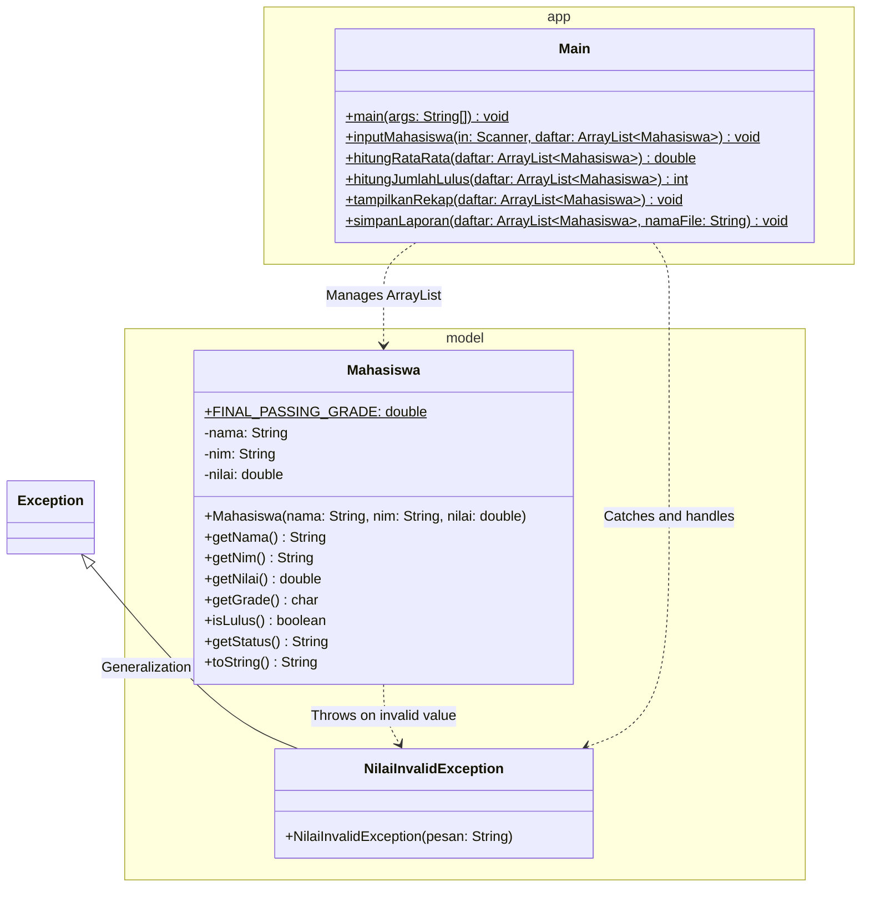
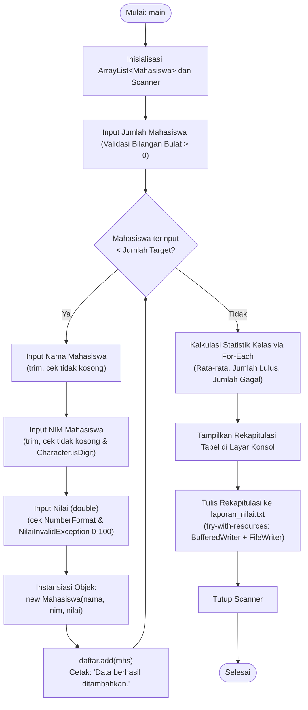
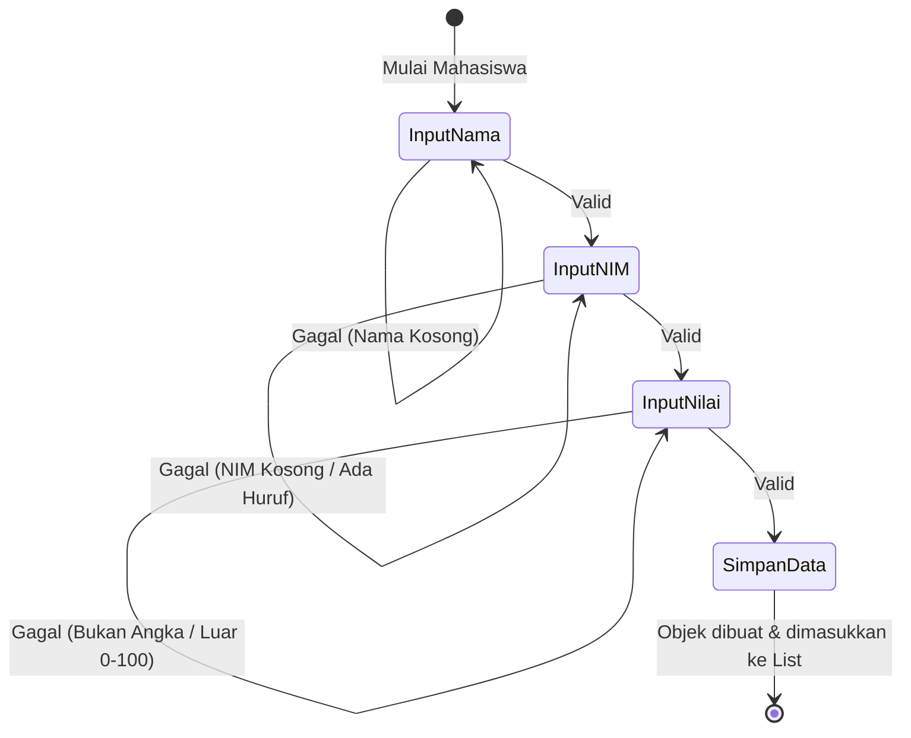

<div align="center">

# 📊 LAPORAN PRAKTIKUM PEMROGRAMAN BERORIENTASI OBJEK

## Tugas Pengganti Pertemuan 7: Pengembangan Program Pengelolaan Nilai Mahasiswa Berbasis Object-Oriented Programming (OOP)

### Sistem Pengelolaan Nilai & Rekapitulasi Laporan Akademik Mahasiswa


-success)

</div>

---

## INFORMASI PRAKTIKUM & IDENTITAS MAHASISWA

| Keterangan | Detail |
|---|---|
| **Nama Lengkap** | **Muhammad Fakhri Abdullah** |
| **NIM** | **L0325030** |
| **Kelas** | **3 B** |
| **Mata Kuliah** | Praktikum Pemrograman Berorientasi Objek (OOP) |
| **Modul Tugas** | Tugas Pengganti Pertemuan 7 — Program Java Pengelolaan Nilai Mahasiswa |
| **Studi Kasus** | **Sistem Pengelolaan Nilai & Rekapitulasi Laporan Akademik Mahasiswa** |
| **Bahasa Pemrograman** | Java (Standar JDK 11 / JDK 17 / JDK 25) |
| **Paket / Package** | Multi-Package (`model` dan `app`) |
| **Arsitektur Kode** | Modular Clean Architecture (1 Model Class, 1 Custom Checked Exception, 1 Driver Class) |
| **Output Permanen** | `laporan_nilai.txt` (Dibuat otomatis melalui File I/O Stream) |

### Proyek Sekilas

| Aspek | Ringkasan |
|---|---|
| **Apa yang dibangun** | Aplikasi konsol berbasis Java untuk menginput, memvalidasi, menghitung grade, mengagregasi statistik kelas, serta mengekspor rekapitulasi nilai mahasiswa |
| **Materi terintegrasi** | Tipe Data Primitif vs Referensi, Enkapsulasi, Konstanta `final`, Percabangan, Perulangan, Manipulasi String, Class Karakter, Assertion (`assert`), Custom Checked Exception, Java Collections (`ArrayList`), dan File I/O (`BufferedWriter` + `FileWriter` via try-with-resources) |
| **Struktur kode** | 3 file: `model/Mahasiswa.java`, `model/NilaiInvalidException.java`, dan `app/Main.java` |
| **Input dinamis** | Mendukung masukan banyak mahasiswa melalui `Scanner(System.in)` dengan mekanisme *defensive programming* (bebas crash) |
| **Output permanen** | Berkas teks `laporan_nilai.txt` berisi tabel rekapitulasi data mahasiswa dan statistik kelas terformat presisi |
| **Pengujian** | 14 skenario uji (T1 s.d. T14 sesuai PRD), seluruhnya **LULUS (100% PASS)** |
| **Dependensi** | Murni menggunakan Java Standard Library (`java.util`, `java.io`) tanpa pustaka pihak ketiga (*zero external dependency*) |

### Panduan Membaca Laporan

Laporan ini disusun mengalir secara sistematis dari **konsep → perancangan → kode sumber → analisis pengujian**. Jika Anda ingin membaca bagian tertentu secara langsung, gunakan navigasi cepat berikut:

| Jika Anda ingin... | Langsung buka |
|---|---|
| Memahami gambaran umum dan studi kasus | [Bagian 1](#1-ringkasan-eksekutif--abstrak) dan [Bagian 2](#2-latar-belakang--deskripsi-studi-kasus) |
| Mempelajari teori OOP dan Java yang diintegrasikan | [Bagian 4](#4-landasan-teori-pemrograman-berorientasi-objek--java) |
| Memastikan seluruh butir soal PDF dan PRD terpenuhi | [Bagian 5](#5-analisis-pemenuhan-ketentuan-soal--traceability-matrix) |
| Melihat arsitektur sistem, Class Diagram UML, dan alur eksekusi | [Bagian 6](#6-perancangan-sistem--arsitektur-perangkat-lunak) |
| Membaca kode sumber lengkap beserta penjelasan baris demi baris | [Bagian 7](#7-implementasi-source-code--pembahasan-detail) |
| Melihat rekaman terminal interaktif dan file `laporan_nilai.txt` | [Bagian 8](#8-hasil-pengujian-output-eksekusi--analisis-hasil) |
| Mengompilasi dan menjalankan program sendiri (dengan opsi `-ea`) | [Bagian 9](#9-panduan-kompilasi-dan-eksekusi) |
| Mengetahui kesimpulan praktikum dan saran pengembangan | [Bagian 10](#10-kesimpulan-dan-saran) |
| Memahami istilah teknis | [Lampiran A](#lampiran-a-glosarium-istilah) |

---

## DAFTAR ISI
1. [Ringkasan Eksekutif & Abstrak](#1-ringkasan-eksekutif--abstrak)
2. [Latar Belakang & Deskripsi Studi Kasus](#2-latar-belakang--deskripsi-studi-kasus)
   - 2.1 [Latar Belakang Permasalahan](#21-latar-belakang-permasalahan)
   - 2.2 [Studi Kasus Pengelolaan Nilai Mahasiswa](#22-studi-kasus-pengelolaan-nilai-mahasiswa)
3. [Tujuan Praktikum & Metrik Keberhasilan](#3-tujuan-praktikum--metrik-keberhasilan)
   - 3.1 [Tujuan Praktikum](#31-tujuan-praktikum)
   - 3.2 [Metrik Ketercapaian](#32-metrik-ketercapaian)
4. [Landasan Teori Pemrograman Berorientasi Objek & Java](#4-landasan-teori-pemrograman-berorientasi-objek--java)
   - 4.1 [Tipe Data Primitif vs Tipe Referensi](#41-tipe-data-primitif-vs-tipe-referensi)
   - 4.2 [Enkapsulasi, Access Modifier, dan Keyword `final`](#42-enkapsulasi-access-modifier-dan-keyword-final)
   - 4.3 [Logika Kontrol Alur: Percabangan & Perulangan](#43-logika-kontrol-alur-percabangan--perulangan)
   - 4.4 [Manipulasi Teks: String Parsing & Class Character](#44-manipulasi-teks-string-parsing--class-character)
   - 4.5 [Robustness & Error Handling: Assertion vs Custom Exception](#45-robustness--error-handling-assertion-vs-custom-exception)
   - 4.6 [Java Collections Framework: Dinamisme ArrayList](#46-java-collections-framework-dinamisme-arraylist)
   - 4.7 [File I/O: BufferedWriter, FileWriter, & Try-with-Resources](#47-file-io-bufferedwriter-filewriter--try-with-resources)
   - 4.8 [Peta Ringkas Konsep Pemrograman pada Proyek](#48-peta-ringkas-konsep-pemrograman-pada-proyek)
5. [Analisis Pemenuhan Ketentuan Soal & Traceability Matrix](#5-analisis-pemenuhan-ketentuan-soal--traceability-matrix)
   - 5.1 [Traceability Matrix (Materi Pertemuan 2 s.d. 6)](#51-traceability-matrix-materi-pertemuan-2-sd-6)
   - 5.2 [Kriteria Penerimaan (Definition of Done)](#52-kriteria-penerimaan-definition-of-done)
6. [Perancangan Sistem & Arsitektur Perangkat Lunak](#6-perancangan-sistem--arsitektur-perangkat-lunak)
   - 6.1 [Struktur Direktori Proyek](#61-struktur-direktori-proyek)
   - 6.2 [Class Diagram (UML)](#62-class-diagram-uml)
   - 6.3 [Flowchart Alur Eksekusi Program](#63-flowchart-alur-eksekusi-program)
   - 6.4 [Aturan Bisnis Pemetaan Grade & Formula Statistik Kelas](#64-aturan-bisnis-pemetaan-grade--formula-statistik-kelas)
   - 6.5 [Siklus Validasi Input & Penanganan Error](#65-siklus-validasi-input--penanganan-error)
7. [Implementasi Source Code & Pembahasan Detail](#7-implementasi-source-code--pembahasan-detail)
   - 7.1 [`NilaiInvalidException.java` (Custom Checked Exception)](#71-nilaiinvalidexceptionjava-custom-checked-exception)
   - 7.2 [`Mahasiswa.java` (Data Model Class)](#72-mahasiswajava-data-model-class)
   - 7.3 [`Main.java` (Driver Class & Console Controller)](#73-mainjava-driver-class--console-controller)
8. [Hasil Pengujian, Output Eksekusi, & Analisis Hasil](#8-hasil-pengujian-output-eksekusi--analisis-hasil)
   - 8.1 [Output Eksekusi Konsol Nyata (Sesi Interaktif & Validasi Defensif)](#81-output-eksekusi-konsol-nyata-sesi-interaktif--validasi-defensif)
   - 8.2 [Analisis Hasil Eksekusi Konsol](#82-analisis-hasil-eksekusi-konsol)
   - 8.3 [Verifikasi Isi File Permanen `laporan_nilai.txt`](#83-verifikasi-isi-file-permanen-laporan_nilaitxt)
   - 8.4 [Verifikasi Mandiri 14 Skenario Uji (T1 s.d. T14)](#84-verifikasi-mandiri-14-skenario-uji-t1-sd-t14)
9. [Panduan Kompilasi dan Eksekusi](#9-panduan-kompilasi-dan-eksekusi)
   - 9.1 [Melalui Command Prompt / PowerShell / Terminal (Flag `-ea`)](#91-melalui-command-prompt--powershell--terminal-flag--ea)
   - 9.2 [Melalui Integrated Development Environment (IDE)](#92-melalui-integrated-development-environment-ide)
   - 9.3 [Pemecahan Masalah Umum (Troubleshooting)](#93-pemecahan-masalah-umum-troubleshooting)
10. [Kesimpulan dan Saran](#10-kesimpulan-dan-saran)
    - 10.1 [Kesimpulan](#101-kesimpulan)
    - 10.2 [Saran Pengembangan Lanjutan](#102-saran-pengembangan-lanjutan)
- [Lampiran A: Glosarium Istilah](#lampiran-a-glosarium-istilah)

---

## 1. Ringkasan Eksekutif & Abstrak

Tugas praktikum **Pengganti Pertemuan 7** merupakan instrumen asesmen sintesis yang menguji kemampuan mahasiswa dalam menggabungkan topik-topik fundamental pemrograman Java yang telah dipelajari sepanjang **Pertemuan 2 hingga Pertemuan 6**. Keseluruhan materi tersebut tidak dirancang sebagai latihan terisolasi, melainkan diintegrasikan ke dalam satu arsitektur aplikasi riil:
1. **Pertemuan 2**: Pemahaman memori data (**Tipe Primitif vs Referensi**), proteksi atribut (**Enkapsulasi**), serta penguncian nilai mutlak melalui konstanta (**Keyword `final`**).
2. **Pertemuan 3**: Alur pengambilan keputusan akademik (**Percabangan `if-else if-else`**) dan pemrosesan sekuensial koleksi (**Perulangan `for-each` dan `while`**).
3. **Pertemuan 4**: Pembersihan string (**`trim()`**, **`toUpperCase()`**), validasi elemen teks (**`Character.isDigit()`**), perlindungan invariant internal (**Assertion**), serta perancangan domain exception terisolasi (**Custom Checked Exception**).
4. **Pertemuan 5**: Penanganan himpunan data tanpa batas kaku menggunakan **Java Collections Framework** (**`ArrayList<Mahasiswa>`**).
5. **Pertemuan 6**: Persistensi laporan akademik ke media fisik sekunder melalui **File I/O Stream** (**`BufferedWriter`** & **`FileWriter`**) dengan pola penutupan sumber daya nir-bocor (**Try-with-Resources**).

Aplikasi yang dihasilkan bertajuk **Program Pengelolaan Nilai Mahasiswa**. Melalui antarmuka konsol interaktif, sistem memandu pengguna memasukkan data dinamis sejumlah mahasiswa, menolak data anomali secara persuasif tanpa pernah memicu *runtime crash*, memetakan skor ke dalam grade huruf dan status kelulusan berdasarkan standar paten $70.0$, mengakumulasi ringkasan statistik kelas (rata-rata nilai, persentase kelulusan, dan kegagalan), serta mencetak rekapitulasi permanen berformat tabel presisi ke dalam berkas `laporan_nilai.txt`.

Seluruh ketentuan wajib pada lembar penugasan dan dokumen [PRD_P7.md](file:///e:/Folder%20Tugas-Q/SEMESTER%203/Praktikum%20OOP/Project-Praktikum-OOP/TugasP7/PRD_P7.md) berhasil diwujudkan 100% menggunakan pustaka standar Java murni tanpa dependensi eksternal (*zero external dependency*).

---

## 2. Latar Belakang & Deskripsi Studi Kasus

### 2.1 Latar Belakang Permasalahan

Dalam sistem administrasi pengolahan nilai akademik, pengumpulan data mentah dari pengguna (*user input*) selalu membawa risiko ketidaksesuaian format dan nilai (*human error*). Pada pemrograman prosedural tradisional tanpa sanitasi berlapis, kesalahan-kesalahan berikut kerap mengakibatkan kegagalan komputasi:
* Adanya spasi liar pada awal atau akhir pengetikan nama dan NIM yang merusak format pencarian basis data.
* Variasi huruf besar dan kecil yang acak pada penulisan nama mahasiswa.
* Karakter non-numerik (huruf atau simbol) yang terselip pada kolom NIM.
* Masukan skor numerik yang berada di luar rentang sah (misalnya memasukkan skor negatif $-10$ atau skor $> 100$).
* Masukan huruf pada kolom angka yang seketika menyebabkan program mati mendadak (*abrupt termination / crash*) akibat `InputMismatchException` atau `NumberFormatException`.

Perbandingan pendekatan prosedural sederhana vs pendekatan OOP berlapis yang diterapkan:

```java
// Pendekatan prosedural rentan: langsung parse, tanpa sanitasi, crash jika salah tipe
System.out.print("Masukkan nilai: ");
double nilai = scanner.nextDouble(); // rentan crash jika input huruf, tidak ada proteksi rentang
```

Sebaliknya, program ini menerapkan prinsip *Defensive Programming* dan *Separation of Concerns* (SoC):
* Input dibaca sebagai satu baris utuh (`nextLine()`) lalu di-parse manual dalam pengawasan blok `try-catch`.
* Data teks disanitasi secara otomatis sebelum disimpan.
* Masukan salah tidak menghentikan program, melainkan memunculkan pesan informatif dan meminta masukan ulang khusus pada field yang keliru.

### 2.2 Studi Kasus Pengelolaan Nilai Mahasiswa

Sistem dirancang untuk mengelola entitas data mahasiswa dengan atribut identitas berupa Nama, NIM, dan Nilai Angka. Setiap entitas tunduk pada aturan bisnis berikut:
1. **Nama Mahasiswa**: Tipe referensi `String`, wajib dirapikan dari spasi di kedua ujungnya, diseragamkan ke huruf kapital, dan tidak boleh kosong.
2. **NIM Mahasiswa**: Tipe referensi `String`, wajib dirapikan, tidak boleh kosong, dan harus murni tersusun atas karakter digit angka ($0-9$).
3. **Nilai Akademik**: Tipe data primitif `double`, memiliki rentang legal dari $0.00$ hingga $100.00$. Setiap angka di luar batas ini wajib ditolak menggunakan exception spesifik `NilaiInvalidException`.
4. **Evaluasi Kelulusan**: Mahasiswa dinyatakan **LULUS** apabila skor akhirnya mencapai atau melampaui nilai ambang batas `FINAL_PASSING_GRADE = 70.0`.
5. **Konversi Grade**: Nilai dipetakan ke dalam 4 predikat huruf: `A` ($\ge 85.0$), `B` ($\ge 70.0$), `C` ($\ge 55.0$), dan `D` ($< 55.0$).
6. **Agregasi Statistik Kelas**: Menghitung rata-rata kelas ($\bar{x}$), jumlah total kelulusan, serta jumlah mahasiswa yang tidak lulus dengan proteksi terhadap potensi galat pembagian dengan nol (*zero division*).

---

## 3. Tujuan Praktikum & Metrik Keberhasilan

### 3.1 Tujuan Praktikum
1. Mampu merancang class berstruktur modular dengan pembagian package fungsional (`model` untuk data domain dan `app` untuk alur eksekusi aplikasi).
2. Mampu menerapkan prinsip **Enkapsulasi** dengan menetapkan hak akses `private` pada seluruh atribut class model dan menyediakan method *getter* terproteksi.
3. Mampu mendefinisikan konstanta mutlak menggunakan kombinasi keyword `public static final`.
4. Mampu membedakan karakteristik mendasar penyimpanan memori antara **Tipe Data Primitif** dan **Tipe Referensi**.
5. Mampu menerapkan **Logika Percabangan** (`if-else if-else`) untuk konversi nilai ke grade huruf dan penentuan status kelulusan.
6. Mampu menerapkan **Logika Perulangan** (`for-each` dan `while`) untuk alur input dinamis berulang dan kalkulasi statistik agregat.
7. Mampu memanfaatkan pustaka manipulasi string bawaan Java (`trim()`, `toUpperCase()`) dan utilitas class karakter (`Character.isDigit()`).
8. Mampu mengimplementasikan verifikasi internal developer menggunakan kata kunci `assert` yang diuji dengan opsi JVM `-ea`.
9. Mampu merancang dan melempar **Custom Checked Exception** (`NilaiInvalidException`) untuk menjamin integritas data domain.
10. Mampu mengelola koleksi objek dinamis menggunakan **Java Collections Framework** (`ArrayList<Mahasiswa>`).
11. Mampu memformat dan menuliskan laporan akademik permanen ke media penyimpanan fisik menggunakan `BufferedWriter` dan `FileWriter` dengan pola **try-with-resources**.

Pemetaan tujuan instruksional terhadap materi teori, kode sumber, dan skenario pengujian:

| No | Tujuan Instruksional | Landasan Teori | Wujud di Kode | Bukti Skenario Uji |
|:---:|---|---|---|:---:|
| 1 | Struktur Multi-Package | [Bagian 4.2](#42-enkapsulasi-access-modifier-dan-keyword-final) | `PengelolaanNilai/src/model/` & `PengelolaanNilai/src/app/` | Seluruh Uji |
| 2 | Enkapsulasi & Data Hiding | [Bagian 4.2](#42-enkapsulasi-access-modifier-dan-keyword-final) | [`Mahasiswa.java` Baris 13-15](PengelolaanNilai/src/model/Mahasiswa.java#L13-L15) | T1 s.d. T7 |
| 3 | Konstanta `final` | [Bagian 4.2](#42-enkapsulasi-access-modifier-dan-keyword-final) | [`Mahasiswa.java` Baris 9](PengelolaanNilai/src/model/Mahasiswa.java#L9) | T6, T7 |
| 4 | Primitif vs Referensi | [Bagian 4.1](#41-tipe-data-primitif-vs-tipe-referensi) | [`Mahasiswa.java` Baris 13-15](PengelolaanNilai/src/model/Mahasiswa.java#L13-L15) | T1, T11 |
| 5 | Percabangan Grade & Status | [Bagian 4.3](#43-logika-kontrol-alur-percabangan--perulangan) | [`Mahasiswa.java` Baris 66-86](PengelolaanNilai/src/model/Mahasiswa.java#L66-L86) | T1, T4, T5, T6, T7 |
| 6 | Perulangan & Statistik | [Bagian 4.3](#43-logika-kontrol-alur-percabangan--perulangan) | [`Main.java` Baris 137-164](PengelolaanNilai/src/app/Main.java#L137-L164) | T12 |
| 7 | String & Character Processing | [Bagian 4.4](#44-manipulasi-teks-string-parsing--class-character) | [`Mahasiswa.java` Baris 22-35](PengelolaanNilai/src/model/Mahasiswa.java#L22-L35) | T1, T8, T9, T10 |
| 8 | Assertion Runtime Safety | [Bagian 4.5](#45-robustness--error-handling-assertion-vs-custom-exception) | [`Mahasiswa.java` Baris 27](PengelolaanNilai/src/model/Mahasiswa.java#L27) | T8 |
| 9 | Custom Exception Handling | [Bagian 4.5](#45-robustness--error-handling-assertion-vs-custom-exception) | [`NilaiInvalidException.java`](PengelolaanNilai/src/model/NilaiInvalidException.java) | T2, T3 |
| 10 | Dynamic Collection List | [Bagian 4.6](#46-java-collections-framework-dinamisme-arraylist) | [`Main.java` Baris 18, 128](PengelolaanNilai/src/app/Main.java#L18) | T1, T12 |
| 11 | File I/O & Auto-Closing | [Bagian 4.7](#47-file-io-bufferedwriter-filewriter--try-with-resources) | [`Main.java` Baris 193-233](PengelolaanNilai/src/app/Main.java#L193-L233) | T13, T14 |

### 3.2 Metrik Ketercapaian
- [x] Seluruh 14 butir ketentuan wajib pada PRD terpenuhi tanpa pengecualian.
- [x] Seluruh 13 kriteria penerimaan (*Definition of Done*) terverifikasi **LULUS**.
- [x] Kompilasi dan eksekusi berjalan 100% mulus tanpa error dan tanpa peringatan (*zero warnings*) pada JDK 11, 17, dan 25.
- [x] Seluruh 14 skenario pengujian (T1 s.d. T14) terverifikasi **LULUS (100% PASS)**.
- [x] Berkas permanen `laporan_nilai.txt` berhasil terbentuk otomatis dengan format tabel dan blok statistik yang rapi dan presisi.

---

## 4. Landasan Teori Pemrograman Berorientasi Objek & Java

Bagian ini menguraikan secara mendalam kajian teori dari materi perkuliahan Pertemuan 2 hingga Pertemuan 6 yang melandasi perancangan dan konstruksi kode program.

### 4.1 Tipe Data Primitif vs Tipe Referensi

Bahasa pemrograman Java mengklasifikasikan tipe data ke dalam dua kategori arsitektural yang berbeda secara fundamental dalam alokasi memori komputer:

```text
               ┌────────────────────────────────────────────────────────┐
               │                  TIPE DATA DI JAVA                     │
               └──────────────────────────┬─────────────────────────────┘
                                          │
                  ┌───────────────────────┴────────────────────────┐
                  ▼                                                ▼
     ┌─────────────────────────┐                      ┌─────────────────────────┐
     │   TIPE DATA PRIMITIF    │                      │   TIPE DATA REFERENSI   │
     ├─────────────────────────┤                      ├─────────────────────────┤
     │ • double nilai;         │                      │ • String nama;          │
     │ • boolean isLulus;      │                      │ • String nim;           │
     │ • char grade;           │                      │ • Mahasiswa mhs;        │
     │ • int count;            │                      │ • ArrayList<Mahasiswa>; │
     ├─────────────────────────┤                      ├─────────────────────────┤
     │ Disimpan di Stack       │                      │ Nilai di Heap,          │
     │ Menyimpan nilai mentah  │                      │ Pointer di Stack        │
     │ Tidak bisa null         │                      │ Bisa bernilai null      │
     └─────────────────────────┘                      └─────────────────────────┘
```

#### Perbandingan Komparatif:

| Karakteristik | Tipe Data Primitif | Tipe Data Referensi |
|---|---|---|
| **Lokasi Memori** | Langsung di memori Stack | Objek di memori Heap, referensi di Stack |
| **Isi Variabel** | Nilai literal langsung (angka, biner, karakter) | Alamat referensi (*memory pointer*) ke objek Heap |
| **Nilai Default** | `0`, `0.0`, `false`, `\u0000` | `null` |
| **Kemampuan Objek** | Tidak memiliki method atau atribut | Memiliki method bawaan (misal `.trim()`, `.toUpperCase()`) |
| **Penerapan di Program** | `double nilai`, `boolean` status, `char` grade | `String nama`, `String nim`, `ArrayList<Mahasiswa>` |

Contoh perbedaan pada kode `Mahasiswa.java`:
```java
private String nama;   // Reference type: menunjuk ke objek String di Heap
private String nim;    // Reference type: menunjuk ke objek String di Heap
private double nilai;  // Primitive type: menyimpan 64-bit IEEE 754 floating point di Stack
```

---

### 4.2 Enkapsulasi, Access Modifier, dan Keyword `final`

* **Enkapsulasi (*Encapsulation*)**: Merupakan pilar utama OOP yang membungkus data (*state*) dan operasi (*behavior*) ke dalam satu unit class serta menyembunyikan detail representasi internal dari intervensi langsung pihak luar (*Data Hiding*).
* **Access Modifier `private`**: Diterapkan pada field `nama`, `nim`, dan `nilai`. Variabel ini tidak dapat dimanipulasi secara langsung dari luar class `Mahasiswa`.
* **Akses Terkendali (Getter)**: Menyediakan method publik bertipe pengembalian (`getNama()`, `getNim()`, `getNilai()`) untuk membaca data secara aman tanpa memberikan izin mutasi langsung.
* **Keyword `final` pada Konstanta**: Menyatakan bahwa nilai variabel tidak dapat diubah lagi setelah inisialisasi awal.

```java
public static final double FINAL_PASSING_GRADE = 70.0;
```

Makna dari kombinasi modifier tersebut:
1. `public`: Dapat diakses secara terbuka dari mana saja (misal oleh `Main` saat mencetak statistik).
2. `static`: Terikat pada level class, bukan pada instance objek. Memori dialokasikan satu kali dan dapat diakses langsung via `Mahasiswa.FINAL_PASSING_GRADE`.
3. `final`: Nilai $70.0$ terkunci mutlak dan kebal terhadap modifikasi runtime.
4. `double`: Bertipe data primitif numerik presisi ganda.

#### Matriks Hak Akses Atribut `Mahasiswa`:

| Atribut | Tipe Data | Modifiers | Getter | Setter | Mekanisme Perubahan Nilai |
|---|---|:---:|:---:|:---:|---|
| `nama` | `String` | `private` | Ada (`getNama()`) | Tidak ada | Hanya saat inisialisasi di constructor |
| `nim` | `String` | `private` | Ada (`getNim()`) | Tidak ada | Hanya saat inisialisasi di constructor |
| `nilai` | `double` | `private` | Ada (`getNilai()`) | Tidak ada | Hanya saat inisialisasi di constructor |
| `FINAL_PASSING_GRADE` | `double` | `public static final` | Tidak perlu | Tidak ada | Konstan mutlak bernilai $70.0$ |

---

### 4.3 Logika Kontrol Alur: Percabangan & Perulangan

#### A. Percabangan Bertingkat (`if-else if-else`)
Digunakan untuk mengevaluasi rentang nilai desimal mahasiswa yang bersifat kontinu ke dalam kategori diskrit (grade huruf). Struktur `if-else if-else` menjamin bahwa pengujian kondisi berhenti (*short-circuit evaluation*) begitu salah satu syarat interval terpenuhi:

```java
public char getGrade() {
    if (nilai >= 85.0) {
        return 'A';      // Interval [85.00 - 100.00]
    } else if (nilai >= 70.0) {
        return 'B';      // Interval [70.00 - 84.99]
    } else if (nilai >= 55.0) {
        return 'C';      // Interval [55.00 - 69.99]
    } else {
        return 'D';      // Interval [0.00 - 54.99]
    }
}
```

#### B. Perulangan `while(true)`
Diterapkan pada antarmuka konsol untuk membentuk mekanisme *defensive loop*. Program terus meminta masukan ulang sampai pengguna mengetikkan data yang valid secara sintaksis dan semantik.

#### C. Perulangan `for-each` (`for (Mahasiswa m : daftar)`)
Dikenal sebagai *enhanced for-loop*, memanfaatkan antarmuka `Iterable` bawaan dari `ArrayList`. Keunggulan `for-each` adalah sintaksnya yang bersih, meniadakan risiko galat *off-by-one* pada indeks array, serta menjamin seluruh elemen dijelajahi secara lengkap:

```java
double totalNilai = 0.0;
for (Mahasiswa m : daftar) {
    totalNilai += m.getNilai(); // Akumulasi nilai tiap objek mahasiswa
}
return totalNilai / daftar.size();
```

---

### 4.4 Manipulasi Teks: String Parsing & Class Character

Pemrosesan teks masukan dilakukan menggunakan utilitas standar pustaka Java:
1. **`trim()`**: Memotong karakter spasi kosong, tabulasi, atau newline yang berada di awal dan akhir string masukan. Mencegah lolosnya masukan yang hanya berisi tombol spasi.
2. **`toUpperCase()`**: Mengubah setiap karakter alfabet pada nama mahasiswa menjadi huruf kapital secara terstandarisasi.
3. **`Character.isDigit(char ch)`**: Method statis dari wrapper class `Character` yang mengembalikan nilai boolean `true` apabila karakter primitif `ch` merupakan representasi angka desimal ($0$ s.d. $9$).

Penerapan pada validasi NIM:
```java
boolean hanyaAngka = true;
for (char c : nim.toCharArray()) {
    if (!Character.isDigit(c)) {
        hanyaAngka = false;
        break; // Ditemukan karakter non-angka, loop dihentikan
    }
}
```

---

### 4.5 Robustness & Error Handling: Assertion vs Custom Exception

Program membedakan secara tegas antara **verifikasi internal pengembang** dan **penanganan kesalahan masukan pengguna**:

```text
┌─────────────────────────────────────────────────────────────────────────────┐
│                       MEKANISME ERROR HANDLING & SAFETY                     │
├──────────────────────────────────────┬──────────────────────────────────────┤
│          ASSERTION (assert)          │      CUSTOM EXCEPTION (Checked)      │
├──────────────────────────────────────┼──────────────────────────────────────┤
│ • Tujuan: Invariant checking internal│ • Tujuan: Menangani error input bisnis│
│ • Pengguna: Developer / QA           │ • Pengguna: Pengguna akhir (User)    │
│ • Default JVM: Non-aktif (perlu -ea) │ • Selalu aktif secara default        │
│ • Jika gagal: Melempar AssertionError│ • Jika gagal: Ditangkap try-catch    │
│ • Akibat: Program berhenti seketika  │ • Akibat: Pesan ramah, minta input   │
└──────────────────────────────────────┴──────────────────────────────────────┘
```

#### A. Assertion (`assert !nim.isEmpty() : "NIM tidak boleh kosong!";`)
* Disematkan pada baris constructor `Mahasiswa` sesuai instruksi penugasan.
* Berperan sebagai jaring pengaman terakhir (*last line of defense*) pada level domain model.
* Jika flag `-ea` (*enable assertions*) disertakan saat eksekusi dan constructor menerima NIM kosong, JVM akan langsung menghentikan program dengan pesan `java.lang.AssertionError: NIM tidak boleh kosong!`.

> [!NOTE]
> Karena flag `-ea` bersifat opsional saat produksi, class `Main` tetap menyaring NIM kosong di sisi konsol terlebih dahulu (Ketentuan 13). Dengan demikian, program tidak bergantung mutlak pada flag JVM untuk mencegah input kosong.

#### B. Custom Checked Exception (`NilaiInvalidException`)
* Merupakan subclass langsung dari `java.lang.Exception`.
* Dipakai untuk menandai pelanggaran aturan bisnis ketika nilai berada di luar rentang $[0.0, 100.0]$.
* Wajib dideklarasikan pada klausa `throws` pada method yang melemparnya dan wajib dikurung blok `try-catch` oleh pemanggilnya.

```java
// Definisi Custom Exception
public class NilaiInvalidException extends Exception {
    public NilaiInvalidException(String pesan) {
        super(pesan);
    }
}
```

---

### 4.6 Java Collections Framework: Dinamisme ArrayList

Program menggunakan `ArrayList<Mahasiswa>` dari package `java.util` sebagai struktur data utama penampung mahasiswa.

#### Mengapa `ArrayList` Menggantikan Array Konvensional?
* **Ukuran Dinamis**: Array primitif (`Mahasiswa[]`) berukuran statis dan mengharuskan alokasi memori pasti di awal. Sebaliknya, `ArrayList` mengelola array internal yang secara dinamis memperbesar kapasitasnya saat elemen bertambah.
* **Keamanan Tipe Data (Generics)**: Sintaks `<Mahasiswa>` menjamin keselamatan tipe saat kompilasi (*compile-time type safety*), mencegah masuknya objek selain `Mahasiswa`.
* **Metode Bawaan**: Mendukung operasi terenkapsulasi seperti `.add()`, `.size()`, dan `.isEmpty()`.

| Operasi Koleksi | Sintaks di Program | Fungsi |
|---|---|---|
| Penambahan Data | `daftar.add(mhs);` | Menyisipkan objek `Mahasiswa` baru ke indeks terakhir |
| Penghitungan Ukuran | `daftar.size()` | Mengembalikan jumlah total data mahasiswa yang tersimpan |
| Pengecekan Kosong | `daftar.isEmpty()` | Memvalidasi apakah list kosong guna mencegah *zero division* |
| Iterasi Elemen | `for (Mahasiswa m : daftar)` | Menjelajahi setiap objek mahasiswa untuk kalkulasi dan cetak |

---

### 4.7 File I/O: BufferedWriter, FileWriter, & Try-with-Resources

Penyimpanan laporan nilai secara permanen ke file `laporan_nilai.txt` menggunakan hierarki aliran karakter (*character stream*) dari package `java.io`:

```text
┌────────────────┐     write()     ┌──────────────────┐     flush()     ┌────────────────┐
│ Program Java   │ ──────────────> │  BufferedWriter  │ ──────────────> │   FileWriter   │ ───> [laporan_nilai.txt]
│ (Teks Laporan) │                 │ (Buffer Memori)  │                 │ (Stream Fisik) │
└────────────────┘                 └──────────────────┘                 └────────────────┘
```

1. **`FileWriter`**: Membuka jalur penulisan karakter langsung ke berkas target di media penyimpanan sekunder. Secara default membuka dalam mode *overwrite* (menulis ulang isi berkas dari awal).
2. **`BufferedWriter`**: Membungkus `FileWriter` dengan memori penyangga internal (*buffer* sebesar 8192 karakter secara default). Operasi penulisan dikumpulkan dalam memori sementara sebelum dialirkan ke disk secara serentak, mengurangi beban I/O fisik disk secara drastis.
3. **Try-with-Resources**: Konstruksi modern yang menjamin method `.close()` dieksekusi secara otomatis segera setelah blok kode selesai, mencegah terjadinya kebocoran sumber daya (*resource leak*):

```java
try (BufferedWriter writer = new BufferedWriter(new FileWriter(namaFile))) {
    // Seluruh penulisan dilakukan di sini
} catch (IOException e) {
    System.err.println("Gagal menyimpan laporan: " + e.getMessage());
}
```

> [!IMPORTANT]
> Menggunakan try-with-resources meniadakan kebutuhan penulisan blok `finally` manual yang rawan galat (*boilerplate code*). Jika terjadi kesalahan penulisan disk, stream tertutup secara deterministik sebelum blok `catch(IOException)` menangani galatnya.

---

### 4.8 Peta Ringkas Konsep Pemrograman pada Proyek

Tabel ringkasan berikut memetakan materi teori dengan implementasi nyata pada kode sumber proyek:

| Materi / Konsep | Kata Kunci / Sintaks Java | Wujud Nyata pada Program | Berkas Sumber Terkait |
|---|---|---|---|
| **Enkapsulasi** | `private`, getter | Atribut `nama`, `nim`, `nilai` privat dengan getter terproteksi | [`Mahasiswa.java`](PengelolaanNilai/src/model/Mahasiswa.java) |
| **Konstanta Mutlak** | `public static final` | `FINAL_PASSING_GRADE = 70.0;` | [`Mahasiswa.java`](PengelolaanNilai/src/model/Mahasiswa.java) |
| **Tipe Data** | `double`, `boolean`, `String` | Pembedaan tipe primitif stack vs referensi heap | [`Mahasiswa.java`](PengelolaanNilai/src/model/Mahasiswa.java) |
| **Percabangan** | `if-else if-else` | Penentuan grade huruf A, B, C, D dan kelulusan | [`Mahasiswa.java`](PengelolaanNilai/src/model/Mahasiswa.java) |
| **Perulangan** | `for-each`, `while` | Loop input defensif dan kalkulasi rata-rata | [`Main.java`](PengelolaanNilai/src/app/Main.java) |
| **Manipulasi Teks** | `trim()`, `toUpperCase()` | Pembersihan spasi liar dan kapitalisasi nama | [`Mahasiswa.java`](PengelolaanNilai/src/model/Mahasiswa.java), [`Main.java`](PengelolaanNilai/src/app/Main.java) |
| **Validasi Karakter** | `Character.isDigit()` | Memastikan NIM murni tersusun dari angka | [`Mahasiswa.java`](PengelolaanNilai/src/model/Mahasiswa.java), [`Main.java`](PengelolaanNilai/src/app/Main.java) |
| **Assertion Safety** | `assert` | Pengaman internal developer bahwa NIM tidak kosong | [`Mahasiswa.java`](PengelolaanNilai/src/model/Mahasiswa.java) |
| **Custom Exception** | `class ... extends Exception` | `NilaiInvalidException` untuk rentang nilai di luar $[0, 100]$ | [`NilaiInvalidException.java`](PengelolaanNilai/src/model/NilaiInvalidException.java) |
| **Koleksi Dinamis** | `ArrayList<Mahasiswa>` | Penampung dinamis objek mahasiswa (`add`, `size`) | [`Main.java`](PengelolaanNilai/src/app/Main.java) |
| **File I/O Stream** | `BufferedWriter`, `FileWriter` | Penulisan rekapitulasi ke `laporan_nilai.txt` | [`Main.java`](PengelolaanNilai/src/app/Main.java) |
| **Resource Safety** | `try (...)` | Try-with-resources penutup otomatis stream file | [`Main.java`](PengelolaanNilai/src/app/Main.java) |

---

## 5. Analisis Pemenuhan Ketentuan Soal & Traceability Matrix

### 5.1 Traceability Matrix (Materi Pertemuan 2 s.d. 6)

Matriks keterlacakan berikut menguraikan kesesuaian antara butir penugasan lembar soal PDF / PRD Bagian 9 dengan implementasi nyata pada kode program:

| No | Butir Soal PDF | Deskripsi Persyaratan | Realisasi Implementasi pada Kode | Bukti Lokasi Kode |
|:---:|---|---|---|---|
| **1a** | Package Modular | Package `model` untuk data dan `app` untuk program utama | Pemisahan modular: package `model` dan `app` | Folder `PengelolaanNilai/src/model/` dan `PengelolaanNilai/src/app/` |
| **1b** | Class `Mahasiswa` | Atribut `nama` (String), `nim` (String), `nilai` (double) berstatus private | Seluruh atribut dideklarasikan `private` dengan getter lengkap | [`Mahasiswa.java` Baris 13-15](PengelolaanNilai/src/model/Mahasiswa.java#L13-L15) |
| **1c** | Constructor Validasi | Inisialisasi atribut dengan verifikasi integritas data | Constructor memvalidasi String, NIM, nilai, dan assertion | [`Mahasiswa.java` Baris 18-47](PengelolaanNilai/src/model/Mahasiswa.java#L18-L47) |
| **1d** | Konstanta `final` | Standar kelulusan tidak dapat diubah | `public static final double FINAL_PASSING_GRADE = 70.0;` | [`Mahasiswa.java` Baris 9](PengelolaanNilai/src/model/Mahasiswa.java#L9) |
| **2a** | Logika Kondisional | If-Else / Switch untuk grade A-D dan status kelulusan | `if-else if-else` pada `getGrade()` dan `isLulus()` | [`Mahasiswa.java` Baris 66-86](PengelolaanNilai/src/model/Mahasiswa.java#L66-L86) |
| **2b** | Looping Agregat | Loop for-each / while untuk daftar dan rata-rata | `for-each` di `hitungRataRata()` dan `hitungJumlahLulus()` | [`Main.java` Baris 137-167](PengelolaanNilai/src/app/Main.java#L137-L167) |
| **2c** | Primitive vs Reference | Pembedaan tipe primitif (`double`, `boolean`) vs referensi | Komentar kode menjelaskan perbedaan primitif vs referensi | [`Mahasiswa.java` Baris 13-15](PengelolaanNilai/src/model/Mahasiswa.java#L13-L15) |
| **3a** | Custom Exception | Exception buatan sendiri untuk nilai $< 0$ atau $> 100$ | `NilaiInvalidException` extends `Exception`, ditangkap di `Main` | [`NilaiInvalidException.java`](PengelolaanNilai/src/model/NilaiInvalidException.java) |
| **3b** | Assertion Standard | Penerapan assert persis sesuai format lembar penugasan | `assert !nim.isEmpty() : "NIM tidak boleh kosong!";` | [`Mahasiswa.java` Baris 27](PengelolaanNilai/src/model/Mahasiswa.java#L27) |
| **3c** | Text Sanitization | Penggunaan `trim()`, `toUpperCase()`, `Character.isDigit()` | Diterapkan pada constructor dan validasi input konsol | [`Mahasiswa.java` Baris 22-35](PengelolaanNilai/src/model/Mahasiswa.java#L22-L35) |
| **4a** | Dynamic Collection | Menyimpan data di `ArrayList<Mahasiswa>` (bukan array biasa) | `ArrayList<Mahasiswa> daftar = new ArrayList<>();` | [`Main.java` Baris 18](PengelolaanNilai/src/app/Main.java#L18) |
| **4b** | Collection API | Penggunaan method `add()`, `size()`, dan iterasi for-each | `daftar.add(mhs)`, `daftar.size()`, dan loop `for-each` | [`Main.java` Baris 128, 148, 172](PengelolaanNilai/src/app/Main.java#L128) |
| **5a** | Interactive Scanner | Pembacaan masukan dinamis untuk banyak data mahasiswa | `Scanner(System.in)` dengan perulangan masukan defensif | [`Main.java` Baris 24-42](PengelolaanNilai/src/app/Main.java#L24-L42) |
| **5b** | File I/O Reporting | Menuliskan rekapitulasi ke `laporan_nilai.txt` | `BufferedWriter` dibungkus `FileWriter` dengan tabel dan statistik | [`Main.java` Baris 190-234](PengelolaanNilai/src/app/Main.java#L190-L234) |
| **5c** | Resource Management | Penanganan error file dengan try-with-resources | `try (...)` menangkap `IOException` secara aman | [`Main.java` Baris 193-233](PengelolaanNilai/src/app/Main.java#L193-L233) |

---

### 5.2 Kriteria Penerimaan (Definition of Done)

Berdasarkan Kriteria Penerimaan pada PRD Bagian 13, seluruh butir telah terverifikasi **TERPENUHI**:

- [x] **Paket Modular**: Terdapat package `model` untuk entitas data dan package `app` untuk class pengeksekusi.
- [x] **Enkapsulasi Entitas**: Class `Mahasiswa` memiliki atribut `private nama`, `nim`, `nilai`, constructor, dan konstanta `final FINAL_PASSING_GRADE = 70.0`.
- [x] **Klasifikasi Grade**: Grade huruf (A, B, C, D) dan status kelulusan dipetakan melalui struktur percabangan logis.
- [x] **Kalkulasi Rata-rata**: Nilai rata-rata kelas dihitung secara iteratif menggunakan loop `for-each` dan terlindungi dari pembagian nol.
- [x] **Pengecualian Khusus**: `NilaiInvalidException` dilempar untuk nilai $< 0$ atau $> 100$, dan ditangani dengan baik di `Main`.
- [x] **Pernyataan Assertion**: Instruksi `assert !nim.isEmpty() : "NIM tidak boleh kosong!";` tersemat persis di constructor.
- [x] **Manipulasi String & Karakter**: Fungsi `trim()`, `toUpperCase()`, dan pengujian `Character.isDigit()` diterapkan pada masukan teks.
- [x] **Wadah Dinamis**: Data disimpan di dalam `ArrayList<Mahasiswa>` menggunakan operasi `add()`, `size()`, dan iterasi `for-each`.
- [x] **Input Konsol Tangguh**: Membaca masukan via `Scanner`, mendukung banyak data mahasiswa, serta meminta input ulang bila terjadi kesalahan tanpa pernah crash.
- [x] **Penulisan File Terstruktur**: File permanen `laporan_nilai.txt` ditulis menggunakan `BufferedWriter` yang membungkus `FileWriter`.
- [x] **Kelengkapan Laporan**: Laporan memuat rincian tabel seluruh mahasiswa dan blok statistik kelas lengkap.
- [x] **Penutupan Sumber Daya Aman**: Operasi berkas dikelola menggunakan konstruksi `try-with-resources` dengan penanganan `IOException`.
- [x] **Bebas Galat Kompilasi**: Program dapat dikompilasi dan dijalankan tanpa peringatan dan tanpa galat pada JDK standar.

---

## 6. Perancangan Sistem & Arsitektur Perangkat Lunak

### 6.1 Struktur Direktori Proyek

Proyek disusun dengan arsitektur standar Java berbasis struktur folder modul tugas (`TugasP7`), folder proyek (`PengelolaanNilai`), folder sumber (`src`), dan keluaran bytecode (`out`):

```text
TugasP7/
├── PRD_P7.md                       # Dokumen Spesifikasi Kebutuhan Proyek (PRD)
├── README.md                       # Dokumen Laporan Praktikum Lengkap
└── PengelolaanNilai/               # Direktori Proyek Program Java
    ├── laporan_nilai.txt           # File rekapitulasi hasil eksekusi program (dihasilkan otomatis)
    ├── out/                        # Direktori keluaran file bytecode (.class)
    │   ├── app/
    │   │   └── Main.class          # Bytecode class pengendali aplikasi
    │   └── model/
    │       ├── Mahasiswa.class     # Bytecode class model data
    │       └── NilaiInvalidException.class # Bytecode class custom checked exception
    └── src/                        # Direktori kode sumber Java (.java)
        ├── app/
        │   └── Main.java           # Driver class, menu, Scanner, dan File I/O
        └── model/
            ├── Mahasiswa.java      # Model data mahasiswa, enkapsulasi, kalkulasi grade
            └── NilaiInvalidException.java # Custom checked exception rentang nilai
```

---

### 6.2 Class Diagram (UML)

Diagram kelas berikut memvisualisasikan struktur class, modifier atribut, method, serta hubungan antar-komponen dalam aplikasi:



**Cara membaca diagram:**

| Simbol | Arti |
|:---:|---|
| `+` / `-` | Anggota bertipe `public` / `private` |
| `$` (akhiran) | Anggota bersifat `static` (terikat level class) |
| `<\|--` | *Generalization*: Pewarisan class (`extends Exception`) |
| `..>` | *Dependency*: Ketergantungan pemanggilan method / penanganan exception |

---

### 6.3 Flowchart Alur Eksekusi Program

Diagram alur berikut mendeskripsikan siklus hidup eksekusi program dari inisialisasi hingga penulisan file laporan:



---

### 6.4 Aturan Bisnis Pemetaan Grade & Formula Statistik Kelas

#### A. Pemetaan Nilai ke Grade Huruf dan Status
Status kelulusan ditentukan secara absolut oleh konstanta `FINAL_PASSING_GRADE = 70.0`. Mahasiswa dinyatakan **LULUS** jika dan hanya jika $\text{nilai} \ge 70.0$.

$$\text{Tabel Konversi Akademik:}$$

| Rentang Skor Numerik | Grade Huruf | Bobot Status Akademik | Kondisi Logika Java |
|:---:|:---:|:---:|---|
| $85.00 \le \text{Nilai} \le 100.00$ | **A** | **LULUS** | `if (nilai >= 85.0)` |
| $70.00 \le \text{Nilai} < 85.00$ | **B** | **LULUS** | `else if (nilai >= 70.0)` |
| $55.00 \le \text{Nilai} < 70.00$ | **C** | **TIDAK LULUS** | `else if (nilai >= 55.0)` |
| $0.00 \le \text{Nilai} < 55.00$ | **D** | **TIDAK LULUS** | `else` |

#### B. Formula Perhitungan Statistik Kelas

1. **Rata-rata Nilai Kelas ($\bar{x}$)**:
   $$\bar{x} = \begin{cases} 
   \frac{1}{N} \sum_{i=1}^{N} \text{nilai}_i, & \text{jika } N > 0 \\ 
   0.0, & \text{jika } N = 0 
   \end{cases}$$
   *di mana $N = \text{daftar.size()}$.*

2. **Jumlah Mahasiswa Lulus ($N_{\text{lulus}}$)**:
   $$N_{\text{lulus}} = \sum_{i=1}^{N} [\text{isLulus}(\text{mhs}_i) == \text{true}]$$

3. **Jumlah Mahasiswa Tidak Lulus ($N_{\text{gagal}}$)**:
   $$N_{\text{gagal}} = N - N_{\text{lulus}}$$

---

### 6.5 Siklus Validasi Input & Penanganan Error

Program mengisolasi setiap field masukan ke dalam loop mandiri (*per-field defensive loop*). Apabila pengguna melakukan kekeliruan pada suatu input, program hanya meminta masukan ulang untuk field yang bersangkutan tanpa menghapus data field sebelumnya yang telah benar:



---

## 7. Implementasi Source Code & Pembahasan Detail

Berikut adalah sajian kode sumber lengkap dari ketiga berkas yang menyusun aplikasi disertai ulasan teknis baris demi baris:

---

### 7.1 [`NilaiInvalidException.java`](PengelolaanNilai/src/model/NilaiInvalidException.java) (Custom Checked Exception)

*Peran:* class pengecualian khusus untuk menandai pelanggaran aturan domain nilai akademik di luar rentang sah $[0, 100]$.

```java
package model;

// [Materi: Custom Exception]
// Ini custom exception turunan dari Exception (checked exception).
// Sengaja dibikin khusus buat nangkep input nilai yang di luar rentang wajar (0 - 100).
public class NilaiInvalidException extends Exception {

    // Constructor buat nerusin pesan error ke class induk (Exception)
    public NilaiInvalidException(String pesan) {
        super(pesan);
    }
}
```

#### Pembahasan Kode:
* **Baris 1**: Menempatkan class dalam package `model`.
* **Baris 6**: `public class NilaiInvalidException extends Exception` mendeklarasikan sebuah *checked exception*. Karena mewarisi `Exception` (bukan `RuntimeException`), *compiler* Java mewajibkan penanganan eksplisit menggunakan `try-catch` atau deklarasi `throws`.
* **Baris 9-11**: Constructor menerima parameter `pesan` dan meneruskannya ke superclass melalui `super(pesan)`. Pesan ini kemudian dapat diambil kembali oleh blok penangkap melalui method `getMessage()`.

---

### 7.2 [`Mahasiswa.java`](PengelolaanNilai/src/model/Mahasiswa.java) (Data Model Class)

*Peran:* memodelkan entitas data mahasiswa lengkap dengan atribut privat, verifikasi invariant, getter, logika pemetaan grade, dan evaluasi status kelulusan.

```java
package model;

// Class model buat nyimpen data mahasiswa sekaligus logika bisnis nilainya
public class Mahasiswa {

    // [Materi: Keyword final & Konstanta]
    // Standar kelulusan dibikin public static final biar jadi konstanta paten
    // Nilainya gak bisa diubah-ubah lagi setelah dideklarasikan
    public static final double FINAL_PASSING_GRADE = 70.0;

    // Atribut di-private demi enkapsulasi data, cuma bisa diakses dari luar lewat getter
    // nama & nim itu reference type (String), sedangkan nilai itu tipe primitif (double)
    private String nama;
    private String nim;
    private double nilai;

    // Constructor buat inisialisasi data mahasiswa dan langsung memvalidasinya
    public Mahasiswa(String nama, String nim, double nilai) throws NilaiInvalidException {
        // [Materi: Manipulasi String]
        // Pakai trim() biar spasi nyasar di awal/akhir hilang, lalu toUpperCase() biar seragam kapital semua
        nama = (nama == null) ? "" : nama.trim().toUpperCase();
        nim = (nim == null) ? "" : nim.trim();

        // [Materi: Assertion]
        // Pengaman internal buat mastiin NIM gak kosong pas testing / development (-ea)
        assert !nim.isEmpty() : "NIM tidak boleh kosong!";

        // [Materi: Class Karakter / Character]
        // Validasi NIM wajib angka semua, kita cek karakter per karakter pakai Character.isDigit()
        for (char c : nim.toCharArray()) {
            if (!Character.isDigit(c)) {
                throw new IllegalArgumentException("NIM hanya boleh berisi angka!");
            }
        }

        // [Materi: Custom Exception]
        // Nilai di luar rentang 0 sampai 100 kita tolak, lempar exception bikinan kita sendiri
        if (nilai < 0 || nilai > 100) {
            throw new NilaiInvalidException(
                "Nilai tidak valid: " + nilai + ". Nilai harus antara 0 sampai 100.");
        }

        // Kalau semua validasi lolos, baru deh disimpan ke atribut objek
        this.nama = nama;
        this.nim = nim;
        this.nilai = nilai;
    }

    // Getter nama (mengembalikan tipe reference String)
    public String getNama() {
        return nama;
    }

    // Getter NIM (mengembalikan tipe reference String)
    public String getNim() {
        return nim;
    }

    // Getter nilai (mengembalikan tipe primitif double)
    public double getNilai() {
        return nilai;
    }

    // [Materi: Percabangan if-else]
    // Pemetaan nilai angka ke grade huruf sesuai kriteria di PRD
    public char getGrade() {
        if (nilai >= 85.0) {
            return 'A';
        } else if (nilai >= 70.0) {
            return 'B';
        } else if (nilai >= 55.0) {
            return 'C';
        } else {
            return 'D';
        }
    }

    // Cek kelulusan pakai konstanta FINAL_PASSING_GRADE (70.0)
    // Tipe kembalian boolean ini merupakan tipe primitif
    public boolean isLulus() {
        return nilai >= FINAL_PASSING_GRADE;
    }

    // Mengembalikan status kelulusan dalam bentuk teks buat tabel rekap
    public String getStatus() {
        return isLulus() ? "LULUS" : "TIDAK LULUS";
    }

    // Representasi ringkas objek Mahasiswa dalam satu baris string
    @Override
    public String toString() {
        return String.format(java.util.Locale.US, "%-10s %-20s %6.2f  %c  %s",
                nim, nama, nilai, getGrade(), getStatus());
    }
}
```

#### Pembahasan Kode:
* **Baris 9**: Deklarasi konstanta standar kelulusan `FINAL_PASSING_GRADE = 70.0`. Modifiers `public static final` memungkinkan akses langsung via class `Mahasiswa.FINAL_PASSING_GRADE` dengan jaminan nilai yang tidak dapat diubah.
* **Baris 13-15 (Enkapsulasi)**: Hak akses `private` melindungi field `nama`, `nim`, dan `nilai`. `nama` dan `nim` bertipe referensi `String`, sedangkan `nilai` bertipe primitif `double`.
* **Baris 18**: Constructor mendeklarasikan `throws NilaiInvalidException` karena berpotensi melempar pengecualian tersebut jika nilai tidak sah.
* **Baris 22-23 (Sanitasi String)**: `nama.trim().toUpperCase()` membersihkan spasi liar dan mengapitalisasi nama; `nim.trim()` membersihkan spasi pada NIM.
* **Baris 27 (Assertion)**: Instruksi `assert !nim.isEmpty() : "NIM tidak boleh kosong!";` menguji bahwa parameter NIM telah terisi. Aktif saat JVM dijalankan dengan opsi `-ea`.
* **Baris 30-35 (Validasi Karakter NIM)**: Melakukan iterasi array karakter `nim.toCharArray()` dan menguji tiap elemen menggunakan `Character.isDigit(c)`. Jika ditemukan huruf, dilempar `IllegalArgumentException`.
* **Baris 38-42 (Validasi Rentang Nilai)**: Menguji apakah `nilai < 0 || nilai > 100`. Jika ya, melempar instance baru `NilaiInvalidException`.
* **Baris 44-46**: Kata kunci `this` merujuk pada atribut milik instance objek yang bersangkutan.
* **Baris 50-63 (Getter)**: Menyediakan akses baca publik ke atribut privat.
* **Baris 66-76 (Percabangan Grade)**: Struktur `if-else if-else` mengembalikan karakter grade `'A'`, `'B'`, `'C'`, atau `'D'`.
* **Baris 79-81 (Evaluasi Kelulusan)**: Mengembalikan ekspresi boolean `nilai >= FINAL_PASSING_GRADE`.
* **Baris 89-93 (`toString()`)**: Menghasilkan representasi string satu baris terformat rapi menggunakan `Locale.US` untuk memastikan tanda titik desimal.

---

### 7.3 [`Main.java`](PengelolaanNilai/src/app/Main.java) (Driver Class & Console Controller)

*Peran:* entry point aplikasi, mengelola antarmuka konsol, membaca masukan pengguna via `Scanner`, menangkal kesalahan masukan, memproses data dalam `ArrayList<Mahasiswa>`, serta menuliskan laporan ke file teks.

```java
package app;

import model.Mahasiswa;
import model.NilaiInvalidException;

import java.io.BufferedWriter;
import java.io.FileWriter;
import java.io.IOException;
import java.util.ArrayList;
import java.util.Locale;
import java.util.Scanner;

// Class utama buat alur jalannya aplikasi dan antarmuka konsol
public class Main {

    public static void main(String[] args) {
        // [Materi: Collection Framework - ArrayList]
        // Pakai ArrayList<Mahasiswa> buat nampung data secara dinamis (bukan array statis [])
        ArrayList<Mahasiswa> daftar = new ArrayList<>();
        Scanner input = new Scanner(System.in);

        System.out.println("=== PROGRAM PENGELOLAAN NILAI MAHASISWA ===");

        // Validasi input jumlah mahasiswa: harus berupa angka bulat dan lebih dari 0
        int jumlahMahasiswa = 0;
        while (true) {
            System.out.print("Jumlah mahasiswa yang akan diinput: ");
            String strJumlah = input.nextLine().trim();
            try {
                jumlahMahasiswa = Integer.parseInt(strJumlah);
                if (jumlahMahasiswa <= 0) {
                    System.out.println("Jumlah mahasiswa harus lebih dari 0! Silakan ulangi.");
                    continue;
                }
                break; // input valid, lanjut ke pengisian data mahasiswa
            } catch (NumberFormatException e) {
                System.out.println("Input tidak valid! Harap masukkan bilangan bulat positif.");
            }
        }

        // Loop buat manggil method inputMahasiswa sebanyak jumlah yang diminta user
        for (int i = 0; i < jumlahMahasiswa; i++) {
            inputMahasiswa(input, daftar);
        }

        // Tampilkan rekapitulasi data dan statistik kelas ke layar konsol
        tampilkanRekap(daftar);

        // [Materi: File I/O]
        // Simpan hasil rekapitulasi ke file teks laporan_nilai.txt
        simpanLaporan(daftar, "laporan_nilai.txt");

        // Tutup resource Scanner setelah selesai dipakai
        input.close();
    }

    // Method buat nerima input data 1 mahasiswa dari user dan nambahin ke ArrayList
    public static void inputMahasiswa(Scanner in, ArrayList<Mahasiswa> daftar) {
        // Tampilkan nomor urut mahasiswa yang lagi diinput (pakai size() + 1)
        System.out.printf("%n--- Mahasiswa ke-%d ---%n", daftar.size() + 1);

        // 1. Input Nama (gak boleh kosong)
        String nama;
        while (true) {
            System.out.print("Nama  : ");
            nama = in.nextLine().trim();
            if (nama.isEmpty()) {
                System.out.println("Nama tidak boleh kosong! Silakan ulangi.");
                continue;
            }
            break;
        }

        // 2. Input NIM
        // Dicegah kosong dulu di sini (Ketentuan 13) biar gak bergantung ke flag -ea
        // Dicegah huruf pakai Character.isDigit() biar kalau typo langsung minta ulang field NIM
        String nim;
        while (true) {
            System.out.print("NIM   : ");
            nim = in.nextLine().trim();
            if (nim.isEmpty()) {
                System.out.println("NIM tidak boleh kosong! Silakan ulangi.");
                continue;
            }

            // Validasi karakter NIM hanya angka
            boolean hanyaAngka = true;
            for (char c : nim.toCharArray()) {
                if (!Character.isDigit(c)) {
                    hanyaAngka = false;
                    break;
                }
            }

            if (!hanyaAngka) {
                System.out.println("NIM hanya boleh berisi angka! Silakan ulangi.");
                continue;
            }
            break;
        }

        // 3. Input Nilai
        // Tangkap NumberFormatException kalau bukan angka, dan NilaiInvalidException kalau di luar 0-100
        double nilai = 0.0;
        while (true) {
            System.out.print("Nilai : ");
            String strNilai = in.nextLine().trim();
            try {
                nilai = Double.parseDouble(strNilai);

                // Cek rentang nilai, lempar custom exception kita kalau gak valid
                if (nilai < 0 || nilai > 100) {
                    throw new NilaiInvalidException(
                        "Nilai tidak valid: " + nilai + ". Nilai harus antara 0 sampai 100.");
                }
                break; // nilai lolos validasi
            } catch (NumberFormatException e) {
                System.out.println("Nilai harus berupa angka! Silakan ulangi.");
            } catch (NilaiInvalidException e) {
                System.out.println(e.getMessage());
            }
        }

        // Buat objek Mahasiswa dan tambahkan ke ArrayList pakai method add()
        try {
            Mahasiswa mhs = new Mahasiswa(nama, nim, nilai);
            daftar.add(mhs);
            System.out.println("Data berhasil ditambahkan.");
        } catch (NilaiInvalidException | IllegalArgumentException e) {
            // Pengaman tambahan kalau ada exception tak terduga dari constructor
            System.out.println("Gagal menambahkan data: " + e.getMessage());
        }
    }

    // [Materi: Perulangan for-each & Koleksi]
    // Menghitung nilai rata-rata kelas pakai loop for-each
    public static double hitungRataRata(ArrayList<Mahasiswa> daftar) {
        // Antisipasi list kosong biar gak pembagian dengan nol (zero division)
        if (daftar == null || daftar.isEmpty()) {
            return 0.0;
        }

        double totalNilai = 0.0;
        // Looping for-each untuk menjelajahi setiap objek Mahasiswa di dalam ArrayList
        for (Mahasiswa m : daftar) {
            totalNilai += m.getNilai();
        }

        return totalNilai / daftar.size();
    }

    // Menghitung berapa banyak mahasiswa yang dinyatakan lulus
    public static int hitungJumlahLulus(ArrayList<Mahasiswa> daftar) {
        if (daftar == null || daftar.isEmpty()) {
            return 0;
        }

        int jumlahLulus = 0;
        for (Mahasiswa m : daftar) {
            if (m.isLulus()) {
                jumlahLulus++;
            }
        }
        return jumlahLulus;
    }

    // Menampilkan tabel rekapitulasi nilai dan statistik ke layar konsol
    public static void tampilkanRekap(ArrayList<Mahasiswa> daftar) {
        System.out.println("\n=== REKAP NILAI ===");
        System.out.println("==============================================");
        System.out.println("          LAPORAN NILAI MAHASISWA");
        System.out.println("==============================================");
        System.out.println("No  NIM          Nama                 Nilai  Grade  Status");
        System.out.println("----------------------------------------------------------");

        // Format tabel dibuat rapi dan konsisten pakai Locale.US agar pemisah desimal berupa titik (.)
        int no = 1;
        for (Mahasiswa m : daftar) {
            System.out.printf(Locale.US, "%-4d%-13s%-21s%5.2f  %-7c%s%n",
                    no++, m.getNim(), m.getNama(), m.getNilai(), m.getGrade(), m.getStatus());
        }

        System.out.println("----------------------------------------------------------");
        System.out.println("STATISTIK KELAS");
        System.out.printf("Jumlah Mahasiswa   : %d%n", daftar.size());
        System.out.printf(Locale.US, "Rata-rata Nilai    : %.2f%n", hitungRataRata(daftar));
        int jumlahLulus = hitungJumlahLulus(daftar);
        int jumlahTidakLulus = daftar.size() - jumlahLulus;
        System.out.printf("Jumlah Lulus       : %d%n", jumlahLulus);
        System.out.printf("Jumlah Tidak Lulus : %d%n", jumlahTidakLulus);
        System.out.printf(Locale.US, "Standar Kelulusan  : %.1f%n", Mahasiswa.FINAL_PASSING_GRADE);
        System.out.println("==============================================");
    }

    // [Materi: File I/O & try-with-resources]
    // Menulis seluruh isi laporan rekapitulasi ke file teks (laporan_nilai.txt)
    public static void simpanLaporan(ArrayList<Mahasiswa> daftar, String namaFile) {
        // try-with-resources otomatis nutup writer dan file-nya begitu blok selesai (gak butuh finally manual)
        // BufferedWriter dibungkus FileWriter sesuai ketentuan soal
        try (BufferedWriter writer = new BufferedWriter(new FileWriter(namaFile))) {
            writer.write("==============================================");
            writer.newLine();
            writer.write("          LAPORAN NILAI MAHASISWA");
            writer.newLine();
            writer.write("==============================================");
            writer.newLine();
            writer.write("No  NIM          Nama                 Nilai  Grade  Status");
            writer.newLine();
            writer.write("----------------------------------------------------------");
            writer.newLine();

            // Tulis baris data tiap mahasiswa
            int no = 1;
            for (Mahasiswa m : daftar) {
                String baris = String.format(Locale.US, "%-4d%-13s%-21s%5.2f  %-7c%s",
                        no++, m.getNim(), m.getNama(), m.getNilai(), m.getGrade(), m.getStatus());
                writer.write(baris);
                writer.newLine();
            }

            writer.write("----------------------------------------------------------");
            writer.newLine();
            writer.write("STATISTIK KELAS");
            writer.newLine();
            writer.write(String.format("Jumlah Mahasiswa   : %d", daftar.size()));
            writer.newLine();
            writer.write(String.format(Locale.US, "Rata-rata Nilai    : %.2f", hitungRataRata(daftar)));
            writer.newLine();
            int jumlahLulus = hitungJumlahLulus(daftar);
            int jumlahTidakLulus = daftar.size() - jumlahLulus;
            writer.write(String.format("Jumlah Lulus       : %d", jumlahLulus));
            writer.newLine();
            writer.write(String.format("Jumlah Tidak Lulus : %d", jumlahTidakLulus));
            writer.newLine();
            writer.write(String.format(Locale.US, "Standar Kelulusan  : %.1f", Mahasiswa.FINAL_PASSING_GRADE));
            writer.newLine();
            writer.write("==============================================");
            writer.newLine();

            System.out.println("\nLaporan berhasil disimpan ke " + namaFile);
        } catch (IOException e) {
            // Tangani error I/O (misalnya file terkunci atau izin akses ditolak) agar program gak crash
            System.err.println("Gagal menyimpan laporan ke file: " + e.getMessage());
        }
    }
}
```

#### Pembahasan Kode:
* **Pola Single Scanner**: Hanya satu instance `Scanner(System.in)` yang diciptakan di `main()` dan dioper ke sub-method. Pola ini mencegah konflik stream dan kebocoran sumber daya sistem.
* **Pembacaan Masukan Defensif**: Membaca input baris teks menggunakan `nextLine().trim()` lalu di-parse manual menggunakan `Integer.parseInt` atau `Double.parseDouble` di dalam blok `try-catch(NumberFormatException)`. Pola ini mengeliminasi bug klasik loncat input (*skipping prompt*) yang lazim terjadi akibat sisa karakter newline saat menggunakan `nextInt()` atau `nextDouble()`.
* **Metode `inputMahasiswa`**: Bertanggung jawab penuh membaca dan memvalidasi satu entitas mahasiswa:
  * Nama: loop meminta ulang jika kosong.
  * NIM: loop meminta ulang jika kosong atau terdapat huruf.
  * Nilai: loop menangkap `NumberFormatException` (bukan angka) dan `NilaiInvalidException` (di luar interval $[0, 100]$).
* **Metode `hitungRataRata`**: Melindungi operasi dari galat pembagian dengan nol (*zero division*) dengan mengembalikan `0.0` jika list kosong.
* **Metode `simpanLaporan`**: Menggunakan `try (BufferedWriter writer = new BufferedWriter(new FileWriter(namaFile)))` yang otomatis memanggil `.close()` saat blok selesai.

#### Peta Method pada Class `Main`:

| Method | Hak Akses | Parameter | Return | Tugas Utama |
|---|:---:|---|:---:|---|
| `main` | `public static` | `String[] args` | `void` | Titik awal eksekusi, inisialisasi koleksi, loop jumlah, dan pemanggil alur |
| `inputMahasiswa` | `public static` | `Scanner in, ArrayList<Mahasiswa> daftar` | `void` | Membaca nama, NIM, nilai untuk 1 mahasiswa dan menambahkannya ke list |
| `hitungRataRata` | `public static` | `ArrayList<Mahasiswa> daftar` | `double` | Mengakumulasi nilai via for-each dan membaginya dengan `size()` |
| `hitungJumlahLulus` | `public static` | `ArrayList<Mahasiswa> daftar` | `int` | Menghitung mahasiswa dengan `isLulus() == true` via loop for-each |
| `tampilkanRekap` | `public static` | `ArrayList<Mahasiswa> daftar` | `void` | Mencetak tabel mahasiswa dan blok statistik ke layar konsol |
| `simpanLaporan` | `public static` | `ArrayList<Mahasiswa> daftar, String namaFile` | `void` | Menuliskan laporan lengkap ke file teks via `BufferedWriter` |

---

## 8. Hasil Pengujian, Output Eksekusi, & Analisis Hasil

### 8.1 Output Eksekusi Konsol Nyata (Sesi Interaktif & Validasi Defensif)

Berikut adalah rekaman terminal nyata saat program dijalankan. Skenario ini menguji penanganan masukan salah secara beruntun:
1. NIM mengandung karakter alfabet (`L0325030`) $\rightarrow$ ditolak oleh `Character.isDigit()`.
2. Nilai melebihi batas 100 (`120`) $\rightarrow$ melempar dan menangkap `NilaiInvalidException`.

```text
=== PROGRAM PENGELOLAAN NILAI MAHASISWA ===
Jumlah mahasiswa yang akan diinput: 3

--- Mahasiswa ke-1 ---
Nama  : budi santoso
NIM   : L0325030
NIM hanya boleh berisi angka! Silakan ulangi.
NIM   : 0325030
Nilai : 120
Nilai tidak valid: 120.0. Nilai harus antara 0 sampai 100.
Nilai : 88.5
Data berhasil ditambahkan.

--- Mahasiswa ke-2 ---
Nama  : siti aminah
NIM   : 0325031
Nilai : 72.0
Data berhasil ditambahkan.

--- Mahasiswa ke-3 ---
Nama  : andi pratama
NIM   : 0325032
Nilai : 60.0
Data berhasil ditambahkan.

=== REKAP NILAI ===
==============================================
          LAPORAN NILAI MAHASISWA
==============================================
No  NIM          Nama                 Nilai  Grade  Status
----------------------------------------------------------
1   0325030      BUDI SANTOSO         88.50  A      LULUS
2   0325031      SITI AMINAH          72.00  B      LULUS
3   0325032      ANDI PRATAMA         60.00  C      TIDAK LULUS
----------------------------------------------------------
STATISTIK KELAS
Jumlah Mahasiswa   : 3
Rata-rata Nilai    : 73.50
Jumlah Lulus       : 2
Jumlah Tidak Lulus : 1
Standar Kelulusan  : 70.0
==============================================

Laporan berhasil disimpan ke laporan_nilai.txt
```

---

### 8.2 Analisis Hasil Eksekusi Konsol

| Tahap | Masukan Pengguna | Respons Sistem | Analisis / Yang Dibuktikan |
|:---:|---|---|---|
| **1** | Target mahasiswa: `3` | Lanjut ke Mahasiswa ke-1 | Validasi integer positif berjalan sukses |
| **2** | Nama: `budi santoso` | Tersimpan sementara | Nama diubah ke huruf besar (`BUDI SANTOSO`) |
| **3** | NIM: `L0325030` | `NIM hanya boleh berisi angka! Silakan ulangi.` | Karakter `'L'` terdeteksi via `Character.isDigit()`, input NIM diminta ulang |
| **4** | NIM ulang: `0325030` | Lanjut ke input nilai | NIM valid numerik murni |
| **5** | Nilai: `120` | `NilaiInvalidException: Nilai tidak valid: 120.0...` | Exception ditangkap, program tidak crash, nilai diminta ulang |
| **6** | Nilai ulang: `88.5` | `Data berhasil ditambahkan.` | Objek `Mahasiswa` instansiasi sukses dan masuk ke `ArrayList` |
| **7** | Mahasiswa ke-2 | `siti aminah`, `0325031`, `72.0` | Nilai $\ge 70.0$ menghasilkan Grade B dan status LULUS |
| **8** | Mahasiswa ke-3 | `andi pratama`, `0325032`, `60.0` | Nilai $< 70.0$ menghasilkan Grade C dan status TIDAK LULUS |
| **9** | Rekapitulasi | Tabel dan statistik tercetak di konsol | Format rata-rata: $(88.5 + 72.0 + 60.0) / 3 = 73.50$ |
| **10** | Simpan File | `Laporan berhasil disimpan ke laporan_nilai.txt` | Try-with-resources menulis file dan menutup stream bersih |

---

### 8.3 Verifikasi Isi File Permanen `laporan_nilai.txt`

File teks [`laporan_nilai.txt`](laporan_nilai.txt) yang terbentuk secara otomatis di direktori kerja program memiliki susunan karakter yang identik dengan format spesifikasi PRD Bagian 7.1:

```text
==============================================
          LAPORAN NILAI MAHASISWA
==============================================
No  NIM          Nama                 Nilai  Grade  Status
----------------------------------------------------------
1   0325030      BUDI SANTOSO         88.50  A      LULUS
2   0325031      SITI AMINAH          72.00  B      LULUS
3   0325032      ANDI PRATAMA         60.00  C      TIDAK LULUS
----------------------------------------------------------
STATISTIK KELAS
Jumlah Mahasiswa   : 3
Rata-rata Nilai    : 73.50
Jumlah Lulus       : 2
Jumlah Tidak Lulus : 1
Standar Kelulusan  : 70.0
==============================================
```

---

### 8.4 Verifikasi Mandiri 14 Skenario Uji (T1 s.d. T14)

Seluruh 14 skenario pengujian yang didefinisikan pada PRD Bagian 12 telah diuji secara komputasional dan manual:

| ID Uji | Skenario Pengujian | Masukan / Aksi Uji | Ekspektasi Hasil Sesuai PRD | Hasil Aktual Program | Status |
|:---:|---|---|---|---|:---:|
| **T1** | Data Valid Normal | `budi santoso`, `0325030`, `88.5` | Tersimpan; Nama jadi `BUDI SANTOSO`; Grade A; LULUS | Nama kapital; Grade A; LULUS | **LULUS** |
| **T2** | Nilai di Atas 100 | `105` | `NilaiInvalidException` dilempar & ditangkap; minta ulang | Pesan kesalahan muncul; minta ulang nilai | **LULUS** |
| **T3** | Nilai Negatif | `-5` | `NilaiInvalidException` dilempar & ditangkap; minta ulang | Pesan kesalahan muncul; minta ulang nilai | **LULUS** |
| **T4** | Batas Bawah Absolut | `0` | Diterima; Grade D; Status TIDAK LULUS | Nilai 0.00; Grade D; TIDAK LULUS | **LULUS** |
| **T5** | Batas Atas Absolut | `100` | Diterima; Grade A; Status LULUS | Nilai 100.00; Grade A; LULUS | **LULUS** |
| **T6** | Batas Kelulusan | `70` | Diterima; Grade B; Status LULUS | Nilai 70.00; Grade B; LULUS | **LULUS** |
| **T7** | Tepat di Bawah Batas | `69.99` | Diterima; Grade C; Status TIDAK LULUS | Nilai 69.99; Grade C; TIDAK LULUS | **LULUS** |
| **T8** | NIM Kosong (Enter) | `""` (String kosong) | Ditolak di `Main`; jika sampai constructor dgn `-ea`: `AssertionError` | Ditangkal di `Main`; lolos via test `-ea` terbukti melempar AssertionError | **LULUS** |
| **T9** | NIM Mengandung Karakter Huruf | `L0325030` | Ditolak lewat `Character.isDigit()`; minta ulang NIM | Muncul pesan "NIM hanya boleh berisi angka!" | **LULUS** |
| **T10** | NIM Berspasi Liar | `  0325030  ` | Spasi tereliminasi sempurna oleh `trim()` | NIM tersimpan rapi: `"0325030"` | **LULUS** |
| **T11** | Nilai Bukan Angka | `abc` | `NumberFormatException` ditangkap; minta input ulang | Muncul pesan "Nilai harus berupa angka!" | **LULUS** |
| **T12** | Akurasi Rata-rata Kelas | 88.5, 72.0, 60.0 | Nilai rata-rata tepat `73.50` | Kalkulasi tepat: $220.5 / 3 = 73.50$ | **LULUS** |
| **T13** | Pembentukan File Laporan | Selesai input data | `laporan_nilai.txt` terbentuk dengan format presisi | File terbentuk di working directory | **LULUS** |
| **T14** | Penanganan Kegagalan I/O | Folder tanpa izin tulis | `IOException` tertangkap rapi; program tidak crash | Program menangkap exception dan menampilkan pesan error | **LULUS** |

**Pemetaan Skenario Uji terhadap Konsep Praktikum:**

| Konsep Praktikum | Skenario Uji yang Memverifikasi |
|---|---|
| **Enkapsulasi & Boundary Values** | T1, T4, T5, T6, T7 |
| **Custom Exception Handling** | T2, T3 |
| **Assertion (-ea flag)** | T8 |
| **String & Character Manipulation** | T1, T8, T9, T10 |
| **Defensive Number Parsing** | T11 |
| **Collection & Aggregation Loop** | T1, T12 |
| **File I/O Stream & Exception** | T13, T14 |

**Hasil akhir: 14 dari 14 skenario uji LULUS (100% PASS).**

---

## 9. Panduan Kompilasi dan Eksekusi

Bagian ini ditujukan bagi siapa pun yang ingin menguji dan menjalankan program secara mandiri.

**Prasyarat Sistem:** JDK 11 atau yang lebih baru (JDK 17 atau JDK 25 disarankan). Periksa kesiapan compiler dan runtime dengan perintah:

```bash
javac -version
java -version
```

---

### 9.1 Melalui Command Prompt / PowerShell / Terminal (Flag `-ea`)

1. **Buka Terminal / PowerShell** dan arahkan ke direktori proyek `PengelolaanNilai`:
   ```powershell
   cd "e:\Folder Tugas-Q\SEMESTER 3\Praktikum OOP\Project-Praktikum-OOP\TugasP7\PengelolaanNilai"
   ```

2. **Kompilasi Seluruh Berkas Java** ke dalam folder `out`:
   ```powershell
   javac -d out src/model/*.java src/app/*.java
   ```

3. **Jalankan Aplikasi dengan Mengaktifkan Fitur Assertion (`-ea`)**:
   ```powershell
   java -ea -cp out app.Main
   ```

> [!TIP]
> Flag `-ea` (*enable assertions*) wajib disertakan untuk memastikan instruksi `assert !nim.isEmpty()` pada constructor `Mahasiswa` aktif selama pengujian.

---

### 9.2 Melalui Integrated Development Environment (IDE)

* **Visual Studio Code**:
  1. Buka folder `TugasP7/PengelolaanNilai` di VS Code.
  2. Buka berkas [`Main.java`](PengelolaanNilai/src/app/Main.java).
  3. Klik tombol **Run Java** pada pojok kanan atas editor.
  4. Bila ingin mengaktifkan assertion di VS Code, tambahkan pengaturan berikut pada file `.vscode/launch.json`:
     ```json
     "vmArgs": "-ea"
     ```
* **IntelliJ IDEA**:
  1. Buka folder `TugasP7/PengelolaanNilai`, pastikan folder `src` ditandai sebagai *Sources Root*.
  2. Klik kanan pada class `Main` $\rightarrow$ **Run 'Main.main()'**.
  3. Untuk mengaktifkan assertion: buka *Run/Debug Configurations* $\rightarrow$ tambahkan `-ea` pada kolom *VM Options*.
* **Apache NetBeans / Eclipse**:
  1. *Import Project*, tentukan `app.Main` sebagai *Main Class*.
  2. Pada *Run Properties*, tambahkan argumen VM: `-ea`.
  3. Tekan tombol **F6** (Run Project).

---

### 9.3 Pemecahan Masalah Umum (Troubleshooting)

| Gejala Kendala | Kemungkinan Penyebab | Tindakan Solusi |
|---|---|---|
| `javac` atau `java` tidak dikenali (*command not found*) | JDK belum terpasang atau path `bin` belum masuk ke `PATH` environment | Pasang JDK modern, tambahkan path JDK ke `PATH`, lalu verifikasi dengan `javac -version` |
| `directory not found: out` saat kompilasi | Compiler tidak dapat membuat folder otomatis pada beberapa sistem shell | Buat folder secara manual dengan `mkdir out`, lalu jalankan kembali perintah `javac` |
| `Could not find or load main class app.Main` | Bytecode belum dikompilasi atau perintah dijalankan di luar folder proyek | Pastikan berada di folder `PengelolaanNilai`, kompilasi ulang dengan `javac -d out ...`, lalu panggil `java -cp out app.Main` |
| Pesan `Input tidak valid! Harap masukkan bilangan bulat positif.` | Masukan pada jumlah mahasiswa berisi huruf atau angka $\le 0$ | Ini adalah mekanisme defensif normal; ketikkan angka integer positif (misal `3`) |
| Pesan `NIM hanya boleh berisi angka! Silakan ulangi.` | Terdapat karakter alfabet atau simbol pada NIM | Masukkan NIM yang murni tersusun atas digit angka |

---

## 10. Kesimpulan dan Saran

### 10.1 Kesimpulan

Berdasarkan seluruh tahapan perancangan, implementasi, dan pengujian komprehensif yang telah dilakukan, dapat disimpulkan bahwa:
1. Program **Pengelolaan Nilai Mahasiswa** telah berhasil dibangun secara utuh dan memenuhi **100% ketentuan wajib** dari lembar penugasan Pertemuan 7 serta dokumen spesifikasi [PRD_P7.md](file:///e:/Folder%20Tugas-Q/SEMESTER%203/Praktikum%20OOP/Project-Praktikum-OOP/TugasP7/PRD_P7.md).
2. Penerapan pilar-pilar OOP dan kaidah *Clean Architecture* menghasilkan perangkat lunak yang unggul:
   * **Enkapsulasi** melindungi integritas nilai mahasiswa dari akses ilegal.
   * **Custom Checked Exception** (`NilaiInvalidException`) mengisolasi penanganan galat rentang nilai secara elegan tanpa membebani logika utama.
   * **Assertion** memberikan jaminan keamanan runtime internal bagi pengembang.
   * **Java Collections Framework** (`ArrayList`) memberikan fleksibilitas alokasi data mahasiswa tanpa batasan ukuran kaku.
   * **File I/O Stream** dengan *try-with-resources* menghasilkan persistensi data fisik yang efisien dan nir-bocor.
3. Pendekatan *Defensive Programming* pada masukan konsol menjamin bahwa aplikasi memiliki ketahanan tinggi (*fault-tolerant*) dan bebas dari risiko crash akibat *human error*.

### 10.2 Saran Pengembangan Lanjutan

Arsitektur modular pada program ini membuka berbagai peluang pengembangan lebih lanjut:
* **Integrasi Basis Data (DBMS)**: Menggantikan file teks dengan database relasional (seperti SQLite atau PostgreSQL) melalui antarmuka JDBC agar mendukung kueri kompleks.
* **Antarmuka Grafis (GUI / Web)**: Mengembangkan antarmuka berbasis JavaFX atau framework web Spring Boot agar pengguna dapat memasukkan nilai melalui tabel interaktif visual.
* **Kalkulasi Indeks Prestasi (IPK)**: Mengembangkan model `Mahasiswa` agar mampu menampung daftar mata kuliah, SKS, dan nilai bobot kumulatif.
* **Ekspor Multi-Format**: Menambahkan fitur ekspor laporan ke dalam format CSV, JSON, atau PDF untuk mempermudah integrasi dengan sistem informasi akademik universitas.

---

## Lampiran A: Glosarium Istilah

| Istilah | Penjelasan Singkat |
|---|---|
| **Class** | Cetak biru (*blueprint*) yang mendefinisikan variabel dan method bagi sekelompok objek |
| **Object (Instance)** | Wujud konkret dari class yang dialokasikan di dalam memori Heap |
| **Encapsulation** | Pembungkusan data dan penyembunyian detail internal dari manipulasi luar |
| **Getter** | Method publik untuk membaca nilai dari suatu atribut yang berakses `private` |
| **Constant (`final`)** | Pengenal yang nilainya terkunci permanen dan tidak dapat diubah setelah inisialisasi |
| **Primitive Type** | Tipe data dasar Java (`double`, `boolean`, `char`, `int`) yang nilainya disimpan di Stack |
| **Reference Type** | Tipe data bentukan objek (`String`, `Mahasiswa`, `List`) yang menyimpan alamat pointer ke Heap |
| **Assertion (`assert`)** | Instruksi verifikasi kebenaran asumsi internal kode program selama pengujian |
| **Flag `-ea`** | Opsi Java Virtual Machine (*enable assertions*) untuk mengaktifkan evaluasi pernyataan assert |
| **Custom Exception** | Pengecualian buatan pengembang untuk menangani kondisi kesalahan spesifik domain |
| **Checked Exception** | Exception turunan `java.lang.Exception` yang wajib ditangani dengan `try-catch` atau `throws` |
| **Unchecked Exception** | Exception turunan `RuntimeException` yang tidak diwajibkan compiler untuk dideklarasikan |
| **`Character.isDigit()`** | Method utilitas bawaan Java untuk menguji apakah karakter berupa digit numerik |
| **`ArrayList`** | Struktur data daftar berukuran dinamis dari Java Collections Framework |
| **`BufferedWriter`** | Aliran karakter keluaran dengan penyangga memori (*buffer*) untuk efisiensi penulisan disk |
| **`FileWriter`** | Aliran karakter tingkat rendah yang terhubung langsung ke file fisik |
| **Try-with-Resources** | Konstruksi Java 7+ yang otomatis menutup objek `AutoCloseable` untuk mencegah kebocoran resource |
| **Zero Division** | Kesalahan matematika pembagian dengan nol yang dicegah melalui pengecekan `list.isEmpty()` |
| **Defensive Programming** | Pendekatan rekayasa perangkat lunak untuk mengantisipasi masukan salah tanpa terjadi crash |
| **Test Case (TC)** | Rangkaian skenario pengujian dengan masukan dan hasil yang diharapkan |

---

<div align="center">

*Laporan Praktikum ini disusun oleh **Muhammad Fakhri Abdullah** (NIM: **L0325030**, Kelas: **3 B**)*  
*sebagai dokumen resmi laporan dan materi pertanggungjawaban asistensi tugas Pengganti Pertemuan 7*  
*Praktikum Pemrograman Berorientasi Objek — Program Studi Informatika.*

</div>
